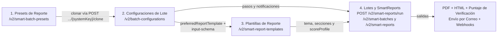

import Tabs from '@theme/Tabs';
import TabItem from '@theme/TabItem';

# SmartReports

**SmartReports** convierte verificaciones de catálogo de Verifik de varios pasos (`SmartCheck` + `SmartBatch`) en expedientes estructurados en HTML y PDF con **puntajes de verificación (Verification Scores)** automatizados, envío por correo electrónico y webhooks en tiempo real. Puedes diseñar e inspeccionar reportes en el portal **Smart-Agent**, disparar ejecuciones de extremo a extremo desde tu backend mediante la **API REST headless** o conectar asistentes autónomos mediante el **Model Context Protocol (MCP)**.

:::info Aislamiento por tenant y autenticación por cliente
Cada endpoint de SmartReports, Plantillas, Configuraciones, Presets y Lotes requiere tu propio **Bearer JWT de Verifik por cliente** (`Authorization: Bearer <VERIFIK_JWT>`). La ejecución mediante la cuenta compartida x402 está estrictamente bloqueada (`403 Forbidden`), y los créditos se descuentan directamente del saldo de tu cuenta Verifik por cada paso del catálogo ejecutado.
:::

---

## Arquitectura y bloques fundamentales

SmartReports separa **qué validaciones ejecutar**, **cómo se ven los resultados** y **cómo se entrega cada ejecución**:



| Bloque | Endpoints principales | Propósito |
| --- | --- | --- |
| **Presets de Reporte** | `GET /v2/smart-batch-presets`<br />`POST /v2/smart-batch-presets/{systemKey}/clone` | Paquetes integrados de Verifik por país y dominio (`citizen`, `company`, `vehicle`; nivel `essential` o `comprehensive`) con pasos de verificación preconfigurados, esquemas de entrada y plantillas con tema. |
| **Configuraciones de Lote** | `GET / POST / PUT / DELETE /v2/batch-configurations`<br />`GET /v2/batch-configurations/{id}/input-schema` | Receta reutilizable que almacena pasos ordenados del catálogo, encadenamiento de pasos (`{{results.N.*}}`), `mergeStrategy` (`sequential`, `parallel-independent`, `parallel-with-fallback`), `preferredReportTemplate` y ajustes de `notification` (`webhookUrl`, `emailOnCompletion`). |
| **Plantillas de Reporte** | `GET / POST / PUT / DELETE /v2/smart-report-templates`<br />`POST /v2/smart-report-templates/generate-layout`<br />`POST /v2/smart-report-templates/preview-html`<br />`POST /v2/smart-report-templates/introspect` | Definición visual de diseño (`sections[]`, `reportTheme`, fuentes personalizadas, marcas de agua, firma digital, protección de PDF con contraseña y configuración de puntaje). Las plantillas del sistema (`type: "System"`) son de solo lectura; las plantillas de cliente (`type: "client"`) son totalmente editables. |
| **Lotes y SmartReports** | `POST /v2/smart-reports/run`<br />`/v2/smart-batches`<br />`/v2/smart-reports` | Ejecuta pasos de verificación en el servidor mediante `FeatureRunner`, calcula el `verificationScore` de la fila, renderiza HTML y PDF, envía correos a destinatarios y despacha eventos webhook. |

### Cómo se conectan las piezas

1. **Descubre o clona un preset** con `GET /v2/smart-batch-presets` y `POST /v2/smart-batch-presets/{systemKey}/clone`, o crea una `BatchConfiguration` personalizada a partir de cualquier endpoint del catálogo habilitado en tu cuenta.
2. **Inspecciona las entradas requeridas** mediante `GET /v2/batch-configurations/{id}/input-schema` (o el objeto `inputSchema` del preset) para obtener `requiredFields`, `optionalFields`, `jsonSchema`, `exampleInput` y `estimatedCreditsPerRow`.
3. **Personaliza una plantilla** en `/v2/smart-report-templates` usando temas integrados, diseños generados por IA (`POST /v2/smart-report-templates/generate-layout`), inspección de paleta de datos (`POST /v2/smart-report-templates/introspect`) y vistas previas HTML en vivo sin costo de créditos (`POST /v2/smart-report-templates/preview-html`).
4. **Ejecuta y entrega** ya sea en una sola llamada headless vía `POST /v2/smart-reports/run` (con `systemKey` o `batchConfigurationId`), o a gran volumen mediante `/v2/smart-batches` y `/v2/smart-batches/from-file`, seguido de `/v2/smart-reports/{id}/generate`, `/download`, `/html` y `/send-email`.

---

## Tres superficies de integración

| Superficie | Punto de entrada | Ideal para |
| --- | --- | --- |
| **Portal Smart-Agent** | `https://ai.verifik.co` | Constructor interactivo de plantillas, galería de presets, monitoreo de lotes, visor de reportes y el **Developer & AI Agent Kit** integrado (`API & AI Agent` / `API / MCP`). |
| **API REST Headless** | `https://api.verifik.co/v2/...`<br />`https://ai.verifik.co/v2/...` | Servicios backend, pipelines automatizados de KYC/KYB/flotas, generación de PDF guiada por webhooks y lotes de archivos de alto volumen sin interfaz de navegador. |
| **Servidor MCP por HTTP Transmitible** | `https://ai.verifik.co/mcp`<br />`https://ai.verifik.co/api/mcp` | Agentes de IA autónomos (Claude Desktop, Cursor, Windsurf, ChatGPT Agents y clientes MCP JSON-RPC 2.0 personalizados) que invocan directamente las 10 herramientas `smart_report_*`. |

:::note Mismas rutas `/v2/...` en `api.verifik.co` y `ai.verifik.co`
Puedes llamar a `/v2/smart-reports/*`, `/v2/smart-report-templates/*`, `/v2/batch-configurations/*`, `/v2/smart-batches/*` y `/v2/smart-batch-presets/*` directamente contra `https://api.verifik.co` o a través del proxy de Smart-Agent en `https://ai.verifik.co`. Ambos aplican exactamente la misma autenticación JWT por cliente.
:::

---

## Modelo de autenticación y facturación

### Aplicación estricta de Bearer JWT por cliente

Cada endpoint de SmartReports, Plantillas, Configuraciones de Lote, Presets y SmartBatch está aislado por tenant y exige un **Bearer JWT de Verifik proporcionado por el llamador**:

```text
Authorization: Bearer <VERIFIK_JWT>
```

- **Guardia del proxy de Smart-Agent (`smartReportAuthGuard`)**: Cualquier solicitud dirigida a `/v2/smart-reports*`, `/v2/smart-report-templates*`, `/v2/batch-configurations*`, `/v2/smart-batches*` o `/v2/smart-batch-presets*` (o equivalentes `/api/...` / `/api/proxy`) sin un Bearer JWT válido por cliente es rechazada antes del manejo de pagos x402 con **HTTP `403 Forbidden`**:

```json
{
  "code": "Forbidden",
  "message": "SmartReports, SmartReportTemplates, BatchConfigurations, and SmartBatches require your own per-client Verifik Bearer JWT. They are not available through the shared x402 account."
}
```

- **Aislamiento por tenant en MCP**: Los métodos de descubrimiento (`initialize`, `ping`, `notifications/initialized`, `tools/list`) funcionan sin credenciales, mientras que `tools/call` exige estrictamente el encabezado por cliente `Authorization: Bearer <VERIFIK_JWT>` y devuelve **HTTP `401`** (JSON-RPC `-32001`) si falta o si se envía un token de servicio compartido.
- **Sin `x-payment-info` en rutas de SmartReports**: En `https://ai.verifik.co/openapi.json`, las rutas de SmartReports utilizan seguridad `bearerAuth` en lugar de encabezados x402 de pago por llamada.

### Facturación basada en créditos

- **Facturación por paso del catálogo**: Los créditos se descuentan del saldo de tu cuenta cliente de Verifik cuando los pasos de verificación realmente se ejecutan contra fuentes del catálogo (registrado en el lote mediante `creditsSpent`).
- **Estimaciones anticipadas**: `GET /v2/smart-batch-presets` y `GET /v2/batch-configurations/{id}/input-schema` devuelven `estimatedCreditsPerRow` antes de ejecutar cualquier consulta.
- **Acciones de diseño y consulta sin costo de créditos**: Listar presets o plantillas, inspeccionar esquemas, llamar a `/introspect`, `/preview-html`, `/theme-starters`, `/score-profiles`, `/simulated-responses`, recuperar `/v2/smart-reports/{id}/html`, descargar PDFs y enviar correos de reporte **no** consumen créditos de verificación.
- **Verificación de permisos de cuenta**: Antes de ejecutar un lote o `POST /v2/smart-reports/run`, Verifik verifica que cada endpoint de paso habilitado esté activo en tu cuenta cliente (devolviendo `409 Conflict` con `endpoints_not_in_account` si algún paso no está disponible).

---

## Puntaje de verificación, temas y motores PDF

### Temas de reporte integrados (`reportTheme.id`)

SmartReports incluye **4 sistemas de diseño HTML/PDF con tema** configurados mediante `reportTheme.id` (con sobrescrituras opcionales en `reportTheme.tokens` para colores de marca, tipografía, espaciado, `logoText` y `logoUrl`):

| ID de tema | Alias | Estilo visual | Paleta predeterminada |
| --- | --- | --- | --- |
| `premium_dark` | — *(predeterminado)* | Portada azul marino oscuro (`#0b1730`), páginas de cuerpo piedra cálido (`#f7f5f2`), tarjetas blancas nítidas | Tinta `#122033`, Acento `#c4b5fd`, Marca `#1e3a5f` |
| `light_cards` | `smart_enroll_v2` | Páginas blancas de alto contraste (`#ffffff`) con tarjetas claras suaves (`#f3f5f1`) y chips tipo píldora | Tinta `#0e0f0c`, Acento `#7145d6`, Marca `#163300` |
| `editorial` | — | Superficie tipo papel cálido (`#fffdf8`), títulos serif (`Noto Serif`), etiquetas en mayúsculas con espaciado | Tinta `#1b1a17`, Acento `#7145d6`, Bordes finos |
| `dashboard` | — | Lienzo blanco limpio con tarjetas de métricas estructuradas (`#f6f7fb`) y radio compacto (`12px`) | Tinta `#111827`, Acento `#7145d6`, Resaltados violeta suave |

:::tip Alias de tema heredado
Las plantillas guardadas con `reportTheme: "smart_enroll_v2"` o `reportTheme.id: "smart_enroll_v2"` se resuelven automáticamente a `light_cards` al renderizar.
:::

### Perfiles de puntaje de verificación (`scoreProfile`)

Cuando la puntuación está habilitada (`score: true` o habilitada automáticamente por una plantilla con tema), SmartReports normaliza cada paso de verificación ejecutado en un puntaje de `0` a `1` (`score` con 4 decimales y `score100` de `0` a `100`), evalúa **reglas knockout** y **cobertura** (mínimo `90%` para `approve`), y produce un veredicto:

- `approve` — puntaje ponderado `0.90–1.00`, cobertura `>= 90%`, todas las validaciones críticas respondidas
- `review` — puntaje ponderado `0.70–0.89` (o hallazgos de revisión no knockout)
- `reject` — puntaje ponderado `< 0.70` o se activó una regla knockout armada
- `pending` — una validación crítica no respondió (por ejemplo timeout/`5xx` del proveedor) o cobertura `< 90%`

Se admiten diez perfiles de puntaje integrados (consulta `GET /v2/smart-report-templates/score-profiles` para ver IDs y etiquetas en vivo):

| ID de perfil | Etiqueta | Alias | Pesos por categoría (`100%` en total) |
| --- | --- | --- | --- |
| `cabify_driver` *(predeterminado)* | Onboarding de conductores | `driver`, `cabify` | `records` (25), `driving` (25), `identity` (15), `biometrics` (15), `watchlists` (10), `vehicle` (10) |
| `kyc` | KYC genérico | `generic_kyc` | `identity` (25), `biometrics` (25), `watchlists` (25), `records` (20), `contact` (5) |
| `kyb` | KYB | — | `company` (45), `watchlists` (25), `identity` (15), `records` (15) |
| `fleet` | Vehículo / flota | `vehicle` | `vehicle` (60), `driving` (15), `identity` (15), `watchlists` (10) |
| `vehicle_purchase` | Compra de vehículo / concesionario | `dealer` | `vehicle` (70), `identity` (15), `watchlists` (10), `driving` (5) |
| `identity_lookup` | Solo identidad | `identity_only` | `identity` (100) |
| `background_check` | Estudio de antecedentes | `screening` | `records` (45), `watchlists` (25), `identity` (20), `company` (10) |
| `lending` | Crédito / préstamos | `credit` | `identity` (40), `records` (25), `supporting` (25), `driving` (10) |
| `healthcare_professional` | Profesional de la salud | `health_professional` | `supporting` (55), `identity` (25), `watchlists` (20) |
| `biometrics` | Biometría | `face` | `biometrics` (70), `identity` (30) |

### Motores de renderizado PDF: `puppeteer` vs `pdfkit`

| Motor | Comportamiento | Funcionalidades soportadas |
| --- | --- | --- |
| `puppeteer` *(predeterminado)* | Renderiza HTML/CSS completo mediante un grupo de instancias headless Chromium. | Los 4 temas de reporte, medidores y gráficos SVG de puntaje (`pie`/`bar`), diseños dinámicos `dataTable` y `keyValueGrid`, fuentes personalizadas, marcas de agua de imagen/texto, superposiciones de firma y cifrado de PDF con contraseña. |
| `pdfkit` | Aceptado en plantillas y solicitudes API por compatibilidad retroactiva, y enrutado a través de la capa de compatibilidad HTML/Puppeteer (`pdf-pdfkit.service.js`). | Las plantillas existentes configuradas con `pdfEngine: "pdfkit"` aprovechan automáticamente el renderizado completo de tablas, marcas de agua y firmas sin marcadores de posición degradados. |

---

## Secciones de la documentación

Explora las guías de SmartReports y las secciones de referencia de la API:

- **Guías e integración**
  - [Guía de API Headless](/verifik-es/smart-reports/headless-api-guide) — Ejecución sync/async en una sola llamada, webhooks, sondeo (polling), recetas personalizadas y manejo de errores sin UI.
  - [MCP y Agentes de IA](/verifik-es/smart-reports/mcp-and-ai-agents) — Servidor MCP por HTTP transmitible (`https://ai.verifik.co/mcp`), las 10 herramientas `smart_report_*`, descubrimiento OpenAPI y el **Developer & AI Agent Kit** integrado.
  - [Webhooks de SmartReports](/verifik-es/resources/smart-reports-webhooks) — Los 6 eventos webhook `smart_batch_*`, esquemas de payload, orden de resolución de URL y calendario de reintentos.
- **API de Reportes**
  - [Ejecutar un Smart Report](/verifik-es/smart-reports/run-a-smart-report) (`POST /v2/smart-reports/run`) — Ejecución headless de extremo a extremo.
  - [Listar Smart Reports](/verifik-es/smart-reports/list-smart-reports) (`GET /v2/smart-reports`)
  - [Crear un Smart Report](/verifik-es/smart-reports/create-a-smart-report) (`POST /v2/smart-reports`)
  - [Recuperar un Smart Report](/verifik-es/smart-reports/retrieve-a-smart-report) (`GET /v2/smart-reports/{id}`)
  - [Actualizar un Smart Report](/verifik-es/smart-reports/update-a-smart-report) (`PUT /v2/smart-reports/{id}`)
  - [Eliminar un Smart Report](/verifik-es/smart-reports/delete-a-smart-report) (`DELETE /v2/smart-reports/{id}`)
  - [Generar PDF de Smart Report](/verifik-es/smart-reports/generate-smart-report-pdf) (`POST /v2/smart-reports/{id}/generate`)
  - [Descargar PDF de Smart Report](/verifik-es/smart-reports/download-smart-report-pdf) (`GET /v2/smart-reports/{id}/download`)
  - [Recuperar HTML de Smart Report](/verifik-es/smart-reports/retrieve-smart-report-html) (`GET /v2/smart-reports/{id}/html`)
  - [Enviar Smart Report por correo electrónico](/verifik-es/smart-reports/send-smart-report-email) (`POST /v2/smart-reports/{id}/send-email`)
- **API de Plantillas**
  - [Listar plantillas de reporte](/verifik-es/smart-reports/list-report-templates) (`GET /v2/smart-report-templates`)
  - [Crear una plantilla de reporte](/verifik-es/smart-reports/create-a-report-template) (`POST /v2/smart-report-templates`)
  - [Recuperar una plantilla de reporte](/verifik-es/smart-reports/retrieve-a-report-template) (`GET /v2/smart-report-templates/{id}`)
  - [Actualizar una plantilla de reporte](/verifik-es/smart-reports/update-a-report-template) (`PUT /v2/smart-report-templates/{id}`)
  - [Eliminar una plantilla de reporte](/verifik-es/smart-reports/delete-a-report-template) (`DELETE /v2/smart-report-templates/{id}`)
  - [Generar diseño de plantilla](/verifik-es/smart-reports/generate-template-layout) (`POST /v2/smart-report-templates/generate-layout`)
  - [Previsualizar HTML de plantilla](/verifik-es/smart-reports/preview-template-html) (`POST /v2/smart-report-templates/preview-html`)
  - [Introspeccionar datos de muestra](/verifik-es/smart-reports/introspect-sample-data) (`POST /v2/smart-report-templates/introspect`)
  - [Listar temas iniciales](/verifik-es/smart-reports/list-theme-starters) (`GET /v2/smart-report-templates/theme-starters`)
  - [Listar perfiles de puntaje](/verifik-es/smart-reports/list-score-profiles) (`GET /v2/smart-report-templates/score-profiles`)
  - [Listar respuestas simuladas](/verifik-es/smart-reports/list-simulated-responses) (`GET /v2/smart-report-templates/simulated-responses`)
  - [Recuperar una respuesta simulada](/verifik-es/smart-reports/retrieve-simulated-response) (`GET /v2/smart-report-templates/simulated-responses/{code}`)
  - [Enviar muestra de plantilla](/verifik-es/smart-reports/send-template-sample) (`POST /v2/smart-report-templates/{id}/send-sample`)
  - [Descargar muestra de plantilla](/verifik-es/smart-reports/download-template-sample) (`POST /v2/smart-report-templates/{id}/download-sample`)
- **API de Presets y Configuraciones**
  - [Listar presets de reporte](/verifik-es/smart-reports/list-report-presets) (`GET /v2/smart-batch-presets`)
  - [Clonar un preset de reporte](/verifik-es/smart-reports/clone-a-report-preset) (`POST /v2/smart-batch-presets/{systemKey}/clone`)
  - [Listar configuraciones de lote](/verifik-es/smart-reports/list-batch-configurations) (`GET /v2/batch-configurations`)
  - [Crear una configuración de lote](/verifik-es/smart-reports/create-a-batch-configuration) (`POST /v2/batch-configurations`)
  - [Recuperar una configuración de lote](/verifik-es/smart-reports/retrieve-a-batch-configuration) (`GET /v2/batch-configurations/{id}`)
  - [Recuperar esquema de entrada de configuración](/verifik-es/smart-reports/retrieve-configuration-input-schema) (`GET /v2/batch-configurations/{id}/input-schema`)
  - [Actualizar una configuración de lote](/verifik-es/smart-reports/update-a-batch-configuration) (`PUT /v2/batch-configurations/{id}`)
  - [Eliminar una configuración de lote](/verifik-es/smart-reports/delete-a-batch-configuration) (`DELETE /v2/batch-configurations/{id}`)
- **API de Ejecución de Lotes**
  - [Listar Smart Batches](/verifik-es/smart-reports/list-smart-batches) (`GET /v2/smart-batches`)
  - [Crear un Smart Batch](/verifik-es/smart-reports/create-a-smart-batch) (`POST /v2/smart-batches`)
  - [Crear un Smart Batch desde un archivo](/verifik-es/smart-reports/create-smart-batch-from-file) (`POST /v2/smart-batches/from-file`)
  - [Recuperar un Smart Batch](/verifik-es/smart-reports/retrieve-a-smart-batch) (`GET /v2/smart-batches/{id}`)
  - [Actualizar un Smart Batch](/verifik-es/smart-reports/update-a-smart-batch) (`PUT /v2/smart-batches/{id}`)
  - [Eliminar un Smart Batch](/verifik-es/smart-reports/delete-a-smart-batch) (`DELETE /v2/smart-batches/{id}`)
  - [SmartBatch](/verifik-es/smart-batch) — Asistente visual, modos Async vs Sync y seguimiento en el dashboard.
  - [Llamar endpoints como cola (async)](/verifik-es/smart-batch/async-queue) — Integración API de una fila con `type=queue` en `https://async.verifik.co`.
