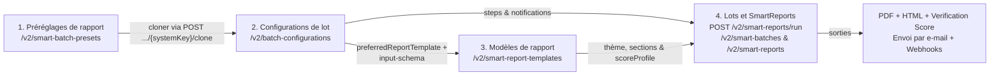

import Tabs from '@theme/Tabs';
import TabItem from '@theme/TabItem';

# SmartReports

**SmartReports** transforme les vérifications multi-étapes du catalogue Verifik (`SmartCheck` + `SmartBatch`) en dossiers HTML et PDF structurés avec des **scores de vérification (`Verification Scores`)** automatisés, l'envoi par e-mail et des webhooks en temps réel. Vous pouvez concevoir et inspecter des rapports dans le portail **Smart-Agent**, déclencher des exécutions de bout en bout depuis votre backend via l'**API REST Headless** ou connecter des assistants autonomes via le **Model Context Protocol (MCP)**.

:::info Isolation des locataires et authentification par client
Chaque point de terminaison SmartReports, Template, Configuration, Preset et Batch exige votre propre **JWT Bearer Verifik par client** (`Authorization: Bearer <VERIFIK_JWT>`). L'exécution via le compte de service partagé x402 est strictement bloquée (`403 Forbidden`), et les crédits sont facturés directement sur le solde de votre compte Verifik à chaque étape du catalogue exécutée.
:::

---

## Architecture et composants

SmartReports sépare **les vérifications à exécuter**, **l'apparence des résultats** et **le mode de livraison de chaque exécution** :



| Composant | Points de terminaison principaux | Rôle |
| --- | --- | --- |
| **Préréglages de rapport** | `GET /v2/smart-batch-presets`<br />`POST /v2/smart-batch-presets/{systemKey}/clone` | Ensembles intégrés Verifik par pays et domaine (`citizen`, `company`, `vehicle` ; niveau `essential` ou `comprehensive`) avec étapes de vérification préconfigurées, schémas d'entrée et modèles thématiques. |
| **Configurations de lot** | `GET / POST / PUT / DELETE /v2/batch-configurations`<br />`GET /v2/batch-configurations/{id}/input-schema` | Recette réutilisable stockant les étapes ordonnées du catalogue, le chaînage d'étapes (`{{results.N.*}}`), `mergeStrategy` (`sequential`, `parallel-independent`, `parallel-with-fallback`), `preferredReportTemplate` et les paramètres `notification` (`webhookUrl`, `emailOnCompletion`). |
| **Modèles de rapport** | `GET / POST / PUT / DELETE /v2/smart-report-templates`<br />`POST /v2/smart-report-templates/generate-layout`<br />`POST /v2/smart-report-templates/preview-html`<br />`POST /v2/smart-report-templates/introspect` | Définition de la mise en page visuelle (`sections[]`, `reportTheme`, polices personnalisées, filigranes, signature numérique, protection PDF par mot de passe et configuration du score). Les modèles système (`type: "System"`) sont en lecture seule ; les modèles client (`type: "client"`) sont entièrement modifiables. |
| **Lots et SmartReports** | `POST /v2/smart-reports/run`<br />`/v2/smart-batches`<br />`/v2/smart-reports` | Exécute les étapes de vérification côté serveur via `FeatureRunner`, calcule le `verificationScore` de la ligne, génère le HTML et le PDF, envoie les e-mails aux destinataires et déclenche les événements webhook. |

### Comment les pièces s'articulent

1. **Découvrez ou clonez un préréglage** avec `GET /v2/smart-batch-presets` et `POST /v2/smart-batch-presets/{systemKey}/clone`, ou créez une `BatchConfiguration` personnalisée à partir de n'importe quel point de terminaison du catalogue activé sur votre compte.
2. **Inspectez les entrées requises** via `GET /v2/batch-configurations/{id}/input-schema` (ou l'objet `inputSchema` du préréglage) afin d'obtenir `requiredFields`, `optionalFields`, `jsonSchema`, `exampleInput` et `estimatedCreditsPerRow`.
3. **Personnalisez un modèle** dans `/v2/smart-report-templates` à l'aide des thèmes intégrés, de la génération de mise en page par IA (`POST /v2/smart-report-templates/generate-layout`), de l'inspection de la palette de données (`POST /v2/smart-report-templates/introspect`) et des aperçus HTML en direct sans consommation de crédits (`POST /v2/smart-report-templates/preview-html`).
4. **Exécutez et livrez** soit en un seul appel headless via `POST /v2/smart-reports/run` (avec `systemKey` ou `batchConfigurationId`), soit à grand volume via `/v2/smart-batches` et `/v2/smart-batches/from-file`, suivis de `/v2/smart-reports/{id}/generate`, `/download`, `/html` et `/send-email`.

---

## Trois surfaces d'intégration

| Surface | Point d'entrée | Idéal pour |
| --- | --- | --- |
| **Portail Smart-Agent** | `https://ai.verifik.co` | Éditeur interactif de modèles, galerie de préréglages, suivi des lots, visionneuse de rapports et le **Developer & AI Agent Kit** intégré (`API & AI Agent` / `API / MCP`). |
| **API REST Headless** | `https://api.verifik.co/v2/...`<br />`https://ai.verifik.co/v2/...` | Services backend, pipelines automatisés KYC/KYB/flotte, génération PDF pilotée par webhooks et lots de fichiers à grand volume sans aucune interface navigateur. |
| **Serveur MCP Streamable HTTP** | `https://ai.verifik.co/mcp`<br />`https://ai.verifik.co/api/mcp` | Agents IA autonomes (Claude Desktop, Cursor, Windsurf, ChatGPT Agents et clients MCP JSON-RPC 2.0 personnalisés) appelant directement les 10 outils `smart_report_*`. |

:::note Mêmes chemins `/v2/...` sur `api.verifik.co` et `ai.verifik.co`
Vous pouvez appeler `/v2/smart-reports/*`, `/v2/smart-report-templates/*`, `/v2/batch-configurations/*`, `/v2/smart-batches/*` et `/v2/smart-batch-presets/*` directement sur `https://api.verifik.co` ou via le proxy Smart-Agent sur `https://ai.verifik.co`. Les deux appliquent une authentification JWT par client identique.
:::

---

## Authentification et modèle de facturation

### Application stricte du JWT Bearer par client

Chaque point de terminaison SmartReports, Template, Batch Configuration, Preset et SmartBatch est cloisonné par locataire et exige un **JWT Bearer Verifik fourni par l'appelant** :

```text
Authorization: Bearer <VERIFIK_JWT>
```

- **Garde du proxy Smart-Agent (`smartReportAuthGuard`)** : Toute requête ciblant `/v2/smart-reports*`, `/v2/smart-report-templates*`, `/v2/batch-configurations*`, `/v2/smart-batches*` ou `/v2/smart-batch-presets*` (ou leurs équivalents `/api/...` / `/api/proxy`) sans JWT Bearer par client valide est rejetée avant le traitement de paiement x402 avec **HTTP `403 Forbidden`** :

```json
{
  "code": "Forbidden",
  "message": "SmartReports, SmartReportTemplates, BatchConfigurations, and SmartBatches require your own per-client Verifik Bearer JWT. They are not available through the shared x402 account."
}
```

- **Isolation des locataires MCP** : Les méthodes de découverte (`initialize`, `ping`, `notifications/initialized`, `tools/list`) fonctionnent sans identifiants, tandis que `tools/call` exige strictement un en-tête par client `Authorization: Bearer <VERIFIK_JWT>` et renvoie **HTTP `401`** (JSON-RPC `-32001`) s'il est absent ou si un jeton de service partagé est fourni.
- **Absence de `x-payment-info` sur les routes SmartReports** : Dans `https://ai.verifik.co/openapi.json`, les routes SmartReports utilisent la sécurité `bearerAuth` plutôt que les en-têtes de paiement à l'appel x402.

### Facturation à l'usage par crédits

- **Facturation par étape du catalogue** : Les crédits sont déduits du solde de votre compte client Verifik lorsque les étapes de vérification s'exécutent réellement auprès des sources du catalogue (suivi sur le lot via `creditsSpent`).
- **Estimations préalables** : `GET /v2/smart-batch-presets` et `GET /v2/batch-configurations/{id}/input-schema` renvoient `estimatedCreditsPerRow` avant toute exécution de requête.
- **Actions de conception et de récupération sans coût en crédits** : Lister les préréglages ou les modèles, inspecter les schémas, appeler `/introspect`, `/preview-html`, `/theme-starters`, `/score-profiles`, `/simulated-responses`, récupérer `/v2/smart-reports/{id}/html`, télécharger des PDF et envoyer des rapports par e-mail ne consomment **aucun** crédit de vérification.
- **Vérification des droits du compte** : Avant d'exécuter un lot ou `POST /v2/smart-reports/run`, Verifik vérifie que chaque point de terminaison activé est autorisé sur votre compte client (renvoyant `409 Conflict` avec `endpoints_not_in_account` si une étape n'est pas disponible).

---

## Score de vérification, thèmes et moteurs PDF

### Thèmes de rapport intégrés (`reportTheme.id`)

SmartReports inclut **4 systèmes de design HTML/PDF thématiques** configurés via `reportTheme.id` (avec des surcharges facultatives dans `reportTheme.tokens` pour les couleurs de marque, la typographie, l'espacement, `logoText` et `logoUrl`) :

| ID du thème | Alias | Style visuel | Palette par défaut |
| --- | --- | --- | --- |
| `premium_dark` | — *(par défaut)* | Couverture bleu nuit foncé (`#0b1730`), pages intérieures pierre chaude (`#f7f5f2`), cartes blanches nettes | Encre `#122033`, Accent `#c4b5fd`, Marque `#1e3a5f` |
| `light_cards` | `smart_enroll_v2` | Pages blanches à fort contraste (`#ffffff`) avec cartes claires douces (`#f3f5f1`) et puces en pilule | Encre `#0e0f0c`, Accent `#7145d6`, Marque `#163300` |
| `editorial` | — | Surface papier chaud (`#fffdf8`), titres serif (`Noto Serif`), étiquettes en majuscules espacées | Encre `#1b1a17`, Accent `#7145d6`, Bordures fines |
| `dashboard` | — | Toile blanche épurée avec cartes métriques structurées (`#f6f7fb`) et rayon compact (`12px`) | Encre `#111827`, Accent `#7145d6`, Surbrillances violet doux |

:::tip Alias de thème hérité
Les modèles enregistrés avec `reportTheme: "smart_enroll_v2"` ou `reportTheme.id: "smart_enroll_v2"` sont automatiquement résolus vers `light_cards` lors du rendu.
:::

### Profils de score de vérification (`scoreProfile`)

Lorsque le calcul du score est activé (`score: true` ou activé automatiquement par un modèle thématique), SmartReports normalise chaque étape de vérification exécutée en un score de `0` à `1` (`score` à 4 décimales et `score100` de `0` à `100`), évalue les **règles éliminatoires (`knockout`)** et la **couverture** (minimum `90%` pour `approve`), puis produit un verdict :

- `approve` — score pondéré `0.90–1.00`, couverture `>= 90%`, toutes les vérifications critiques ont répondu
- `review` — score pondéré `0.70–0.89` (ou anomalies nécessitant une revue sans règle éliminatoire)
- `reject` — score pondéré `< 0.70` ou déclenchement d'une règle éliminatoire armée
- `pending` — une vérification critique n'a pas répondu (par exemple expiration amont/`5xx`) ou couverture `< 90%`

Dix profils de score intégrés sont pris en charge (interrogez `GET /v2/smart-report-templates/score-profiles` pour obtenir les identifiants et libellés à jour) :

| ID du profil | Libellé | Alias | Pondérations par catégorie (total `100%`) |
| --- | --- | --- | --- |
| `cabify_driver` *(par défaut)* | Intégration conducteur | `driver`, `cabify` | `records` (25), `driving` (25), `identity` (15), `biometrics` (15), `watchlists` (10), `vehicle` (10) |
| `kyc` | KYC générique | `generic_kyc` | `identity` (25), `biometrics` (25), `watchlists` (25), `records` (20), `contact` (5) |
| `kyb` | KYB | — | `company` (45), `watchlists` (25), `identity` (15), `records` (15) |
| `fleet` | Véhicule / flotte | `vehicle` | `vehicle` (60), `driving` (15), `identity` (15), `watchlists` (10) |
| `vehicle_purchase` | Achat véhicule / concessionnaire | `dealer` | `vehicle` (70), `identity` (15), `watchlists` (10), `driving` (5) |
| `identity_lookup` | Identité uniquement | `identity_only` | `identity` (100) |
| `background_check` | Vérification d'antécédents | `screening` | `records` (45), `watchlists` (25), `identity` (20), `company` (10) |
| `lending` | Crédit / prêt | `credit` | `identity` (40), `records` (25), `supporting` (25), `driving` (10) |
| `healthcare_professional` | Professionnel de santé | `health_professional` | `supporting` (55), `identity` (25), `watchlists` (20) |
| `biometrics` | Biométrie | `face` | `biometrics` (70), `identity` (30) |

### Moteurs de rendu PDF : `puppeteer` vs `pdfkit`

| Moteur | Comportement | Fonctionnalités prises en charge |
| --- | --- | --- |
| `puppeteer` *(par défaut)* | Effectue le rendu HTML/CSS complet via un pool d'instances Chromium headless. | Les 4 thèmes de rapport, jauges de score et graphiques SVG (`pie`/`bar`), mises en page dynamiques `dataTable` et `keyValueGrid`, polices personnalisées, filigranes texte/image, calques de signature et chiffrement PDF par mot de passe. |
| `pdfkit` | Accepté dans les modèles et requêtes API pour la rétrocompatibilité, et redirigé via la couche de compatibilité HTML/Puppeteer (`pdf-pdfkit.service.js`). | Les modèles existants configurés avec `pdfEngine: "pdfkit"` bénéficient automatiquement du rendu complet des tableaux, filigranes et signatures sans substitution dégradée. |

---

## Sections de la documentation

Parcourez les guides SmartReports et les sections de référence API :

- **Guides et intégration**
  - [Guide de l'API Headless](/verifik-fr/smart-reports/headless-api-guide) — Exécution directe synchrone/asynchrone, webhooks, polling, recettes personnalisées et gestion des erreurs sans interface utilisateur.
  - [MCP et Agents IA](/verifik-fr/smart-reports/mcp-and-ai-agents) — Serveur MCP Streamable HTTP (`https://ai.verifik.co/mcp`), les 10 outils `smart_report_*`, découverte OpenAPI et le **Developer & AI Agent Kit** intégré.
  - [Webhooks SmartReports](/verifik-fr/resources/smart-reports-webhooks) — Les 6 événements webhook `smart_batch_*`, schémas de payload, ordre de résolution des URL et calendrier de tentatives.
- **API Rapports**
  - [Exécuter un Smart Report](/verifik-fr/smart-reports/run-a-smart-report) (`POST /v2/smart-reports/run`) — Exécution headless de bout en bout.
  - [Lister les Smart Reports](/verifik-fr/smart-reports/list-smart-reports) (`GET /v2/smart-reports`)
  - [Créer un Smart Report](/verifik-fr/smart-reports/create-a-smart-report) (`POST /v2/smart-reports`)
  - [Récupérer un Smart Report](/verifik-fr/smart-reports/retrieve-a-smart-report) (`GET /v2/smart-reports/{id}`)
  - [Mettre à jour un Smart Report](/verifik-fr/smart-reports/update-a-smart-report) (`PUT /v2/smart-reports/{id}`)
  - [Supprimer un Smart Report](/verifik-fr/smart-reports/delete-a-smart-report) (`DELETE /v2/smart-reports/{id}`)
  - [Générer le PDF d'un Smart Report](/verifik-fr/smart-reports/generate-smart-report-pdf) (`POST /v2/smart-reports/{id}/generate`)
  - [Télécharger le PDF d'un Smart Report](/verifik-fr/smart-reports/download-smart-report-pdf) (`GET /v2/smart-reports/{id}/download`)
  - [Récupérer le HTML d'un Smart Report](/verifik-fr/smart-reports/retrieve-smart-report-html) (`GET /v2/smart-reports/{id}/html`)
  - [Envoyer un Smart Report par e-mail](/verifik-fr/smart-reports/send-smart-report-email) (`POST /v2/smart-reports/{id}/send-email`)
- **API Modèles**
  - [Lister les modèles de rapport](/verifik-fr/smart-reports/list-report-templates) (`GET /v2/smart-report-templates`)
  - [Créer un modèle de rapport](/verifik-fr/smart-reports/create-a-report-template) (`POST /v2/smart-report-templates`)
  - [Récupérer un modèle de rapport](/verifik-fr/smart-reports/retrieve-a-report-template) (`GET /v2/smart-report-templates/{id}`)
  - [Mettre à jour un modèle de rapport](/verifik-fr/smart-reports/update-a-report-template) (`PUT /v2/smart-report-templates/{id}`)
  - [Supprimer un modèle de rapport](/verifik-fr/smart-reports/delete-a-report-template) (`DELETE /v2/smart-report-templates/{id}`)
  - [Générer la mise en page d'un modèle](/verifik-fr/smart-reports/generate-template-layout) (`POST /v2/smart-report-templates/generate-layout`)
  - [Prévisualiser le HTML d'un modèle](/verifik-fr/smart-reports/preview-template-html) (`POST /v2/smart-report-templates/preview-html`)
  - [Introspecter des données d'exemple](/verifik-fr/smart-reports/introspect-sample-data) (`POST /v2/smart-report-templates/introspect`)
  - [Lister les thèmes de démarrage](/verifik-fr/smart-reports/list-theme-starters) (`GET /v2/smart-report-templates/theme-starters`)
  - [Lister les profils de score](/verifik-fr/smart-reports/list-score-profiles) (`GET /v2/smart-report-templates/score-profiles`)
  - [Lister les réponses simulées](/verifik-fr/smart-reports/list-simulated-responses) (`GET /v2/smart-report-templates/simulated-responses`)
  - [Récupérer une réponse simulée](/verifik-fr/smart-reports/retrieve-simulated-response) (`GET /v2/smart-report-templates/simulated-responses/{code}`)
  - [Envoyer un exemple de modèle](/verifik-fr/smart-reports/send-template-sample) (`POST /v2/smart-report-templates/{id}/send-sample`)
  - [Télécharger un exemple de modèle](/verifik-fr/smart-reports/download-template-sample) (`POST /v2/smart-report-templates/{id}/download-sample`)
- **API Préréglages et configurations**
  - [Lister les préréglages de rapport](/verifik-fr/smart-reports/list-report-presets) (`GET /v2/smart-batch-presets`)
  - [Cloner un préréglage de rapport](/verifik-fr/smart-reports/clone-a-report-preset) (`POST /v2/smart-batch-presets/{systemKey}/clone`)
  - [Lister les configurations de lot](/verifik-fr/smart-reports/list-batch-configurations) (`GET /v2/batch-configurations`)
  - [Créer une configuration de lot](/verifik-fr/smart-reports/create-a-batch-configuration) (`POST /v2/batch-configurations`)
  - [Récupérer une configuration de lot](/verifik-fr/smart-reports/retrieve-a-batch-configuration) (`GET /v2/batch-configurations/{id}`)
  - [Récupérer le schéma d'entrée d'une configuration](/verifik-fr/smart-reports/retrieve-configuration-input-schema) (`GET /v2/batch-configurations/{id}/input-schema`)
  - [Mettre à jour une configuration de lot](/verifik-fr/smart-reports/update-a-batch-configuration) (`PUT /v2/batch-configurations/{id}`)
  - [Supprimer une configuration de lot](/verifik-fr/smart-reports/delete-a-batch-configuration) (`DELETE /v2/batch-configurations/{id}`)
- **API Exécution de lots**
  - [Lister les Smart Batches](/verifik-fr/smart-reports/list-smart-batches) (`GET /v2/smart-batches`)
  - [Créer un Smart Batch](/verifik-fr/smart-reports/create-a-smart-batch) (`POST /v2/smart-batches`)
  - [Créer un Smart Batch à partir d'un fichier](/verifik-fr/smart-reports/create-smart-batch-from-file) (`POST /v2/smart-batches/from-file`)
  - [Récupérer un Smart Batch](/verifik-fr/smart-reports/retrieve-a-smart-batch) (`GET /v2/smart-batches/{id}`)
  - [Mettre à jour un Smart Batch](/verifik-fr/smart-reports/update-a-smart-batch) (`PUT /v2/smart-batches/{id}`)
  - [Supprimer un Smart Batch](/verifik-fr/smart-reports/delete-a-smart-batch) (`DELETE /v2/smart-batches/{id}`)
  - [SmartBatch](/verifik-fr/smart-batch) — Assistant UI, modes Async vs Sync et suivi sur le tableau de bord.
  - [Appeler les endpoints en file (async)](/verifik-fr/smart-batch/async-queue) — Intégration API d'une ligne avec `type=queue` sur `https://async.verifik.co`.
