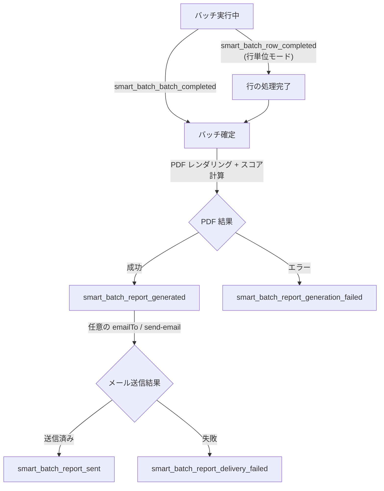

import Tabs from '@theme/Tabs';
import TabItem from '@theme/TabItem';

### 概要

SmartReports と SmartBatch は、Verifik 共通の **Webhook** および **Smart Monitor** 配信パイプライン（`WebhookEvents`）を通じてライフサイクル通知を配信します。バッチ行が完了したとき、バッチ全体が終了したとき、レポート PDF のレンダリングが成功（または失敗）したとき、あるいはメール配信が成功（またはバウンス）したときに、Verifik は型付きの `smart_batch_*` イベントを HTTP `POST` で送信します。

:::info HTTP 配信形式とセキュリティ

各配信は、ターゲット URL への **`5000 ms`（`5` 秒）** タイムアウトの HTTP **`POST`** リクエストであり、次の JSON エンベロープを使用します。

```json
{
  "type": "smart_batch_report_generated",
  "object": { }
}
```

- **`type`** — 正確な `smart_batch_*` イベント識別子（`smart_batch_report_generated`、`smart_batch_report_sent` など）。
- **`object`** — イベント固有のペイロード。機密性の高い内部フィールド（`encryptedOcr` や `prompt`）が存在する場合は削除されます。
- **HMAC 署名ヘッダーなし**: `smart_batch_*` プロダクトの配信では、現在 `x-verifik-signature` ヘッダーは送信**されません**。必ず **HTTPS** を使用し、設定する URL のパス内シークレットトークンやクエリ/ヘッダーシークレットでリスナー URL を保護し、取り消せない後続アクションを実行する前に `GET https://api.verifik.co/v2/smart-reports/{id}`（`Authorization: Bearer <VERIFIK_JWT>` を使用）に対して `object.reportId` / `object.batchId` および `object.externalRefId` を検証してください。

`object` に追加される新しい任意フィールドは追加的（additive）なものとして扱ってください。

:::

---

### ターゲット URL の決定方法

ターゲット URL の解決方法は、イベントが **SmartReport** 操作と **SmartBatch** 実行のどちらから発生したかによって異なります。

:::tip ターゲット URL の解決順序

1. **レポートイベント**（`smart_batch_report_generated`、`smart_batch_report_generation_failed`、`smart_batch_report_sent`、`smart_batch_report_delivery_failed`）:
   1. レポート単位 / 実行単位の **`report.webhookUrl`** 上書き指定（`POST /v2/smart-reports/run` または `POST /v2/smart-reports` で指定）。
   2. バッチの `BatchConfiguration` 上の **`batchConfiguration.notification.webhookUrl`**。
   3. どちらも存在しない場合、**Webhook は送信されません**。
2. **バッチおよび行の実行イベント**（`smart_batch_row_completed`、`smart_batch_batch_completed`）:
   - 明示的に渡された場合は `options.webhookUrl` を使用し、それ以外は **`batchConfiguration.notification.webhook`** / **`batchConfiguration.notification.webhookUrl`** を使用します。
   - *注記*: 非同期の `FeatureRunner` 実行（`smart-batch-run-sync`）では、**`batchConfiguration.notification.webhookUrl`** を使用して `smart_batch_batch_completed` を発行し、`object` に `runId` と `creditsSpent` を含めます。

`webhookUrl` が解決されると、Verifik は有効なクライアント `Webhook` レコード（`Smart Batch — <name>`）を自動的に検索または作成し、`BatchConfiguration` にリンクすることで、配信履歴が **Smart Monitor** に表示されるようにします。

:::

---

### 配信保証とリトライスケジュール

- **成功基準**: エンドポイントは **`5000 ms`** 以内に HTTP **`2xx`** レスポンスを返す必要があります。即座に `200 OK` を返し、PDF のダウンロードやデータベースへの書き込みはバックグラウンドワーカーへオフロードしてください。
- **リトライスケジュール**: 非 2xx レスポンス、タイムアウト、または接続エラーが発生した場合、Verifik はバックオフ間隔 **`[60, 60, 120, 120, 360, 720]` 分**（1時間、1時間、2時間、2時間、6時間、12時間、最も近い 10 分単位に丸められます）で最大 **`6` 回の再試行** をスケジュールします。
- **失敗/成功時の任意通知メール**: リンクされた `Webhook` レコードに `notification.email` が設定されており、`notification.success` または `notification.fail` が有効になっている場合、Verifik は **1 回目の試行** 時に Mailgun アラートを送信します。

---

### イベントライフサイクル



---

### イベントカタログ

| イベント `type` | `object.event` | 発火タイミング | `object` の主要フィールド |
| --- | --- | --- | --- |
| `smart_batch_report_generated` | `"report.generated"` | レポート PDF のレンダリングが成功したとき（`POST /v2/smart-reports/run`、`POST /v2/smart-reports/{id}/generate`、または非同期バッチ完了時）。 | `reportId`, `batchId`, `templateId`, `status`, `rowIndex`, `pdfSize`, `pdfEngine`, `generationDurationMs`, `downloadUrl`, `htmlUrl`, `verificationScore`, `externalRefId`, `generatedAt` |
| `smart_batch_report_generation_failed` | `"report.generation_failed"` | レポート PDF のレンダリングに失敗したとき。 | `reportId`, `batchId`, `templateId`, `status`, `error`, `externalRefId`, `failedAt` |
| `smart_batch_report_sent` | `"report.sent"` | レポート PDF のメール配信が成功したとき（`/run` の `emailTo` または `POST /v2/smart-reports/{id}/send-email`）。 | `reportId`, `batchId`, `templateId`, `status`, `recipients`, `subject`, `messageId`, `downloadUrl`, `htmlUrl`, `externalRefId`, `sentAt` |
| `smart_batch_report_delivery_failed` | `"report.delivery_failed"` | レポート PDF のメール配信が失敗またはバウンスしたとき。 | `reportId`, `batchId`, `templateId`, `status`, `recipients`, `subject`, `messageId`, `error`, `downloadUrl`, `htmlUrl`, `externalRefId`, `sentAt` |
| `smart_batch_batch_completed` | `"batch.completed"` | `SmartBatch` 内のすべての行が終了状態（`completed` または `failed`）に達したとき。 | `batchId`, `runId`, `status`, `creditsSpent`, `stats` |
| `smart_batch_row_completed` | `"row.completed"` | `SmartBatch` 内の最終行以外の行が終了ステータス（`completed`、`failed`、または `partial`）に達したとき。 | `batchId`, `rowIndex`, `status`, `results`, `errors` |

---

### イベントスキーマとペイロード例

#### 1. `smart_batch_report_generated`

SmartReport PDF のレンダリングが完了したとき（`status: "generated"`）に発火します。

| フィールド | 型 | 説明 |
| --- | --- | --- |
| `object.event` | string | 常に `"report.generated"`。 |
| `object.reportId` | string | SmartReport の ObjectId。 |
| `object.batchId` | string | 関連付けられた SmartBatch の ObjectId。 |
| `object.templateId` | string | PDF のレンダリングに使用された SmartReportTemplate の ObjectId。 |
| `object.status` | string | `"generated"`。 |
| `object.rowIndex` | number | レポートにレンダリングされた 0 始まりのバッチ行インデックス。 |
| `object.pdfSize` | number | レンダリングされた PDF のファイルサイズ（バイト）。 |
| `object.pdfEngine` | string | 使用されたエンジン（`"puppeteer"` または `"pdfkit"`）。 |
| `object.generationDurationMs` | number | PDF レンダリングにかかった時間（ミリ秒）。 |
| `object.downloadUrl` | string | PDF バイナリを取得するための相対 API パス `/v2/smart-reports/{reportId}/download`。 |
| `object.htmlUrl` | string | HTML + 検証スコア JSON を取得するための相対 API パス `/v2/smart-reports/{reportId}/html`。 |
| `object.verificationScore` | object *（任意）* | スコアリングが有効な場合のスコアサマリー（`score`、`verdict`、`coverage`、`profile`）。 |
| `object.externalRefId` | string *（任意）* | `/run` またはレポート作成時に渡された呼び出し元の相関 ID。 |
| `object.generatedAt` | string (ISO 8601) | 生成が完了したタイムスタンプ。 |

```json
{
  "type": "smart_batch_report_generated",
  "object": {
    "event": "report.generated",
    "reportId": "6740a1b2c3d4e5f678901234",
    "batchId": "6740a1b2c3d4e5f678901111",
    "templateId": "6740a1b2c3d4e5f678902222",
    "status": "generated",
    "rowIndex": 0,
    "pdfSize": 184320,
    "pdfEngine": "puppeteer",
    "generationDurationMs": 1420,
    "downloadUrl": "/v2/smart-reports/6740a1b2c3d4e5f678901234/download",
    "htmlUrl": "/v2/smart-reports/6740a1b2c3d4e5f678901234/html",
    "verificationScore": {
      "score": 0.9625,
      "verdict": "approve",
      "coverage": 1,
      "profile": "cabify_driver"
    },
    "externalRefId": "case-12345",
    "generatedAt": "2026-11-24T20:15:30.120Z"
  }
}
```

#### 2. `smart_batch_report_generation_failed`

PDF 生成が失敗したとき（`status: "failed"`）に発火します。

| フィールド | 型 | 説明 |
| --- | --- | --- |
| `object.event` | string | 常に `"report.generation_failed"`。 |
| `object.reportId` | string | SmartReport の ObjectId。 |
| `object.batchId` | string | 関連付けられた SmartBatch の ObjectId。 |
| `object.templateId` | string | SmartReportTemplate の ObjectId。 |
| `object.status` | string | `"failed"`。 |
| `object.error` | string | レンダリングが中止された理由を示すエラーメッセージ。 |
| `object.externalRefId` | string *（任意）* | レポートに存在する場合の呼び出し元相関 ID。 |
| `object.failedAt` | string (ISO 8601) | 失敗が発生したタイムスタンプ。 |

```json
{
  "type": "smart_batch_report_generation_failed",
  "object": {
    "event": "report.generation_failed",
    "reportId": "6740a1b2c3d4e5f678901234",
    "batchId": "6740a1b2c3d4e5f678901111",
    "templateId": "6740a1b2c3d4e5f678902222",
    "status": "failed",
    "error": "Chromium page timeout while rendering custom font asset",
    "externalRefId": "case-12345",
    "failedAt": "2026-11-24T20:16:02.450Z"
  }
}
```

#### 3. `smart_batch_report_sent`

レポートのメール配信が成功したとき（`status: "sent"`）に発火します。

| フィールド | 型 | 説明 |
| --- | --- | --- |
| `object.event` | string | 常に `"report.sent"`。 |
| `object.reportId` | string | SmartReport の ObjectId。 |
| `object.batchId` | string | 関連付けられた SmartBatch の ObjectId。 |
| `object.templateId` | string | SmartReportTemplate の ObjectId。 |
| `object.status` | string | `"sent"`。 |
| `object.recipients` | string[] | 受信者のメールアドレス。 |
| `object.subject` | string | 送信されたメールの件名。 |
| `object.messageId` | string | メールプロバイダのメッセージ ID。 |
| `object.downloadUrl` | string | 相対 API パス `/v2/smart-reports/{reportId}/download`。 |
| `object.htmlUrl` | string | 相対 API パス `/v2/smart-reports/{reportId}/html`。 |
| `object.externalRefId` | string *（任意）* | レポートに存在する場合の呼び出し元相関 ID。 |
| `object.sentAt` | string (ISO 8601) | メール送信が完了したタイムスタンプ。 |

```json
{
  "type": "smart_batch_report_sent",
  "object": {
    "event": "report.sent",
    "reportId": "6740a1b2c3d4e5f678901234",
    "batchId": "6740a1b2c3d4e5f678901111",
    "templateId": "6740a1b2c3d4e5f678902222",
    "status": "sent",
    "recipients": ["compliance@yourcompany.com"],
    "subject": "SmartReport: Colombia Citizen Comprehensive — 2026-11-24",
    "messageId": "<20261124201535.1.abc123@mg.verifik.co>",
    "downloadUrl": "/v2/smart-reports/6740a1b2c3d4e5f678901234/download",
    "htmlUrl": "/v2/smart-reports/6740a1b2c3d4e5f678901234/html",
    "externalRefId": "case-12345",
    "sentAt": "2026-11-24T20:15:35.800Z"
  }
}
```

#### 4. `smart_batch_report_delivery_failed`

レポートのメール配信が失敗したとき（`status: "failed"`）に発火します。これにより、統合システムは試行されなかった送信と失敗した送信を区別できます。

| フィールド | 型 | 説明 |
| --- | --- | --- |
| `object.event` | string | 常に `"report.delivery_failed"`。 |
| `object.reportId` | string | SmartReport の ObjectId。 |
| `object.batchId` | string | 関連付けられた SmartBatch の ObjectId。 |
| `object.templateId` | string | SmartReportTemplate の ObjectId。 |
| `object.status` | string | `"failed"`。 |
| `object.recipients` | string[] | 受信者のメールアドレス。 |
| `object.subject` | string | 送信を試みたメールの件名。 |
| `object.messageId` | string *（任意）* | 失敗前に発行されていた場合のメールプロバイダのメッセージ ID。 |
| `object.error` | string | メール配信エラーメッセージ。 |
| `object.downloadUrl` | string | 相対 API パス `/v2/smart-reports/{reportId}/download`。 |
| `object.htmlUrl` | string | 相対 API パス `/v2/smart-reports/{reportId}/html`。 |
| `object.externalRefId` | string *（任意）* | レポートに存在する場合の呼び出し元相関 ID。 |
| `object.sentAt` | string (ISO 8601) | 失敗した送信試行が完了したタイムスタンプ。 |

```json
{
  "type": "smart_batch_report_delivery_failed",
  "object": {
    "event": "report.delivery_failed",
    "reportId": "6740a1b2c3d4e5f678901234",
    "batchId": "6740a1b2c3d4e5f678901111",
    "templateId": "6740a1b2c3d4e5f678902222",
    "status": "failed",
    "recipients": ["invalid@nonexistent-domain.test"],
    "subject": "SmartReport: Colombia Citizen Comprehensive — 2026-11-24",
    "messageId": null,
    "error": "Mailgun 400: invalid recipient domain",
    "downloadUrl": "/v2/smart-reports/6740a1b2c3d4e5f678901234/download",
    "htmlUrl": "/v2/smart-reports/6740a1b2c3d4e5f678901234/html",
    "externalRefId": "case-12345",
    "sentAt": "2026-11-24T20:15:36.210Z"
  }
}
```

#### 5. `smart_batch_batch_completed`

`SmartBatch` が終了状態（`"completed"` または `"failed"`）に遷移したときに 1 回発火します。

| フィールド | 型 | 説明 |
| --- | --- | --- |
| `object.event` | string | 常に `"batch.completed"`。 |
| `object.batchId` | string | SmartBatch の ObjectId。 |
| `object.runId` | string *（任意）* | `FeatureRunner` 実行の ObjectId（非同期 `FeatureRunner` 同期実行時に含まれます）。 |
| `object.status` | string | `"completed"` または `"failed"`。 |
| `object.creditsSpent` | number *（任意）* | 実行によって消費された合計 Verifik クレジット数（非同期 `FeatureRunner` 同期実行時に含まれます）。 |
| `object.stats` | object | 集計カウント: `{ totalRows, completedRows, failedRows, partialRows }`。 |

```json
{
  "type": "smart_batch_batch_completed",
  "object": {
    "event": "batch.completed",
    "batchId": "6740a1b2c3d4e5f678901111",
    "runId": "6740a1b2c3d4e5f678903333",
    "status": "completed",
    "creditsSpent": 12,
    "stats": {
      "totalRows": 2,
      "completedRows": 2,
      "failedRows": 0,
      "partialRows": 0
    }
  }
}
```

#### 6. `smart_batch_row_completed`

バッチ内のすべての行が完了する前に、いずれかの行が終了状態（`"completed"`、`"failed"`、または `"partial"`）に達したときに、行単位バッチ更新フローで発火します。

| フィールド | 型 | 説明 |
| --- | --- | --- |
| `object.event` | string | 常に `"row.completed"`。 |
| `object.batchId` | string | SmartBatch の ObjectId。 |
| `object.rowIndex` | number | バッチ内の 0 始まりの行インデックス。 |
| `object.status` | string | `"completed"`、`"failed"`、または `"partial"`。 |
| `object.results` | object | ステップ番号（sequence）をキーとした検証ステップ出力のマップ。 |
| `object.errors` | array | 失敗したステップに対して記録された `{ step, message, code }` エラーのリスト。 |

```json
{
  "type": "smart_batch_row_completed",
  "object": {
    "event": "row.completed",
    "batchId": "6740a1b2c3d4e5f678901111",
    "rowIndex": 0,
    "status": "completed",
    "results": {
      "1": {
        "fullName": "JUAN CARLOS PEREZ GOMEZ",
        "documentNumber": "123456789"
      }
    },
    "errors": []
  }
}
```

---

### Webhook レシーバーの実装例

以下のレシーバー実装では、`5` 秒以内に即座にリクエストへ応答（`200 OK`）し、重複配信を冪等に排除し、`GET /v2/smart-reports/{id}` でレポートを検証したうえで、`Authorization: Bearer <VERIFIK_JWT>` を使用して PDF をダウンロードしています。

<Tabs>
  <TabItem value="nodejs" label="Node.js (Express)" default>

```javascript
import express from 'express';
import fs from 'node:fs/promises';

const app = express();
app.use(express.json({ limit: '2mb' }));

const VERIFIK_API_URL = 'https://api.verifik.co';
const VERIFIK_JWT = process.env.VERIFIK_JWT;

// Replace with Redis or a unique DB index in production
const processedEvents = new Set();

async function verifyAndDownloadPdf(obj) {
  // Verify the event directly against Verifik API before trusting payload fields
  const metaRes = await fetch(`${VERIFIK_API_URL}/v2/smart-reports/${obj.reportId}`, {
    headers: { Authorization: `Bearer ${VERIFIK_JWT}` },
  });
  if (!metaRes.ok) {
    throw new Error(`Report lookup failed: HTTP ${metaRes.status}`);
  }
  const { data: report } = await metaRes.json();

  const pdfRes = await fetch(`${VERIFIK_API_URL}${obj.downloadUrl}`, {
    headers: { Authorization: `Bearer ${VERIFIK_JWT}` },
  });
  if (!pdfRes.ok) {
    throw new Error(`PDF download failed: HTTP ${pdfRes.status}`);
  }

  const pdfBuffer = Buffer.from(await pdfRes.arrayBuffer());
  const outPath = `./reports/${report.externalRefId || obj.reportId}.pdf`;
  await fs.mkdir('./reports', { recursive: true });
  await fs.writeFile(outPath, pdfBuffer);
  console.log(`Saved ${outPath} (${pdfBuffer.length} bytes), score:`, report.verificationScoreSummary);
}

app.post('/webhooks/verifik-reports', (req, res) => {
  const { type, object: obj } = req.body ?? {};
  if (!type || !obj) {
    return res.status(400).json({ error: 'Invalid webhook payload' });
  }

  const idempotencyKey = `${type}:${obj.reportId || obj.batchId}:${obj.rowIndex ?? ''}:${obj.status || ''}`;
  if (processedEvents.has(idempotencyKey)) {
    return res.status(200).json({ received: true, duplicate: true });
  }
  processedEvents.add(idempotencyKey);

  // Acknowledge within 5 seconds before downloading PDFs or updating downstream systems
  res.status(200).json({ received: true });

  setImmediate(async () => {
    try {
      switch (type) {
        case 'smart_batch_report_generated':
          await verifyAndDownloadPdf(obj);
          break;
        case 'smart_batch_report_generation_failed':
          console.error('Report generation failed:', obj.reportId, obj.externalRefId, obj.error);
          break;
        case 'smart_batch_report_sent':
          console.log('Report emailed:', obj.reportId, obj.recipients, obj.messageId);
          break;
        case 'smart_batch_report_delivery_failed':
          console.error('Email delivery failed:', obj.reportId, obj.recipients, obj.error);
          break;
        case 'smart_batch_batch_completed':
          console.log('Batch settled:', obj.batchId, obj.status, obj.stats, 'credits:', obj.creditsSpent);
          break;
        case 'smart_batch_row_completed':
          console.log('Row completed:', obj.batchId, obj.rowIndex, obj.status);
          break;
        default:
          console.log('Unhandled SmartBatch event:', type);
      }
    } catch (err) {
      console.error('Async webhook handler failed:', err);
    }
  });
});

app.listen(3000, () => console.log('SmartReports webhook listener on :3000'));
```

  </TabItem>
  <TabItem value="python" label="Python (FastAPI)">

```python
import os
from pathlib import Path
import requests
from fastapi import BackgroundTasks, FastAPI, HTTPException, Request

app = FastAPI()

VERIFIK_API_URL = "https://api.verifik.co"
VERIFIK_JWT = os.environ["VERIFIK_JWT"]
PROCESSED_EVENTS: set[str] = set()


def process_smart_report_event(event_type: str, obj: dict) -> None:
    headers = {"Authorization": f"Bearer {VERIFIK_JWT}"}

    if event_type == "smart_batch_report_generated":
        report_id = obj["reportId"]
        # Confirm authentic report state via API
        meta = requests.get(f"{VERIFIK_API_URL}/v2/smart-reports/{report_id}", headers=headers, timeout=30)
        meta.raise_for_status()
        report = meta.json()["data"]

        pdf_resp = requests.get(f"{VERIFIK_API_URL}{obj['downloadUrl']}", headers=headers, timeout=60)
        pdf_resp.raise_for_status()

        out_dir = Path("./reports")
        out_dir.mkdir(parents=True, exist_ok=True)
        filename = f"{report.get('externalRefId') or report_id}.pdf"
        (out_dir / filename).write_bytes(pdf_resp.content)
        print(f"Downloaded {filename} ({len(pdf_resp.content)} bytes)")
    elif event_type == "smart_batch_report_generation_failed":
        print(f"Generation failed for {obj.get('reportId')}: {obj.get('error')}")
    elif event_type == "smart_batch_report_sent":
        print(f"Report {obj.get('reportId')} emailed to {obj.get('recipients')}")
    elif event_type == "smart_batch_report_delivery_failed":
        print(f"Email delivery failed for {obj.get('reportId')}: {obj.get('error')}")
    elif event_type == "smart_batch_batch_completed":
        print(f"Batch {obj.get('batchId')} {obj.get('status')}: {obj.get('stats')}")
    elif event_type == "smart_batch_row_completed":
        print(f"Batch {obj.get('batchId')} row {obj.get('rowIndex')}: {obj.get('status')}")


@app.post("/webhooks/verifik-reports")
async def receive_webhook(request: Request, background_tasks: BackgroundTasks):
    payload = await request.json()
    event_type = payload.get("type")
    obj = payload.get("object")
    if not event_type or not isinstance(obj, dict):
        raise HTTPException(status_code=400, detail="Invalid webhook envelope")

    key = f"{event_type}:{obj.get('reportId') or obj.get('batchId')}:{obj.get('rowIndex', '')}:{obj.get('status', '')}"
    if key in PROCESSED_EVENTS:
        return {"received": True, "duplicate": True}

    PROCESSED_EVENTS.add(key)
    background_tasks.add_task(process_smart_report_event, event_type, obj)
    return {"received": True}
```

  </TabItem>
  <TabItem value="php" label="PHP">

```php
<?php
// webhook-verifik-reports.php
declare(strict_types=1);

$rawBody = file_get_contents('php://input');
$payload = json_decode($rawBody ?: '', true);

if (!is_array($payload) || empty($payload['type']) || !is_array($payload['object'] ?? null)) {
    http_response_code(400);
    header('Content-Type: application/json');
    echo json_encode(['error' => 'Invalid webhook payload']);
    exit;
}

$type = (string) $payload['type'];
$obj = $payload['object'];

// Deduplicate using Redis/database in production
$idempotencyKey = implode(':', [
    $type,
    $obj['reportId'] ?? $obj['batchId'] ?? 'unknown',
    $obj['rowIndex'] ?? '',
    $obj['status'] ?? '',
]);
$lockFile = sys_get_temp_dir() . '/verifik_evt_' . sha1($idempotencyKey) . '.lock';
if (file_exists($lockFile)) {
    http_response_code(200);
    header('Content-Type: application/json');
    echo json_encode(['received' => true, 'duplicate' => true]);
    exit;
}
file_put_contents($lockFile, (string) time());

// Return 200 OK quickly (under 5s) before downloading files
http_response_code(200);
header('Content-Type: application/json');
echo json_encode(['received' => true]);
if (function_exists('fastcgi_finish_request')) {
    fastcgi_finish_request();
}

$jwt = getenv('VERIFIK_JWT') ?: '';
$apiUrl = 'https://api.verifik.co';

if ($type === 'smart_batch_report_generated' && !empty($obj['downloadUrl']) && $jwt !== '') {
    $ch = curl_init($apiUrl . $obj['downloadUrl']);
    curl_setopt_array($ch, [
        CURLOPT_RETURNTRANSFER => true,
        CURLOPT_FOLLOWLOCATION => true,
        CURLOPT_TIMEOUT => 30,
        CURLOPT_HTTPHEADER => ["Authorization: Bearer {$jwt}"],
    ]);
    $pdfBytes = curl_exec($ch);
    $statusCode = curl_getinfo($ch, CURLINFO_HTTP_CODE);
    curl_close($ch);

    if ($statusCode === 200 && $pdfBytes !== false) {
        $ref = preg_replace('/[^a-zA-Z0-9_-]/', '_', (string) ($obj['externalRefId'] ?? $obj['reportId']));
        file_put_contents(__DIR__ . "/report_{$ref}.pdf", $pdfBytes);
    }
}
```

  </TabItem>
  <TabItem value="go" label="Go">

```go
package main

import (
	"encoding/json"
	"fmt"
	"io"
	"log"
	"net/http"
	"os"
	"sync"
	"time"
)

type WebhookEnvelope struct {
	Type   string                 `json:"type"`
	Object map[string]interface{} `json:"object"`
}

var (
	seenMu sync.Mutex
	seen   = map[string]bool{}
)

func stringField(m map[string]interface{}, key string) string {
	if v, ok := m[key].(string); ok {
		return v
	}
	return ""
}

func downloadReportPDF(reportID, downloadPath, externalRefID string) {
	jwt := os.Getenv("VERIFIK_JWT")
	client := &http.Client{Timeout: 45 * time.Second}

	req, err := http.NewRequest(http.MethodGet, "https://api.verifik.co"+downloadPath, nil)
	if err != nil {
		log.Printf("request error: %v", err)
		return
	}
	req.Header.Set("Authorization", "Bearer "+jwt)

	resp, err := client.Do(req)
	if err != nil {
		log.Printf("download failed for %s: %v", reportID, err)
		return
	}
	defer resp.Body.Close()

	if resp.StatusCode != http.StatusOK {
		log.Printf("unexpected download status %d for %s", resp.StatusCode, reportID)
		return
	}

	pdfBytes, err := io.ReadAll(resp.Body)
	if err != nil {
		log.Printf("read error for %s: %v", reportID, err)
		return
	}

	name := externalRefID
	if name == "" {
		name = reportID
	}
	outPath := fmt.Sprintf("report-%s.pdf", name)
	if err := os.WriteFile(outPath, pdfBytes, 0o600); err != nil {
		log.Printf("write error: %v", err)
		return
	}
	log.Printf("saved %s (%d bytes)", outPath, len(pdfBytes))
}

func webhookHandler(w http.ResponseWriter, r *http.Request) {
	if r.Method != http.MethodPost {
		http.Error(w, "method not allowed", http.StatusMethodNotAllowed)
		return
	}

	var env WebhookEnvelope
	if err := json.NewDecoder(r.Body).Decode(&env); err != nil || env.Type == "" || env.Object == nil {
		http.Error(w, "invalid payload", http.StatusBadRequest)
		return
	}

	id := stringField(env.Object, "reportId")
	if id == "" {
		id = stringField(env.Object, "batchId")
	}
	key := fmt.Sprintf("%s:%s:%v:%s", env.Type, id, env.Object["rowIndex"], stringField(env.Object, "status"))

	seenMu.Lock()
	if seen[key] {
		seenMu.Unlock()
		w.WriteHeader(http.StatusOK)
		_, _ = w.Write([]byte(`{"received":true,"duplicate":true}`))
		return
	}
	seen[key] = true
	seenMu.Unlock()

	// Respond 200 OK immediately within 5 seconds
	w.Header().Set("Content-Type", "application/json")
	w.WriteHeader(http.StatusOK)
	_, _ = w.Write([]byte(`{"received":true}`))

	go func(evt WebhookEnvelope) {
		switch evt.Type {
		case "smart_batch_report_generated":
			downloadReportPDF(
				stringField(evt.Object, "reportId"),
				stringField(evt.Object, "downloadUrl"),
				stringField(evt.Object, "externalRefId"),
			)
		case "smart_batch_report_generation_failed":
			log.Printf("generation failed: report=%s err=%s", stringField(evt.Object, "reportId"), stringField(evt.Object, "error"))
		case "smart_batch_report_sent":
			log.Printf("email sent: report=%s msg=%s", stringField(evt.Object, "reportId"), stringField(evt.Object, "messageId"))
		case "smart_batch_report_delivery_failed":
			log.Printf("email failed: report=%s err=%s", stringField(evt.Object, "reportId"), stringField(evt.Object, "error"))
		case "smart_batch_batch_completed":
			log.Printf("batch completed: batch=%s status=%s", stringField(evt.Object, "batchId"), stringField(evt.Object, "status"))
		case "smart_batch_row_completed":
			log.Printf("row completed: batch=%s row=%v status=%s", stringField(evt.Object, "batchId"), evt.Object["rowIndex"], stringField(evt.Object, "status"))
		}
	}(env)
}

func main() {
	http.HandleFunc("/webhooks/verifik-reports", webhookHandler)
	log.Fatal(http.ListenAndServe(":3000", nil))
}
```

  </TabItem>
</Tabs>

---

### 関連項目

- [サポートされているイベント](/resources/supported-events)
- [Webhooks 概要](/resources/webhooks)
- [Webhook 統合](/resources/webhook-integration)
- [ヘッドレス API ガイド](/verifik-ja/smart-reports/headless-api-guide)
- [Smart Report を実行する](/verifik-ja/smart-reports/run-a-smart-report)
- [MCP と AI エージェント](/verifik-ja/smart-reports/mcp-and-ai-agents)
