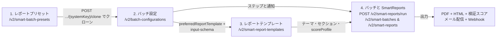

import Tabs from '@theme/Tabs';
import TabItem from '@theme/TabItem';

# SmartReports

**SmartReports** は、Verifik カタログの複数ステップ検証（`SmartCheck` + `SmartBatch`）を、自動化された **検証スコア（Verification Score）**、メール配信、リアルタイム Webhook を備えた構造化 HTML および PDF レポートに変換します。**Smart-Agent** ポータルでレポートを設計・確認したり、**ヘッドレス REST API** 経由でバックエンドからエンドツーエンドの実行をトリガーしたり、**Model Context Protocol（MCP）** を介して自律型アシスタントを接続したりできます。

:::info テナント分離とクライアント別認証
すべての SmartReports、Template、Configuration、Preset、および Batch エンドポイントでは、お客様自身の **クライアント別 Verifik Bearer JWT**（`Authorization: Bearer <VERIFIK_JWT>`）が必要です。共有 x402 サービスアカウントによる実行は厳格にブロックされ（`403 Forbidden`）、実行されたカタログステップごとに Verifik アカウント残高からクレジットが直接請求されます。
:::

---

## アーキテクチャと構成要素

SmartReports は **実行する検証内容**、**結果の表示スタイル**、および **各実行の配信方法** を分離しています。



| 構成要素 | 主なエンドポイント | 役割 |
| --- | --- | --- |
| **レポートプリセット** | `GET /v2/smart-batch-presets`<br />`POST /v2/smart-batch-presets/{systemKey}/clone` | 事前に構成された検証ステップ、入力スキーマ、テーマ付きテンプレートを含む、国別・ドメイン別（`citizen`、`company`、`vehicle`、`essential` または `comprehensive` ティア）の Verifik 組み込みバンドルです。 |
| **バッチ設定** | `GET / POST / PUT / DELETE /v2/batch-configurations`<br />`GET /v2/batch-configurations/{id}/input-schema` | 順序付けられたカタログステップ、ステップ連携（`{{results.N.*}}`）、`mergeStrategy`（`sequential`、`parallel-independent`、`parallel-with-fallback`）、`preferredReportTemplate`、および `notification` 設定（`webhookUrl`、`emailOnCompletion`）を保存する再利用可能なレシピです。 |
| **レポートテンプレート** | `GET / POST / PUT / DELETE /v2/smart-report-templates`<br />`POST /v2/smart-report-templates/generate-layout`<br />`POST /v2/smart-report-templates/preview-html`<br />`POST /v2/smart-report-templates/introspect` | ビジュアルレイアウト定義（`sections[]`、`reportTheme`、カスタムフォント、透かし、電子署名、PDF パスワード保護、スコア設定）。システムテンプレート（`type: "System"`）は読み取り専用、クライアントテンプレート（`type: "client"`）は完全に編集可能です。 |
| **バッチと SmartReports** | `POST /v2/smart-reports/run`<br />`/v2/smart-batches`<br />`/v2/smart-reports` | サーバー側で `FeatureRunner` 経由の検証ステップを実行し、行の `verificationScore` を算出し、HTML および PDF を生成し、受信者へメール送信して Webhook イベントを配信します。 |

### 各構成要素の連携方法

1. **プリセットの検索またはクローン**: `GET /v2/smart-batch-presets` および `POST /v2/smart-batch-presets/{systemKey}/clone` を使用するか、アカウントで利用可能な任意のカタログエンドポイントからカスタムの `BatchConfiguration` を構築します。
2. **必須入力の確認**: `GET /v2/batch-configurations/{id}/input-schema`（またはプリセットの `inputSchema` オブジェクト）を使用して、`requiredFields`、`optionalFields`、`jsonSchema`、`exampleInput`、および `estimatedCreditsPerRow` を取得します。
3. **テンプレートのカスタマイズ**: `/v2/smart-report-templates` で組み込みテーマ、AI 生成レイアウト（`POST /v2/smart-report-templates/generate-layout`）、データパレットのイントロスペクション（`POST /v2/smart-report-templates/introspect`）、およびクレジット消費なしのライブ HTML プレビュー（`POST /v2/smart-report-templates/preview-html`）を活用します。
4. **実行と配信**: `POST /v2/smart-reports/run`（`systemKey` または `batchConfigurationId` を指定）による 1 回のヘッドレス呼び出し、あるいは `/v2/smart-batches` や `/v2/smart-batches/from-file` を使った大容量処理の後に `/v2/smart-reports/{id}/generate`、`/download`、`/html`、`/send-email` を実行します。

---

## 3 つの統合インターフェース

| インターフェース | エントリーポイント | 最適な用途 |
| --- | --- | --- |
| **Smart-Agent ポータル** | `https://ai.verifik.co` | 対話型テンプレートビルダー、プリセットギャラリー、バッチ監視、レポートビューア、および組み込みの **Developer & AI Agent Kit**（`API & AI Agent` / `API / MCP`）。 |
| **ヘッドレス REST API** | `https://api.verifik.co/v2/...`<br />`https://ai.verifik.co/v2/...` | ブラウザ UI を介さないバックエンドサービス、自動化された KYC/KYB/フリートパイプライン、Webhook 駆動の PDF 生成、および大容量ファイルバッチ。 |
| **Streamable HTTP MCP サーバー** | `https://ai.verifik.co/mcp`<br />`https://ai.verifik.co/api/mcp` | 10 個の `smart_report_*` ツールを直接呼び出す自律型 AI エージェント（Claude Desktop、Cursor、Windsurf、ChatGPT Agents、カスタム JSON-RPC 2.0 MCP クライアント）。 |

:::note `api.verifik.co` と `ai.verifik.co` で共通の `/v2/...` パス
`/v2/smart-reports/*`、`/v2/smart-report-templates/*`、`/v2/batch-configurations/*`、`/v2/smart-batches/*`、および `/v2/smart-batch-presets/*` は、`https://api.verifik.co` へ直接呼び出すことも、`https://ai.verifik.co` の Smart-Agent プロキシ経由で呼び出すこともできます。どちらも同じクライアント別 JWT 認証を適用します。
:::

---

## 認証と課金モデル

### クライアント別 Bearer JWT の厳格な適用

すべての SmartReports、Template、Batch Configuration、Preset、および SmartBatch エンドポイントはテナント単位で分離されており、**呼び出し元が提供する Verifik Bearer JWT** を必須としています。

```text
Authorization: Bearer <VERIFIK_JWT>
```

- **Smart-Agent プロキシガード（`smartReportAuthGuard`）**: `/v2/smart-reports*`、`/v2/smart-report-templates*`、`/v2/batch-configurations*`、`/v2/smart-batches*`、または `/v2/smart-batch-presets*`（あるいは同等の `/api/...` / `/api/proxy` パス）を対象とし、有効なクライアント別 Bearer JWT を含まないリクエストは、x402 決済処理の前に **HTTP `403 Forbidden`** で拒否されます。

```json
{
  "code": "Forbidden",
  "message": "SmartReports, SmartReportTemplates, BatchConfigurations, and SmartBatches require your own per-client Verifik Bearer JWT. They are not available through the shared x402 account."
}
```

- **MCP のテナント分離**: ディスカバリメソッド（`initialize`、`ping`、`notifications/initialized`、`tools/list`）は認証情報なしで動作しますが、`tools/call` はクライアント別の `Authorization: Bearer <VERIFIK_JWT>` ヘッダーを厳格に要求し、欠落している場合や共有サービストークンが指定された場合は **HTTP `401`**（JSON-RPC `-32001`）を返します。
- **SmartReports ルートでの `x-payment-info` 非使用**: `https://ai.verifik.co/openapi.json` において、SmartReports ルートは従量課金 x402 ヘッダーではなく `bearerAuth` セキュリティを使用します。

### クレジットベースの課金

- **カタログステップ単位の課金**: 検証ステップがカタログソースに対して実際に実行された時点で、お客様の Verifik クライアントアカウント残高からクレジットが差し引かれます（バッチ上の `creditsSpent` で追跡されます）。
- **事前見積もり**: `GET /v2/smart-batch-presets` および `GET /v2/batch-configurations/{id}/input-schema` は、照会を実行する前に `estimatedCreditsPerRow` を返します。
- **クレジット消費なしの設計・取得操作**: プリセットやテンプレートの一覧表示、スキーマ確認、`/introspect`・`/preview-html`・`/theme-starters`・`/score-profiles`・`/simulated-responses` の呼び出し、`/v2/smart-reports/{id}/html` の取得、PDF ダウンロード、レポートメール送信では検証クレジットは**消費されません**。
- **アカウント権限チェック**: バッチまたは `POST /v2/smart-reports/run` を実行する前に、Verifik は有効化されたすべてのステップのエンドポイントがお客様のクライアントアカウントで有効になっているかを確認します（利用できないステップがある場合は `endpoints_not_in_account` とともに `409 Conflict` を返します）。

---

## 検証スコア、テーマ、および PDF エンジン

### 組み込みレポートテーマ（`reportTheme.id`）

SmartReports には、`reportTheme.id` で設定できる **4 つのテーマ付き HTML/PDF デザインシステム** が含まれています（ブランドカラー、タイポグラフィ、余白、`logoText`、`logoUrl` については `reportTheme.tokens` で任意に上書き可能です）。

| テーマ ID | エイリアス | ビジュアルスタイル | デフォルトパレット |
| --- | --- | --- | --- |
| `premium_dark` | — *（デフォルト）* | ダークネイビーの表紙（`#0b1730`）、温かみのあるストーンカラーの本文ページ（`#f7f5f2`）、シャープな白いカード | インク `#122033`、アクセント `#c4b5fd`、マーク `#1e3a5f` |
| `light_cards` | `smart_enroll_v2` | 高コントラストの白いページ（`#ffffff`）、柔らかなライトカード（`#f3f5f1`）、ピル型チップ | インク `#0e0f0c`、アクセント `#7145d6`、マーク `#163300` |
| `editorial` | — | 温かみのある紙面調（`#fffdf8`）、セリフ体の見出しタイトル（`Noto Serif`）、トラッキング付き大文字ラベル | インク `#1b1a17`、アクセント `#7145d6`、ヘアライン境界線 |
| `dashboard` | — | 整理されたメトリックカード（`#f6f7fb`）とコンパクトな角丸（`12px`）を持つクリーンな白地キャンバス | インク `#111827`、アクセント `#7145d6`、ソフトバイオレットのハイライト |

:::tip レガシーテーマエイリアス
`reportTheme: "smart_enroll_v2"` または `reportTheme.id: "smart_enroll_v2"` で保存されたテンプレートは、レンダリング時に自動的に `light_cards` として解決されます。
:::

### 検証スコアプロファイル（`scoreProfile`）

スコアリングが有効な場合（`score: true` またはテーマ付きテンプレートにより自動有効化）、SmartReports は実行された各検証ステップを `0`〜`1` のスコア（小数点以下 4 桁の `score` および `0`〜`100` の `score100`）に正規化し、**ノックアウトルール** と **カバレッジ**（`approve` には最低 `90%` が必要）を評価して判定（verdict）を生成します。

- `approve` — 加重スコア `0.90–1.00`、カバレッジ `>= 90%`、すべての必須チェックが応答済み
- `review` — 加重スコア `0.70–0.89`（またはノックアウト以外の要確認所見あり）
- `reject` — 加重スコア `< 0.70`、または設定されたノックアウトルールに該当
- `pending` — 必須チェックが応答しなかった（例: 上流タイムアウト/`5xx`）か、カバレッジ `< 90%`

10 種類の組み込みスコアプロファイルがサポートされています（最新の ID とラベルは `GET /v2/smart-report-templates/score-profiles` で取得できます）。

| プロファイル ID | ラベル | エイリアス | カテゴリウェイト（合計 `100%`） |
| --- | --- | --- | --- |
| `cabify_driver` *（デフォルト）* | Driver onboarding | `driver`, `cabify` | `records` (25), `driving` (25), `identity` (15), `biometrics` (15), `watchlists` (10), `vehicle` (10) |
| `kyc` | Generic KYC | `generic_kyc` | `identity` (25), `biometrics` (25), `watchlists` (25), `records` (20), `contact` (5) |
| `kyb` | KYB | — | `company` (45), `watchlists` (25), `identity` (15), `records` (15) |
| `fleet` | Vehicle / fleet | `vehicle` | `vehicle` (60), `driving` (15), `identity` (15), `watchlists` (10) |
| `vehicle_purchase` | Vehicle purchase / dealer | `dealer` | `vehicle` (70), `identity` (15), `watchlists` (10), `driving` (5) |
| `identity_lookup` | Identity only | `identity_only` | `identity` (100) |
| `background_check` | Background screening | `screening` | `records` (45), `watchlists` (25), `identity` (20), `company` (10) |
| `lending` | Lending | `credit` | `identity` (40), `records` (25), `supporting` (25), `driving` (10) |
| `healthcare_professional` | Health professional | `health_professional` | `supporting` (55), `identity` (25), `watchlists` (20) |
| `biometrics` | Biometrics | `face` | `biometrics` (70), `identity` (30) |

### PDF レンダリングエンジン: `puppeteer` と `pdfkit`

| エンジン | 動作 | サポートされる機能 |
| --- | --- | --- |
| `puppeteer` *（デフォルト）* | プールされたヘッドレス Chromium インスタンスを通じて完全な HTML/CSS をレンダリングします。 | 4 つのレポートテーマすべて、SVG スコアゲージおよびグラフ（`pie`/`bar`）、動的な `dataTable` および `keyValueGrid` レイアウト、カスタムフォント、画像/テキスト透かし、署名オーバーレイ、PDF パスワード暗号化。 |
| `pdfkit` | 後方互換性のためにテンプレートおよび API リクエストで受け付けられ、HTML/Puppeteer 互換シム（`pdf-pdfkit.service.js`）経由で処理されます。 | `pdfEngine: "pdfkit"` が設定された既存のテンプレートでも、劣化したプレースホルダーになることなく、完全なテーブルレンダリング、透かし、署名が自動的に利用できます。 |

---

## ドキュメントセクション

SmartReports のガイドおよび API リファレンスセクションをご覧ください。

- **ガイドと統合**
  - [ヘッドレス API ガイド](/verifik-ja/smart-reports/headless-api-guide) — UI を使わないワンショット同期/非同期実行、Webhook、ポーリング、カスタムレシピ、エラーハンドリング。
  - [MCP と AI エージェント](/verifik-ja/smart-reports/mcp-and-ai-agents) — Streamable HTTP MCP サーバー（`https://ai.verifik.co/mcp`）、全 10 個の `smart_report_*` ツール、OpenAPI ディスカバリ、アプリ内 **Developer & AI Agent Kit**。
  - [SmartReports Webhook](/verifik-ja/resources/smart-reports-webhooks) — 全 6 種類の `smart_batch_*` Webhook イベント、ペイロードスキーマ、URL 解決順序、リトライスケジュール。
- **Reports API**
  - [Smart Report を実行する](/verifik-ja/smart-reports/run-a-smart-report) (`POST /v2/smart-reports/run`) — エンドツーエンドのヘッドレス実行。
  - [Smart Report 一覧を取得する](/verifik-ja/smart-reports/list-smart-reports) (`GET /v2/smart-reports`)
  - [Smart Report を作成する](/verifik-ja/smart-reports/create-a-smart-report) (`POST /v2/smart-reports`)
  - [Smart Report を取得する](/verifik-ja/smart-reports/retrieve-a-smart-report) (`GET /v2/smart-reports/{id}`)
  - [Smart Report を更新する](/verifik-ja/smart-reports/update-a-smart-report) (`PUT /v2/smart-reports/{id}`)
  - [Smart Report を削除する](/verifik-ja/smart-reports/delete-a-smart-report) (`DELETE /v2/smart-reports/{id}`)
  - [Smart Report PDF を生成する](/verifik-ja/smart-reports/generate-smart-report-pdf) (`POST /v2/smart-reports/{id}/generate`)
  - [Smart Report PDF をダウンロードする](/verifik-ja/smart-reports/download-smart-report-pdf) (`GET /v2/smart-reports/{id}/download`)
  - [Smart Report HTML を取得する](/verifik-ja/smart-reports/retrieve-smart-report-html) (`GET /v2/smart-reports/{id}/html`)
  - [Smart Report をメールで送信する](/verifik-ja/smart-reports/send-smart-report-email) (`POST /v2/smart-reports/{id}/send-email`)
- **Templates API**
  - [レポートテンプレート一覧を取得する](/verifik-ja/smart-reports/list-report-templates) (`GET /v2/smart-report-templates`)
  - [レポートテンプレートを作成する](/verifik-ja/smart-reports/create-a-report-template) (`POST /v2/smart-report-templates`)
  - [レポートテンプレートを取得する](/verifik-ja/smart-reports/retrieve-a-report-template) (`GET /v2/smart-report-templates/{id}`)
  - [レポートテンプレートを更新する](/verifik-ja/smart-reports/update-a-report-template) (`PUT /v2/smart-report-templates/{id}`)
  - [レポートテンプレートを削除する](/verifik-ja/smart-reports/delete-a-report-template) (`DELETE /v2/smart-report-templates/{id}`)
  - [テンプレートレイアウトを生成する](/verifik-ja/smart-reports/generate-template-layout) (`POST /v2/smart-report-templates/generate-layout`)
  - [テンプレート HTML をプレビューする](/verifik-ja/smart-reports/preview-template-html) (`POST /v2/smart-report-templates/preview-html`)
  - [サンプルデータをイントロスペクトする](/verifik-ja/smart-reports/introspect-sample-data) (`POST /v2/smart-report-templates/introspect`)
  - [テーマスターター一覧を取得する](/verifik-ja/smart-reports/list-theme-starters) (`GET /v2/smart-report-templates/theme-starters`)
  - [スコアプロファイル一覧を取得する](/verifik-ja/smart-reports/list-score-profiles) (`GET /v2/smart-report-templates/score-profiles`)
  - [シミュレートレスポンス一覧を取得する](/verifik-ja/smart-reports/list-simulated-responses) (`GET /v2/smart-report-templates/simulated-responses`)
  - [シミュレートレスポンスを取得する](/verifik-ja/smart-reports/retrieve-simulated-response) (`GET /v2/smart-report-templates/simulated-responses/{code}`)
  - [テンプレートサンプルを送信する](/verifik-ja/smart-reports/send-template-sample) (`POST /v2/smart-report-templates/{id}/send-sample`)
  - [テンプレートサンプルをダウンロードする](/verifik-ja/smart-reports/download-template-sample) (`POST /v2/smart-report-templates/{id}/download-sample`)
- **Presets & Configurations API**
  - [レポートプリセット一覧を取得する](/verifik-ja/smart-reports/list-report-presets) (`GET /v2/smart-batch-presets`)
  - [レポートプリセットをクローンする](/verifik-ja/smart-reports/clone-a-report-preset) (`POST /v2/smart-batch-presets/{systemKey}/clone`)
  - [バッチ設定一覧を取得する](/verifik-ja/smart-reports/list-batch-configurations) (`GET /v2/batch-configurations`)
  - [バッチ設定を作成する](/verifik-ja/smart-reports/create-a-batch-configuration) (`POST /v2/batch-configurations`)
  - [バッチ設定を取得する](/verifik-ja/smart-reports/retrieve-a-batch-configuration) (`GET /v2/batch-configurations/{id}`)
  - [設定の入力スキーマを取得する](/verifik-ja/smart-reports/retrieve-configuration-input-schema) (`GET /v2/batch-configurations/{id}/input-schema`)
  - [バッチ設定を更新する](/verifik-ja/smart-reports/update-a-batch-configuration) (`PUT /v2/batch-configurations/{id}`)
  - [バッチ設定を削除する](/verifik-ja/smart-reports/delete-a-batch-configuration) (`DELETE /v2/batch-configurations/{id}`)
- **Batch Execution API**
  - [Smart Batch 一覧を取得する](/verifik-ja/smart-reports/list-smart-batches) (`GET /v2/smart-batches`)
  - [Smart Batch を作成する](/verifik-ja/smart-reports/create-a-smart-batch) (`POST /v2/smart-batches`)
  - [ファイルから Smart Batch を作成する](/verifik-ja/smart-reports/create-smart-batch-from-file) (`POST /v2/smart-batches/from-file`)
  - [Smart Batch を取得する](/verifik-ja/smart-reports/retrieve-a-smart-batch) (`GET /v2/smart-batches/{id}`)
  - [Smart Batch を更新する](/verifik-ja/smart-reports/update-a-smart-batch) (`PUT /v2/smart-batches/{id}`)
  - [Smart Batch を削除する](/verifik-ja/smart-reports/delete-a-smart-batch) (`DELETE /v2/smart-batches/{id}`)
  - [SmartBatch](/verifik-ja/smart-batch) — UI ウィザード、Async と Sync モード、ダッシュボード追跡。
  - [エンドポイントをキューとして呼び出す (async)](/verifik-ja/smart-batch/async-queue) — `https://async.verifik.co` での単一行 `type=queue` API 統合。
