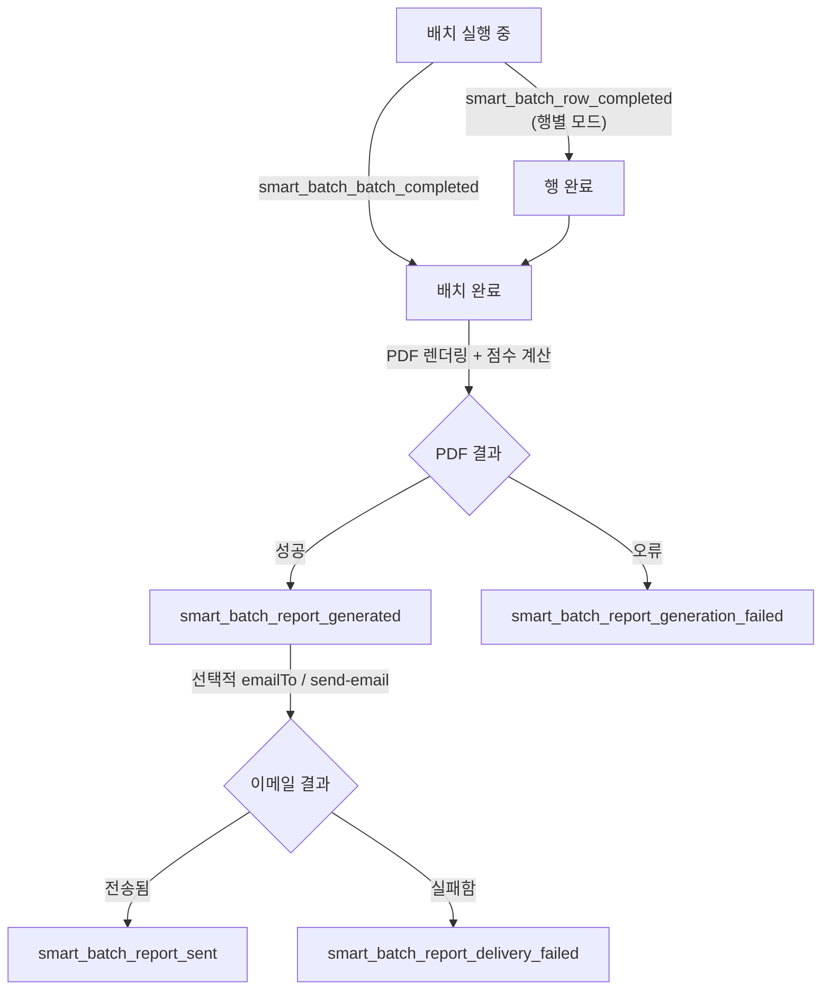

import Tabs from '@theme/Tabs';
import TabItem from '@theme/TabItem';

### 개요

SmartReports 및 SmartBatch는 Verifik의 공용 **Webhook** 및 **Smart Monitor** 전송 파이프라인(`WebhookEvents`)을 통해 수명 주기 알림을 전달합니다. 배치 행이 완료되거나, 배치가 종료되거나, 리포트 PDF 렌더링이 완료(또는 실패)되거나, 이메일 전송이 성공(또는 반송)할 때마다 Verifik은 HTTP `POST`를 통해 지정된 형식의 `smart_batch_*` 이벤트를 발송합니다.

:::info HTTP 전송 형식 및 보안

모든 전송은 **`5000 ms`(`5`초)** 타임아웃과 함께 다음 JSON 엔벨로프를 담아 대상 URL로 전송되는 HTTP **`POST`** 요청입니다.

```json
{
  "type": "smart_batch_report_generated",
  "object": { }
}
```

- **`type`** — 정확한 `smart_batch_*` 이벤트 식별자(`smart_batch_report_generated`, `smart_batch_report_sent` 등).
- **`object`** — 이벤트별 페이로드. 민감한 내부 필드(`encryptedOcr` 및 `prompt`)는 존재하는 경우 제거됩니다.
- **HMAC 서명 헤더 없음**: 현재 `smart_batch_*` 제품 전송에는 `x-verifik-signature` 헤더가 포함되지 **않습니다**. 항상 **HTTPS**를 사용하고, 구성된 URL에 비밀 경로 토큰이나 쿼리/헤더 시크릿을 적용하여 수신 URL을 보호하며, 돌이킬 수 없는 후속 작업을 트리거하기 전에 `GET https://api.verifik.co/v2/smart-reports/{id}`(`Authorization: Bearer <VERIFIK_JWT>` 사용)로 `object.reportId` / `object.batchId` 및 `object.externalRefId`를 검증하세요.

`object`의 새로운 선택적 필드는 추가적(additive)인 변경으로 간주하세요.

:::

---

### 대상 URL 선택 방식

대상 URL 결정 방식은 이벤트가 **SmartReport** 작업에서 발생했는지, 아니면 **SmartBatch** 실행에서 발생했는지에 따라 달라집니다.

:::tip 대상 URL 결정 순서

1. **리포트 이벤트**(`smart_batch_report_generated`, `smart_batch_report_generation_failed`, `smart_batch_report_sent`, `smart_batch_report_delivery_failed`):
   1. 리포트별 / 실행별 **`report.webhookUrl`** 재정의(`POST /v2/smart-reports/run` 또는 `POST /v2/smart-reports`에서 전달).
   2. 배치의 `BatchConfiguration`에 설정된 **`batchConfiguration.notification.webhookUrl`**.
   3. 둘 다 존재하지 않으면 **웹훅이 전송되지 않습니다**.
2. **배치 및 행 실행 이벤트**(`smart_batch_row_completed`, `smart_batch_batch_completed`):
   - 명시적으로 전달된 경우 `options.webhookUrl`을 사용하거나, **`batchConfiguration.notification.webhook`** / **`batchConfiguration.notification.webhookUrl`**을 사용합니다.
   - *참고*: 비동기 `FeatureRunner` 실행(`smart-batch-run-sync`)은 **`batchConfiguration.notification.webhookUrl`**을 사용하여 `smart_batch_batch_completed`를 발송하며 `object`에 `runId`와 `creditsSpent`를 포함합니다.

`webhookUrl`이 결정되면 Verifik은 자동으로 활성 클라이언트 `Webhook` 레코드(`Smart Batch — <name>`)를 조회하거나 생성하고 `BatchConfiguration`에 연결하여 **Smart Monitor**에 전송 내역이 표시되도록 합니다.

:::

---

### 전송 보장 및 재시도 일정

- **성공 기준**: 엔드포인트는 **`5000 ms`** 이내에 HTTP **`2xx`** 응답을 반환해야 합니다. 즉시 `200 OK`를 반환하고 PDF 다운로드나 데이터베이스 쓰기는 백그라운드 워커로 오프로드하세요.
- **재시도 일정**: 2xx가 아닌 응답, 타임아웃 또는 연결 오류 발생 시 Verifik은 가장 가까운 10분 경계로 반올림하여 **`[60, 60, 120, 120, 360, 720]`분**(1시간, 1시간, 2시간, 2시간, 6시간, 12시간) 간격의 백오프로 최대 **`6`회 재시도**를 예약합니다.
- **선택적 실패/성공 알림 이메일**: 연결된 `Webhook` 레코드에 `notification.email`이 구성되어 있고 `notification.success` 또는 `notification.fail`이 활성화되어 있으면, Verifik은 **1차 시도** 시 Mailgun 알림을 보냅니다.

---

### 이벤트 수명 주기



---

### 이벤트 카탈로그

| 이벤트 `type` | `object.event` | 발생 시점 | 주요 `object` 필드 |
| --- | --- | --- | --- |
| `smart_batch_report_generated` | `"report.generated"` | 리포트 PDF 렌더링 성공 시(`POST /v2/smart-reports/run`, `POST /v2/smart-reports/{id}/generate` 또는 비동기 배치 완료 시). | `reportId`, `batchId`, `templateId`, `status`, `rowIndex`, `pdfSize`, `pdfEngine`, `generationDurationMs`, `downloadUrl`, `htmlUrl`, `verificationScore`, `externalRefId`, `generatedAt` |
| `smart_batch_report_generation_failed` | `"report.generation_failed"` | 리포트 PDF 렌더링 실패 시. | `reportId`, `batchId`, `templateId`, `status`, `error`, `externalRefId`, `failedAt` |
| `smart_batch_report_sent` | `"report.sent"` | 리포트 PDF 이메일 전송 성공 시(`/run`의 `emailTo` 또는 `POST /v2/smart-reports/{id}/send-email`). | `reportId`, `batchId`, `templateId`, `status`, `recipients`, `subject`, `messageId`, `downloadUrl`, `htmlUrl`, `externalRefId`, `sentAt` |
| `smart_batch_report_delivery_failed` | `"report.delivery_failed"` | 리포트 PDF 이메일 전송 실패 또는 반송 시. | `reportId`, `batchId`, `templateId`, `status`, `recipients`, `subject`, `messageId`, `error`, `downloadUrl`, `htmlUrl`, `externalRefId`, `sentAt` |
| `smart_batch_batch_completed` | `"batch.completed"` | `SmartBatch`의 모든 행이 최종 상태(`completed` 또는 `failed`)에 도달한 경우. | `batchId`, `runId`, `status`, `creditsSpent`, `stats` |
| `smart_batch_row_completed` | `"row.completed"` | 행별 배치 업데이트 흐름에서 최종 행이 아닌 행이 완료 상태(`completed`, `failed` 또는 `partial`)에 도달한 경우. | `batchId`, `rowIndex`, `status`, `results`, `errors` |

---

### 이벤트 스키마 및 페이로드 예제

#### 1. `smart_batch_report_generated`

SmartReport PDF 렌더링이 완료되었을 때(`status: "generated"`) 발생합니다.

| 필드 | 타입 | 설명 |
| --- | --- | --- |
| `object.event` | string | 항상 `"report.generated"`입니다. |
| `object.reportId` | string | SmartReport ObjectId. |
| `object.batchId` | string | 연결된 SmartBatch ObjectId. |
| `object.templateId` | string | PDF 렌더링에 사용된 SmartReportTemplate ObjectId. |
| `object.status` | string | `"generated"`. |
| `object.rowIndex` | number | 리포트로 렌더링된 0부터 시작하는 배치 행 인덱스. |
| `object.pdfSize` | number | 렌더링된 PDF 파일 크기(바이트). |
| `object.pdfEngine` | string | 사용된 엔진(`"puppeteer"` 또는 `"pdfkit"`). |
| `object.generationDurationMs` | number | PDF 렌더링 소요 시간(밀리초). |
| `object.downloadUrl` | string | PDF 바이너리를 가져오기 위한 상대 API 경로 `/v2/smart-reports/{reportId}/download`. |
| `object.htmlUrl` | string | HTML + Verification Score JSON을 가져오기 위한 상대 API 경로 `/v2/smart-reports/{reportId}/html`. |
| `object.verificationScore` | object *(선택)* | 점수 계산이 활성화된 경우 점수 요약(`score`, `verdict`, `coverage`, `profile`). |
| `object.externalRefId` | string *(선택)* | `/run` 또는 리포트 생성 시 전달된 호출자 상관관계 ID. |
| `object.generatedAt` | string (ISO 8601) | 생성이 완료된 타임스탬프. |

```json
{
  "type": "smart_batch_report_generated",
  "object": {
    "event": "report.generated",
    "reportId": "6740a1b2c3d4e5f678901234",
    "batchId": "6740a1b2c3d4e5f678901111",
    "templateId": "6740a1b2c3d4e5f678902222",
    "status": "generated",
    "rowIndex": 0,
    "pdfSize": 184320,
    "pdfEngine": "puppeteer",
    "generationDurationMs": 1420,
    "downloadUrl": "/v2/smart-reports/6740a1b2c3d4e5f678901234/download",
    "htmlUrl": "/v2/smart-reports/6740a1b2c3d4e5f678901234/html",
    "verificationScore": {
      "score": 0.9625,
      "verdict": "approve",
      "coverage": 1,
      "profile": "cabify_driver"
    },
    "externalRefId": "case-12345",
    "generatedAt": "2026-11-24T20:15:30.120Z"
  }
}
```

#### 2. `smart_batch_report_generation_failed`

PDF 생성이 실패했을 때(`status: "failed"`) 발생합니다.

| 필드 | 타입 | 설명 |
| --- | --- | --- |
| `object.event` | string | 항상 `"report.generation_failed"`입니다. |
| `object.reportId` | string | SmartReport ObjectId. |
| `object.batchId` | string | 연결된 SmartBatch ObjectId. |
| `object.templateId` | string | SmartReportTemplate ObjectId. |
| `object.status` | string | `"failed"`. |
| `object.error` | string | 렌더링이 중단된 이유를 설명하는 실패 메시지. |
| `object.externalRefId` | string *(선택)* | 리포트에 존재하는 경우 호출자 상관관계 ID. |
| `object.failedAt` | string (ISO 8601) | 실패가 발생한 타임스탬프. |

```json
{
  "type": "smart_batch_report_generation_failed",
  "object": {
    "event": "report.generation_failed",
    "reportId": "6740a1b2c3d4e5f678901234",
    "batchId": "6740a1b2c3d4e5f678901111",
    "templateId": "6740a1b2c3d4e5f678902222",
    "status": "failed",
    "error": "Chromium page timeout while rendering custom font asset",
    "externalRefId": "case-12345",
    "failedAt": "2026-11-24T20:16:02.450Z"
  }
}
```

#### 3. `smart_batch_report_sent`

리포트 이메일 전송이 성공했을 때(`status: "sent"`) 발생합니다.

| 필드 | 타입 | 설명 |
| --- | --- | --- |
| `object.event` | string | 항상 `"report.sent"`입니다. |
| `object.reportId` | string | SmartReport ObjectId. |
| `object.batchId` | string | 연결된 SmartBatch ObjectId. |
| `object.templateId` | string | SmartReportTemplate ObjectId. |
| `object.status` | string | `"sent"`. |
| `object.recipients` | string[] | 수신자 이메일 주소 목록. |
| `object.subject` | string | 발송된 이메일 제목. |
| `object.messageId` | string | 메일 공급자 메시지 ID. |
| `object.downloadUrl` | string | 상대 API 경로 `/v2/smart-reports/{reportId}/download`. |
| `object.htmlUrl` | string | 상대 API 경로 `/v2/smart-reports/{reportId}/html`. |
| `object.externalRefId` | string *(선택)* | 리포트에 존재하는 경우 호출자 상관관계 ID. |
| `object.sentAt` | string (ISO 8601) | 이메일 발송이 완료된 타임스탬프. |

```json
{
  "type": "smart_batch_report_sent",
  "object": {
    "event": "report.sent",
    "reportId": "6740a1b2c3d4e5f678901234",
    "batchId": "6740a1b2c3d4e5f678901111",
    "templateId": "6740a1b2c3d4e5f678902222",
    "status": "sent",
    "recipients": ["compliance@yourcompany.com"],
    "subject": "SmartReport: Colombia Citizen Comprehensive — 2026-11-24",
    "messageId": "<20261124201535.1.abc123@mg.verifik.co>",
    "downloadUrl": "/v2/smart-reports/6740a1b2c3d4e5f678901234/download",
    "htmlUrl": "/v2/smart-reports/6740a1b2c3d4e5f678901234/html",
    "externalRefId": "case-12345",
    "sentAt": "2026-11-24T20:15:35.800Z"
  }
}
```

#### 4. `smart_batch_report_delivery_failed`

리포트 이메일 전송이 실패했을 때(`status: "failed"`) 발생하며, 전송이 시도조차 되지 않은 경우와 전송 실패를 구분할 수 있습니다.

| 필드 | 타입 | 설명 |
| --- | --- | --- |
| `object.event` | string | 항상 `"report.delivery_failed"`입니다. |
| `object.reportId` | string | SmartReport ObjectId. |
| `object.batchId` | string | 연결된 SmartBatch ObjectId. |
| `object.templateId` | string | SmartReportTemplate ObjectId. |
| `object.status` | string | `"failed"`. |
| `object.recipients` | string[] | 수신자 이메일 주소 목록. |
| `object.subject` | string | 시도된 이메일 제목. |
| `object.messageId` | string *(선택)* | 실패 전 발급된 경우 메일 공급자 메시지 ID. |
| `object.error` | string | 이메일 전송 오류 메시지. |
| `object.downloadUrl` | string | 상대 API 경로 `/v2/smart-reports/{reportId}/download`. |
| `object.htmlUrl` | string | 상대 API 경로 `/v2/smart-reports/{reportId}/html`. |
| `object.externalRefId` | string *(선택)* | 리포트에 존재하는 경우 호출자 상관관계 ID. |
| `object.sentAt` | string (ISO 8601) | 실패한 전송 시도가 완료된 타임스탬프. |

```json
{
  "type": "smart_batch_report_delivery_failed",
  "object": {
    "event": "report.delivery_failed",
    "reportId": "6740a1b2c3d4e5f678901234",
    "batchId": "6740a1b2c3d4e5f678901111",
    "templateId": "6740a1b2c3d4e5f678902222",
    "status": "failed",
    "recipients": ["invalid@nonexistent-domain.test"],
    "subject": "SmartReport: Colombia Citizen Comprehensive — 2026-11-24",
    "messageId": null,
    "error": "Mailgun 400: invalid recipient domain",
    "downloadUrl": "/v2/smart-reports/6740a1b2c3d4e5f678901234/download",
    "htmlUrl": "/v2/smart-reports/6740a1b2c3d4e5f678901234/html",
    "externalRefId": "case-12345",
    "sentAt": "2026-11-24T20:15:36.210Z"
  }
}
```

#### 5. `smart_batch_batch_completed`

`SmartBatch`가 최종 상태(`"completed"` 또는 `"failed"`)로 전환될 때 한 번 발생합니다.

| 필드 | 타입 | 설명 |
| --- | --- | --- |
| `object.event` | string | 항상 `"batch.completed"`입니다. |
| `object.batchId` | string | SmartBatch ObjectId. |
| `object.runId` | string *(선택)* | `FeatureRunner` 실행 ObjectId(비동기 `FeatureRunner` 동기화 시 포함). |
| `object.status` | string | `"completed"` 또는 `"failed"`. |
| `object.creditsSpent` | number *(선택)* | 해당 실행에서 소모된 총 Verifik 크레딧(비동기 `FeatureRunner` 동기화 시 포함). |
| `object.stats` | object | 집계 수치: `{ totalRows, completedRows, failedRows, partialRows }`. |

```json
{
  "type": "smart_batch_batch_completed",
  "object": {
    "event": "batch.completed",
    "batchId": "6740a1b2c3d4e5f678901111",
    "runId": "6740a1b2c3d4e5f678903333",
    "status": "completed",
    "creditsSpent": 12,
    "stats": {
      "totalRows": 2,
      "completedRows": 2,
      "failedRows": 0,
      "partialRows": 0
    }
  }
}
```

#### 6. `smart_batch_row_completed`

배치의 모든 행이 완료되기 전에 행별 배치 업데이트 흐름에서 개별 행이 완료 상태(`"completed"`, `"failed"` 또는 `"partial"`)에 도달하면 발생합니다.

| 필드 | 타입 | 설명 |
| --- | --- | --- |
| `object.event` | string | 항상 `"row.completed"`입니다. |
| `object.batchId` | string | SmartBatch ObjectId. |
| `object.rowIndex` | number | 배치 내 0부터 시작하는 행 인덱스. |
| `object.status` | string | `"completed"`, `"failed"` 또는 `"partial"`. |
| `object.results` | object | 단계 순번(sequence)을 키로 하는 검증 단계 출력 맵. |
| `object.errors` | array | 실패한 단계에 대해 기록된 `{ step, message, code }` 오류 목록. |

```json
{
  "type": "smart_batch_row_completed",
  "object": {
    "event": "row.completed",
    "batchId": "6740a1b2c3d4e5f678901111",
    "rowIndex": 0,
    "status": "completed",
    "results": {
      "1": {
        "fullName": "JUAN CARLOS PEREZ GOMEZ",
        "documentNumber": "123456789"
      }
    },
    "errors": []
  }
}
```

---

### 웹훅 수신기 예제

아래 수신기 구현은 `5`초 이내에 즉시 요청을 확인 응답(`200 OK`)하고, 반복 전송을 멱등하게 중복 제거하며, `GET /v2/smart-reports/{id}`로 리포트를 검증한 뒤 `Authorization: Bearer <VERIFIK_JWT>`를 사용하여 PDF를 다운로드합니다.

<Tabs>
  <TabItem value="nodejs" label="Node.js (Express)" default>

```javascript
import express from 'express';
import fs from 'node:fs/promises';

const app = express();
app.use(express.json({ limit: '2mb' }));

const VERIFIK_API_URL = 'https://api.verifik.co';
const VERIFIK_JWT = process.env.VERIFIK_JWT;

// Replace with Redis or a unique DB index in production
const processedEvents = new Set();

async function verifyAndDownloadPdf(obj) {
  // Verify the event directly against Verifik API before trusting payload fields
  const metaRes = await fetch(`${VERIFIK_API_URL}/v2/smart-reports/${obj.reportId}`, {
    headers: { Authorization: `Bearer ${VERIFIK_JWT}` },
  });
  if (!metaRes.ok) {
    throw new Error(`Report lookup failed: HTTP ${metaRes.status}`);
  }
  const { data: report } = await metaRes.json();

  const pdfRes = await fetch(`${VERIFIK_API_URL}${obj.downloadUrl}`, {
    headers: { Authorization: `Bearer ${VERIFIK_JWT}` },
  });
  if (!pdfRes.ok) {
    throw new Error(`PDF download failed: HTTP ${pdfRes.status}`);
  }

  const pdfBuffer = Buffer.from(await pdfRes.arrayBuffer());
  const outPath = `./reports/${report.externalRefId || obj.reportId}.pdf`;
  await fs.mkdir('./reports', { recursive: true });
  await fs.writeFile(outPath, pdfBuffer);
  console.log(`Saved ${outPath} (${pdfBuffer.length} bytes), score:`, report.verificationScoreSummary);
}

app.post('/webhooks/verifik-reports', (req, res) => {
  const { type, object: obj } = req.body ?? {};
  if (!type || !obj) {
    return res.status(400).json({ error: 'Invalid webhook payload' });
  }

  const idempotencyKey = `${type}:${obj.reportId || obj.batchId}:${obj.rowIndex ?? ''}:${obj.status || ''}`;
  if (processedEvents.has(idempotencyKey)) {
    return res.status(200).json({ received: true, duplicate: true });
  }
  processedEvents.add(idempotencyKey);

  // Acknowledge within 5 seconds before downloading PDFs or updating downstream systems
  res.status(200).json({ received: true });

  setImmediate(async () => {
    try {
      switch (type) {
        case 'smart_batch_report_generated':
          await verifyAndDownloadPdf(obj);
          break;
        case 'smart_batch_report_generation_failed':
          console.error('Report generation failed:', obj.reportId, obj.externalRefId, obj.error);
          break;
        case 'smart_batch_report_sent':
          console.log('Report emailed:', obj.reportId, obj.recipients, obj.messageId);
          break;
        case 'smart_batch_report_delivery_failed':
          console.error('Email delivery failed:', obj.reportId, obj.recipients, obj.error);
          break;
        case 'smart_batch_batch_completed':
          console.log('Batch settled:', obj.batchId, obj.status, obj.stats, 'credits:', obj.creditsSpent);
          break;
        case 'smart_batch_row_completed':
          console.log('Row completed:', obj.batchId, obj.rowIndex, obj.status);
          break;
        default:
          console.log('Unhandled SmartBatch event:', type);
      }
    } catch (err) {
      console.error('Async webhook handler failed:', err);
    }
  });
});

app.listen(3000, () => console.log('SmartReports webhook listener on :3000'));
```

  </TabItem>
  <TabItem value="python" label="Python (FastAPI)">

```python
import os
from pathlib import Path
import requests
from fastapi import BackgroundTasks, FastAPI, HTTPException, Request

app = FastAPI()

VERIFIK_API_URL = "https://api.verifik.co"
VERIFIK_JWT = os.environ["VERIFIK_JWT"]
PROCESSED_EVENTS: set[str] = set()


def process_smart_report_event(event_type: str, obj: dict) -> None:
    headers = {"Authorization": f"Bearer {VERIFIK_JWT}"}

    if event_type == "smart_batch_report_generated":
        report_id = obj["reportId"]
        # Confirm authentic report state via API
        meta = requests.get(f"{VERIFIK_API_URL}/v2/smart-reports/{report_id}", headers=headers, timeout=30)
        meta.raise_for_status()
        report = meta.json()["data"]

        pdf_resp = requests.get(f"{VERIFIK_API_URL}{obj['downloadUrl']}", headers=headers, timeout=60)
        pdf_resp.raise_for_status()

        out_dir = Path("./reports")
        out_dir.mkdir(parents=True, exist_ok=True)
        filename = f"{report.get('externalRefId') or report_id}.pdf"
        (out_dir / filename).write_bytes(pdf_resp.content)
        print(f"Downloaded {filename} ({len(pdf_resp.content)} bytes)")
    elif event_type == "smart_batch_report_generation_failed":
        print(f"Generation failed for {obj.get('reportId')}: {obj.get('error')}")
    elif event_type == "smart_batch_report_sent":
        print(f"Report {obj.get('reportId')} emailed to {obj.get('recipients')}")
    elif event_type == "smart_batch_report_delivery_failed":
        print(f"Email delivery failed for {obj.get('reportId')}: {obj.get('error')}")
    elif event_type == "smart_batch_batch_completed":
        print(f"Batch {obj.get('batchId')} {obj.get('status')}: {obj.get('stats')}")
    elif event_type == "smart_batch_row_completed":
        print(f"Batch {obj.get('batchId')} row {obj.get('rowIndex')}: {obj.get('status')}")


@app.post("/webhooks/verifik-reports")
async def receive_webhook(request: Request, background_tasks: BackgroundTasks):
    payload = await request.json()
    event_type = payload.get("type")
    obj = payload.get("object")
    if not event_type or not isinstance(obj, dict):
        raise HTTPException(status_code=400, detail="Invalid webhook envelope")

    key = f"{event_type}:{obj.get('reportId') or obj.get('batchId')}:{obj.get('rowIndex', '')}:{obj.get('status', '')}"
    if key in PROCESSED_EVENTS:
        return {"received": True, "duplicate": True}

    PROCESSED_EVENTS.add(key)
    background_tasks.add_task(process_smart_report_event, event_type, obj)
    return {"received": True}
```

  </TabItem>
  <TabItem value="php" label="PHP">

```php
<?php
// webhook-verifik-reports.php
declare(strict_types=1);

$rawBody = file_get_contents('php://input');
$payload = json_decode($rawBody ?: '', true);

if (!is_array($payload) || empty($payload['type']) || !is_array($payload['object'] ?? null)) {
    http_response_code(400);
    header('Content-Type: application/json');
    echo json_encode(['error' => 'Invalid webhook payload']);
    exit;
}

$type = (string) $payload['type'];
$obj = $payload['object'];

// Deduplicate using Redis/database in production
$idempotencyKey = implode(':', [
    $type,
    $obj['reportId'] ?? $obj['batchId'] ?? 'unknown',
    $obj['rowIndex'] ?? '',
    $obj['status'] ?? '',
]);
$lockFile = sys_get_temp_dir() . '/verifik_evt_' . sha1($idempotencyKey) . '.lock';
if (file_exists($lockFile)) {
    http_response_code(200);
    header('Content-Type: application/json');
    echo json_encode(['received' => true, 'duplicate' => true]);
    exit;
}
file_put_contents($lockFile, (string) time());

// Return 200 OK quickly (under 5s) before downloading files
http_response_code(200);
header('Content-Type: application/json');
echo json_encode(['received' => true]);
if (function_exists('fastcgi_finish_request')) {
    fastcgi_finish_request();
}

$jwt = getenv('VERIFIK_JWT') ?: '';
$apiUrl = 'https://api.verifik.co';

if ($type === 'smart_batch_report_generated' && !empty($obj['downloadUrl']) && $jwt !== '') {
    $ch = curl_init($apiUrl . $obj['downloadUrl']);
    curl_setopt_array($ch, [
        CURLOPT_RETURNTRANSFER => true,
        CURLOPT_FOLLOWLOCATION => true,
        CURLOPT_TIMEOUT => 30,
        CURLOPT_HTTPHEADER => ["Authorization: Bearer {$jwt}"],
    ]);
    $pdfBytes = curl_exec($ch);
    $statusCode = curl_getinfo($ch, CURLINFO_HTTP_CODE);
    curl_close($ch);

    if ($statusCode === 200 && $pdfBytes !== false) {
        $ref = preg_replace('/[^a-zA-Z0-9_-]/', '_', (string) ($obj['externalRefId'] ?? $obj['reportId']));
        file_put_contents(__DIR__ . "/report_{$ref}.pdf", $pdfBytes);
    }
}
```

  </TabItem>
  <TabItem value="go" label="Go">

```go
package main

import (
	"encoding/json"
	"fmt"
	"io"
	"log"
	"net/http"
	"os"
	"sync"
	"time"
)

type WebhookEnvelope struct {
	Type   string                 `json:"type"`
	Object map[string]interface{} `json:"object"`
}

var (
	seenMu sync.Mutex
	seen   = map[string]bool{}
)

func stringField(m map[string]interface{}, key string) string {
	if v, ok := m[key].(string); ok {
		return v
	}
	return ""
}

func downloadReportPDF(reportID, downloadPath, externalRefID string) {
	jwt := os.Getenv("VERIFIK_JWT")
	client := &http.Client{Timeout: 45 * time.Second}

	req, err := http.NewRequest(http.MethodGet, "https://api.verifik.co"+downloadPath, nil)
	if err != nil {
		log.Printf("request error: %v", err)
		return
	}
	req.Header.Set("Authorization", "Bearer "+jwt)

	resp, err := client.Do(req)
	if err != nil {
		log.Printf("download failed for %s: %v", reportID, err)
		return
	}
	defer resp.Body.Close()

	if resp.StatusCode != http.StatusOK {
		log.Printf("unexpected download status %d for %s", resp.StatusCode, reportID)
		return
	}

	pdfBytes, err := io.ReadAll(resp.Body)
	if err != nil {
		log.Printf("read error for %s: %v", reportID, err)
		return
	}

	name := externalRefID
	if name == "" {
		name = reportID
	}
	outPath := fmt.Sprintf("report-%s.pdf", name)
	if err := os.WriteFile(outPath, pdfBytes, 0o600); err != nil {
		log.Printf("write error: %v", err)
		return
	}
	log.Printf("saved %s (%d bytes)", outPath, len(pdfBytes))
}

func webhookHandler(w http.ResponseWriter, r *http.Request) {
	if r.Method != http.MethodPost {
		http.Error(w, "method not allowed", http.StatusMethodNotAllowed)
		return
	}

	var env WebhookEnvelope
	if err := json.NewDecoder(r.Body).Decode(&env); err != nil || env.Type == "" || env.Object == nil {
		http.Error(w, "invalid payload", http.StatusBadRequest)
		return
	}

	id := stringField(env.Object, "reportId")
	if id == "" {
		id = stringField(env.Object, "batchId")
	}
	key := fmt.Sprintf("%s:%s:%v:%s", env.Type, id, env.Object["rowIndex"], stringField(env.Object, "status"))

	seenMu.Lock()
	if seen[key] {
		seenMu.Unlock()
		w.WriteHeader(http.StatusOK)
		_, _ = w.Write([]byte(`{"received":true,"duplicate":true}`))
		return
	}
	seen[key] = true
	seenMu.Unlock()

	// Respond 200 OK immediately within 5 seconds
	w.Header().Set("Content-Type", "application/json")
	w.WriteHeader(http.StatusOK)
	_, _ = w.Write([]byte(`{"received":true}`))

	go func(evt WebhookEnvelope) {
		switch evt.Type {
		case "smart_batch_report_generated":
			downloadReportPDF(
				stringField(evt.Object, "reportId"),
				stringField(evt.Object, "downloadUrl"),
				stringField(evt.Object, "externalRefId"),
			)
		case "smart_batch_report_generation_failed":
			log.Printf("generation failed: report=%s err=%s", stringField(evt.Object, "reportId"), stringField(evt.Object, "error"))
		case "smart_batch_report_sent":
			log.Printf("email sent: report=%s msg=%s", stringField(evt.Object, "reportId"), stringField(evt.Object, "messageId"))
		case "smart_batch_report_delivery_failed":
			log.Printf("email failed: report=%s err=%s", stringField(evt.Object, "reportId"), stringField(evt.Object, "error"))
		case "smart_batch_batch_completed":
			log.Printf("batch completed: batch=%s status=%s", stringField(evt.Object, "batchId"), stringField(evt.Object, "status"))
		case "smart_batch_row_completed":
			log.Printf("row completed: batch=%s row=%v status=%s", stringField(evt.Object, "batchId"), evt.Object["rowIndex"], stringField(evt.Object, "status"))
		}
	}(env)
}

func main() {
	http.HandleFunc("/webhooks/verifik-reports", webhookHandler)
	log.Fatal(http.ListenAndServe(":3000", nil))
}
```

  </TabItem>
</Tabs>

---

### 관련 문서

- [지원되는 이벤트](/resources/supported-events)
- [웹훅 개요](/resources/webhooks)
- [웹훅 연동](/resources/webhook-integration)
- [헤드리스 API 가이드](/verifik-ko/smart-reports/headless-api-guide)
- [Smart Report 실행](/verifik-ko/smart-reports/run-a-smart-report)
- [MCP 및 AI 에이전트](/verifik-ko/smart-reports/mcp-and-ai-agents)
