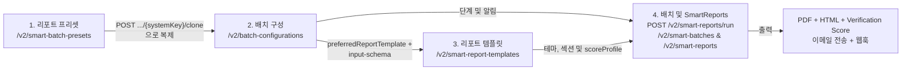

import Tabs from '@theme/Tabs';
import TabItem from '@theme/TabItem';

# SmartReports

**SmartReports**는 다단계 Verifik 카탈로그 검증(`SmartCheck` + `SmartBatch`)을 자동화된 **검증 점수(Verification Scores)**, 이메일 전송, 실시간 웹훅이 포함된 구조화된 HTML 및 PDF 리포트로 변환합니다. **Smart-Agent** 포털에서 리포트를 설계 및 검토하거나, **헤드리스 REST API**를 통해 백엔드에서 종단 간 실행을 트리거하거나, **Model Context Protocol (MCP)**을 통해 자율 에이전트를 연결할 수 있습니다.

:::info 테넌트 격리 및 클라이언트별 인증
모든 SmartReports, 템플릿, 구성, 프리셋 및 배치 엔드포인트는 **클라이언트별 Verifik Bearer JWT**(`Authorization: Bearer <VERIFIK_JWT>`)가 필요합니다. 공유 x402 서비스 계정을 통한 실행은 엄격히 차단되며(`403 Forbidden`), 실행된 카탈로그 단계마다 Verifik 계정 잔액에서 크레딧이 직접 차감됩니다.
:::

---

## 아키텍처 및 구성 요소

SmartReports는 **실행할 검증 항목**, **결과 표시 방식**, **각 실행의 전달 방식**을 분리하여 관리합니다.



| 구성 요소 | 주요 엔드포인트 | 역할 |
| --- | --- | --- |
| **리포트 프리셋(Report Presets)** | `GET /v2/smart-batch-presets`<br />`POST /v2/smart-batch-presets/{systemKey}/clone` | 사전 연결된 검증 단계, 입력 스키마 및 테마 적용 템플릿이 포함된 국가별·도메인별(`citizen`, `company`, `vehicle`; `essential` 또는 `comprehensive` 등급) Verifik 기본 번들입니다. |
| **배치 구성(Batch Configurations)** | `GET / POST / PUT / DELETE /v2/batch-configurations`<br />`GET /v2/batch-configurations/{id}/input-schema` | 정렬된 카탈로그 단계, 단계 체이닝(`{{results.N.*}}`), `mergeStrategy`(`sequential`, `parallel-independent`, `parallel-with-fallback`), `preferredReportTemplate` 및 `notification` 설정(`webhookUrl`, `emailOnCompletion`)을 저장하는 재사용 가능한 레시피입니다. |
| **리포트 템플릿(Report Templates)** | `GET / POST / PUT / DELETE /v2/smart-report-templates`<br />`POST /v2/smart-report-templates/generate-layout`<br />`POST /v2/smart-report-templates/preview-html`<br />`POST /v2/smart-report-templates/introspect` | 시각적 레이아웃 정의(`sections[]`, `reportTheme`, 사용자 지정 글꼴, 워터마크, 디지털 서명, PDF 비밀번호 보호 및 점수 설정)입니다. 시스템 템플릿(`type: "System"`)은 읽기 전용이며, 클라이언트 템플릿(`type: "client"`)은 전체 수정이 가능합니다. |
| **배치 및 SmartReports(Batches & SmartReports)** | `POST /v2/smart-reports/run`<br />`/v2/smart-batches`<br />`/v2/smart-reports` | `FeatureRunner`를 통해 서버 측에서 검증 단계를 실행하고, 행의 `verificationScore`를 계산하며, HTML 및 PDF를 렌더링하고, 수신자에게 이메일을 전송하며 웹훅 이벤트를 발송합니다. |

### 각 요소의 연결 방식

1. **프리셋 탐색 또는 복제**: `GET /v2/smart-batch-presets` 및 `POST /v2/smart-batch-presets/{systemKey}/clone`을 호출하거나, 계정에 활성화된 카탈로그 엔드포인트로 사용자 지정 `BatchConfiguration`을 생성합니다.
2. **필수 입력 확인**: `GET /v2/batch-configurations/{id}/input-schema`(또는 프리셋의 `inputSchema` 객체)를 통해 `requiredFields`, `optionalFields`, `jsonSchema`, `exampleInput` 및 `estimatedCreditsPerRow`를 조회합니다.
3. **템플릿 사용자 지정**: `/v2/smart-report-templates`에서 내장 테마, AI 레이아웃 생성(`POST /v2/smart-report-templates/generate-layout`), 데이터 팔레트 분석(`POST /v2/smart-report-templates/introspect`), 크레딧 차감 없는 실시간 HTML 미리보기(`POST /v2/smart-report-templates/preview-html`)를 활용하여 템플릿을 구성합니다.
4. **실행 및 전달**: `POST /v2/smart-reports/run`(`systemKey` 또는 `batchConfigurationId` 지정)으로 단일 헤드리스 호출을 실행하거나, 대용량 처리 시 `/v2/smart-batches` 및 `/v2/smart-batches/from-file`을 사용한 후 `/v2/smart-reports/{id}/generate`, `/download`, `/html`, `/send-email`을 호출합니다.

---

## 세 가지 통합 방식

| 통합 방식 | 진입점 | 적합한 용도 |
| --- | --- | --- |
| **Smart-Agent 포털** | `https://ai.verifik.co` | 대화형 템플릿 빌더, 프리셋 갤러리, 배치 모니터링, 리포트 뷰어 및 내장된 **Developer & AI Agent Kit**(`API & AI Agent` / `API / MCP`). |
| **헤드리스 REST API** | `https://api.verifik.co/v2/...`<br />`https://ai.verifik.co/v2/...` | 브라우저 UI 없이 백엔드 서비스, 자동화된 KYC/KYB/차량 관리 파이프라인, 웹훅 기반 PDF 생성 및 대용량 파일 배치 처리. |
| **Streamable HTTP MCP 서버** | `https://ai.verifik.co/mcp`<br />`https://ai.verifik.co/api/mcp` | 10개의 `smart_report_*` 도구를 직접 호출하는 자율 AI 에이전트(Claude Desktop, Cursor, Windsurf, ChatGPT Agents 및 사용자 지정 JSON-RPC 2.0 MCP 클라이언트). |

:::note `api.verifik.co`와 `ai.verifik.co`의 동일한 `/v2/...` 경로
`/v2/smart-reports/*`, `/v2/smart-report-templates/*`, `/v2/batch-configurations/*`, `/v2/smart-batches/*` 및 `/v2/smart-batch-presets/*`는 `https://api.verifik.co`에서 직접 호출하거나 `https://ai.verifik.co`의 Smart-Agent 프록시를 통해 호출할 수 있습니다. 두 경로 모두 동일한 클라이언트별 JWT 인증을 적용합니다.
:::

---

## 인증 및 과금 모델

### 클라이언트별 Bearer JWT 강제 적용

모든 SmartReports, 템플릿, 배치 구성, 프리셋 및 SmartBatch 엔드포인트는 테넌트 단위로 격리되며 **호출자가 제공하는 Verifik Bearer JWT**가 필요합니다.

```text
Authorization: Bearer <VERIFIK_JWT>
```

- **Smart-Agent 프록시 가드(`smartReportAuthGuard`)**: 유효한 클라이언트별 Bearer JWT 없이 `/v2/smart-reports*`, `/v2/smart-report-templates*`, `/v2/batch-configurations*`, `/v2/smart-batches*`, `/v2/smart-batch-presets*`(또는 `/api/...` / `/api/proxy` 대응 경로)로 요청을 보내면 x402 결제 처리 전에 **HTTP `403 Forbidden`**으로 거부됩니다.

```json
{
  "code": "Forbidden",
  "message": "SmartReports, SmartReportTemplates, BatchConfigurations, and SmartBatches require your own per-client Verifik Bearer JWT. They are not available through the shared x402 account."
}
```

- **MCP 테넌트 격리**: 검색 메서드(`initialize`, `ping`, `notifications/initialized`, `tools/list`)는 자격 증명 없이 동작하지만, `tools/call`은 클라이언트별 `Authorization: Bearer <VERIFIK_JWT>` 헤더를 반드시 요구하며 헤더가 누락되었거나 공유 서비스 토큰이 전달되면 **HTTP `401`**(JSON-RPC `-32001`)을 반환합니다.
- **SmartReports 라우트에서 `x-payment-info` 미사용**: `https://ai.verifik.co/openapi.json`에서 SmartReports 라우트는 호출당 결제 x402 헤더 대신 `bearerAuth` 보안을 사용합니다.

### 크레딧 기반 종량제 과금

- **카탈로그 단계별 과금**: 검증 단계가 카탈로그 소스를 대상으로 실제 실행될 때 Verifik 클라이언트 계정 잔액에서 크레딧이 차감됩니다(배치의 `creditsSpent` 필드로 추적됨).
- **사전 비용 예측**: `GET /v2/smart-batch-presets` 및 `GET /v2/batch-configurations/{id}/input-schema`는 조회를 실행하기 전에 `estimatedCreditsPerRow`를 반환합니다.
- **크레딧 차감 없는 설계 및 조회 작업**: 프리셋·템플릿 목록 조회, 스키마 검사, `/introspect`, `/preview-html`, `/theme-starters`, `/score-profiles`, `/simulated-responses` 호출, `/v2/smart-reports/{id}/html` 조회, PDF 다운로드 및 리포트 이메일 전송에는 검증 크레딧이 **차감되지 않습니다**.
- **계정 권한 확인**: 배치 또는 `POST /v2/smart-reports/run`을 실행하기 전, Verifik은 활성화된 모든 단계 엔드포인트가 클라이언트 계정에 활성화되어 있는지 확인합니다(사용 불가능한 단계가 있으면 `409 Conflict` 및 `endpoints_not_in_account` 반환).

---

## 검증 점수(Verification Score), 테마 및 PDF 엔진

### 기본 제공 리포트 테마(`reportTheme.id`)

SmartReports는 `reportTheme.id`를 통해 구성되는 **4가지 테마 적용 HTML/PDF 디자인 시스템**을 제공합니다(`reportTheme.tokens`에서 브랜드 색상, 타이포그래피, 여백, `logoText` 및 `logoUrl` 선택적 재정의 가능).

| 테마 ID | 별칭 | 시각적 스타일 | 기본 팔레트 |
| --- | --- | --- | --- |
| `premium_dark` | — *(기본값)* | 짙은 네이비 표지(`#0b1730`), 따뜻한 스톤 톤 본문 페이지(`#f7f5f2`), 깔끔한 흰색 카드 | Ink `#122033`, Accent `#c4b5fd`, Mark `#1e3a5f` |
| `light_cards` | `smart_enroll_v2` | 고대비 흰색 페이지(`#ffffff`), 부드러운 밝은 카드(`#f3f5f1`) 및 알약 형태 칩 | Ink `#0e0f0c`, Accent `#7145d6`, Mark `#163300` |
| `editorial` | — | 따뜻한 종이 질감 배경(`#fffdf8`), 세리프 디스플레이 제목(`Noto Serif`), 대문자 자간 라벨 | Ink `#1b1a17`, Accent `#7145d6`, 가는 테두리(Hairline borders) |
| `dashboard` | — | 구조화된 메트릭 카드(`#f6f7fb`)와 컴팩트한 모서리 반경(`12px`)의 깔끔한 흰색 캔버스 | Ink `#111827`, Accent `#7145d6`, 부드러운 바이올렛 강조 |

:::tip 레거시 테마 별칭
`reportTheme: "smart_enroll_v2"` 또는 `reportTheme.id: "smart_enroll_v2"`로 저장된 템플릿은 렌더링 시 자동으로 `light_cards`로 해석됩니다.
:::

### 검증 점수 프로필(`scoreProfile`)

점수 산출이 활성화되면(`score: true`이거나 테마 적용 템플릿에 의해 자동 활성화됨), SmartReports는 실행된 각 검증 단계를 `0`–`1` 점수로 정규화하고(소수점 넷째 자리 `score` 및 `0`–`100` 범위의 `score100`), **부적격 규칙(knockout rules)** 및 **커버리지**(`approve` 판정 시 최소 `90%`)를 평가하여 최종 판정을 생성합니다.

- `approve` — 가중 점수 `0.90–1.00`, 커버리지 `>= 90%`, 모든 필수 검사 응답 완료
- `review` — 가중 점수 `0.70–0.89`(또는 부적격 항목이 아닌 검토 필요 결과 포함)
- `reject` — 가중 점수 `< 0.70`이거나 설정된 부적격 규칙(knockout rule) 발동
- `pending` — 필수 검사에서 응답하지 못함(예: 업스트림 타임아웃/`5xx`) 또는 커버리지 `< 90%`

10가지 기본 제공 점수 프로필이 지원됩니다(실시간 ID 및 라벨은 `GET /v2/smart-report-templates/score-profiles`로 조회 가능).

| 프로필 ID | 라벨 | 별칭 | 카테고리 가중치(합계 `100%`) |
| --- | --- | --- | --- |
| `cabify_driver` *(기본값)* | 드라이버 온보딩 | `driver`, `cabify` | `records` (25), `driving` (25), `identity` (15), `biometrics` (15), `watchlists` (10), `vehicle` (10) |
| `kyc` | 일반 KYC | `generic_kyc` | `identity` (25), `biometrics` (25), `watchlists` (25), `records` (20), `contact` (5) |
| `kyb` | KYB | — | `company` (45), `watchlists` (25), `identity` (15), `records` (15) |
| `fleet` | 차량 / 플릿 | `vehicle` | `vehicle` (60), `driving` (15), `identity` (15), `watchlists` (10) |
| `vehicle_purchase` | 차량 구매 / 딜러 | `dealer` | `vehicle` (70), `identity` (15), `watchlists` (10), `driving` (5) |
| `identity_lookup` | 신원 조회 전용 | `identity_only` | `identity` (100) |
| `background_check` | 신원 조회(백그라운드) | `screening` | `records` (45), `watchlists` (25), `identity` (20), `company` (10) |
| `lending` | 대출 심사 | `credit` | `identity` (40), `records` (25), `supporting` (25), `driving` (10) |
| `healthcare_professional` | 의료 전문가 | `health_professional` | `supporting` (55), `identity` (25), `watchlists` (20) |
| `biometrics` | 생체 인증 | `face` | `biometrics` (70), `identity` (30) |

### PDF 렌더링 엔진: `puppeteer` vs `pdfkit`

| 엔진 | 동작 방식 | 지원 기능 |
| --- | --- | --- |
| `puppeteer` *(기본값)* | 풀링된 헤드리스 Chromium 인스턴스를 통해 전체 HTML/CSS를 렌더링합니다. | 4가지 리포트 테마 전체, SVG 점수 게이지 및 차트(`pie`/`bar`), 동적 `dataTable` 및 `keyValueGrid` 레이아웃, 사용자 지정 글꼴, 이미지/텍스트 워터마크, 서명 오버레이, PDF 비밀번호 암호화. |
| `pdfkit` | 하위 호환성을 위해 템플릿 및 API 요청에서 허용되며, HTML/Puppeteer 호환성 심(`pdf-pdfkit.service.js`)을 통해 라우팅됩니다. | `pdfEngine: "pdfkit"`으로 구성된 기존 템플릿도 기능 저하된 자리 표시자 없이 전체 테이블 렌더링, 워터마크 및 서명 기능을 자동으로 활용할 수 있습니다. |

---

## 문서 섹션

SmartReports 가이드 및 API 레퍼런스 섹션을 살펴보세요.

- **가이드 및 연동**
  - [헤드리스 API 가이드](/verifik-ko/smart-reports/headless-api-guide) — UI 없이 원샷 동기/비동기 실행, 웹훅, 폴링, 사용자 지정 레시피 및 오류 처리를 수행합니다.
  - [MCP 및 AI 에이전트](/verifik-ko/smart-reports/mcp-and-ai-agents) — Streamable HTTP MCP 서버(`https://ai.verifik.co/mcp`), 10개의 `smart_report_*` 도구 전체, OpenAPI 검색 및 앱 내 **Developer & AI Agent Kit**을 다룹니다.
  - [SmartReports 웹훅](/verifik-ko/resources/smart-reports-webhooks) — 6가지 `smart_batch_*` 웹훅 이벤트 전체, 페이로드 스키마, URL 결정 순서 및 재시도 일정을 다룹니다.
- **Reports API**
  - [Smart Report 실행](/verifik-ko/smart-reports/run-a-smart-report) (`POST /v2/smart-reports/run`) — 종단 간 헤드리스 실행
  - [Smart Report 목록 조회](/verifik-ko/smart-reports/list-smart-reports) (`GET /v2/smart-reports`)
  - [Smart Report 생성](/verifik-ko/smart-reports/create-a-smart-report) (`POST /v2/smart-reports`)
  - [Smart Report 조회](/verifik-ko/smart-reports/retrieve-a-smart-report) (`GET /v2/smart-reports/{id}`)
  - [Smart Report 수정](/verifik-ko/smart-reports/update-a-smart-report) (`PUT /v2/smart-reports/{id}`)
  - [Smart Report 삭제](/verifik-ko/smart-reports/delete-a-smart-report) (`DELETE /v2/smart-reports/{id}`)
  - [Smart Report PDF 생성](/verifik-ko/smart-reports/generate-smart-report-pdf) (`POST /v2/smart-reports/{id}/generate`)
  - [Smart Report PDF 다운로드](/verifik-ko/smart-reports/download-smart-report-pdf) (`GET /v2/smart-reports/{id}/download`)
  - [Smart Report HTML 조회](/verifik-ko/smart-reports/retrieve-smart-report-html) (`GET /v2/smart-reports/{id}/html`)
  - [이메일로 Smart Report 전송](/verifik-ko/smart-reports/send-smart-report-email) (`POST /v2/smart-reports/{id}/send-email`)
- **Templates API**
  - [리포트 템플릿 목록 조회](/verifik-ko/smart-reports/list-report-templates) (`GET /v2/smart-report-templates`)
  - [리포트 템플릿 생성](/verifik-ko/smart-reports/create-a-report-template) (`POST /v2/smart-report-templates`)
  - [리포트 템플릿 조회](/verifik-ko/smart-reports/retrieve-a-report-template) (`GET /v2/smart-report-templates/{id}`)
  - [리포트 템플릿 수정](/verifik-ko/smart-reports/update-a-report-template) (`PUT /v2/smart-report-templates/{id}`)
  - [리포트 템플릿 삭제](/verifik-ko/smart-reports/delete-a-report-template) (`DELETE /v2/smart-report-templates/{id}`)
  - [템플릿 레이아웃 생성](/verifik-ko/smart-reports/generate-template-layout) (`POST /v2/smart-report-templates/generate-layout`)
  - [템플릿 HTML 미리보기](/verifik-ko/smart-reports/preview-template-html) (`POST /v2/smart-report-templates/preview-html`)
  - [샘플 데이터 구조 분석](/verifik-ko/smart-reports/introspect-sample-data) (`POST /v2/smart-report-templates/introspect`)
  - [테마 스타터 목록 조회](/verifik-ko/smart-reports/list-theme-starters) (`GET /v2/smart-report-templates/theme-starters`)
  - [점수 프로필 목록 조회](/verifik-ko/smart-reports/list-score-profiles) (`GET /v2/smart-report-templates/score-profiles`)
  - [시뮬레이션 응답 목록 조회](/verifik-ko/smart-reports/list-simulated-responses) (`GET /v2/smart-report-templates/simulated-responses`)
  - [시뮬레이션 응답 조회](/verifik-ko/smart-reports/retrieve-simulated-response) (`GET /v2/smart-report-templates/simulated-responses/{code}`)
  - [템플릿 샘플 전송](/verifik-ko/smart-reports/send-template-sample) (`POST /v2/smart-report-templates/{id}/send-sample`)
  - [템플릿 샘플 다운로드](/verifik-ko/smart-reports/download-template-sample) (`POST /v2/smart-report-templates/{id}/download-sample`)
- **Presets & Configurations API**
  - [리포트 프리셋 목록 조회](/verifik-ko/smart-reports/list-report-presets) (`GET /v2/smart-batch-presets`)
  - [리포트 프리셋 복제](/verifik-ko/smart-reports/clone-a-report-preset) (`POST /v2/smart-batch-presets/{systemKey}/clone`)
  - [배치 구성 목록 조회](/verifik-ko/smart-reports/list-batch-configurations) (`GET /v2/batch-configurations`)
  - [배치 구성 생성](/verifik-ko/smart-reports/create-a-batch-configuration) (`POST /v2/batch-configurations`)
  - [배치 구성 조회](/verifik-ko/smart-reports/retrieve-a-batch-configuration) (`GET /v2/batch-configurations/{id}`)
  - [배치 구성 입력 스키마 조회](/verifik-ko/smart-reports/retrieve-configuration-input-schema) (`GET /v2/batch-configurations/{id}/input-schema`)
  - [배치 구성 수정](/verifik-ko/smart-reports/update-a-batch-configuration) (`PUT /v2/batch-configurations/{id}`)
  - [배치 구성 삭제](/verifik-ko/smart-reports/delete-a-batch-configuration) (`DELETE /v2/batch-configurations/{id}`)
- **Batch Execution API**
  - [Smart Batch 목록 조회](/verifik-ko/smart-reports/list-smart-batches) (`GET /v2/smart-batches`)
  - [Smart Batch 생성](/verifik-ko/smart-reports/create-a-smart-batch) (`POST /v2/smart-batches`)
  - [파일로 Smart Batch 생성](/verifik-ko/smart-reports/create-smart-batch-from-file) (`POST /v2/smart-batches/from-file`)
  - [Smart Batch 조회](/verifik-ko/smart-reports/retrieve-a-smart-batch) (`GET /v2/smart-batches/{id}`)
  - [Smart Batch 수정](/verifik-ko/smart-reports/update-a-smart-batch) (`PUT /v2/smart-batches/{id}`)
  - [Smart Batch 삭제](/verifik-ko/smart-reports/delete-a-smart-batch) (`DELETE /v2/smart-batches/{id}`)
  - [SmartBatch](/verifik-ko/smart-batch) — UI 마법사, Async vs Sync 모드 및 대시보드 추적
  - [엔드포인트를 큐로 호출 (async)](/verifik-ko/smart-batch/async-queue) — `https://async.verifik.co` 기반 단일 행 `type=queue` API 연동
