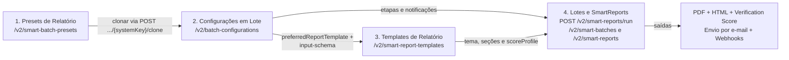

import Tabs from '@theme/Tabs';
import TabItem from '@theme/TabItem';

# SmartReports

O **SmartReports** transforma verificações em várias etapas do catálogo da Verifik (`SmartCheck` + `SmartBatch`) em dossiês estruturados em HTML e PDF com **Verification Scores** automatizados, envio por e-mail e webhooks em tempo real. Você pode criar e inspecionar relatórios no portal **Smart-Agent**, disparar execuções completas pelo seu backend por meio da **API REST Headless** ou conectar assistentes autônomos via **Model Context Protocol (MCP)**.

:::info Isolamento de locatário e autenticação por cliente
Todos os endpoints de SmartReports, Templates, Configurações, Presets e Lotes exigem o seu próprio **Bearer JWT por cliente da Verifik** (`Authorization: Bearer <VERIFIK_JWT>`). A execução pela conta compartilhada x402 é estritamente bloqueada (`403 Forbidden`), e os créditos são cobrados diretamente do saldo da sua conta Verifik por cada etapa de catálogo executada.
:::

---

## Arquitetura e blocos fundamentais

O SmartReports separa **quais verificações executar**, **como os resultados são exibidos** e **como cada execução é entregue**:



| Bloco fundamental | Endpoints principais | Finalidade |
| --- | --- | --- |
| **Presets de Relatório** | `GET /v2/smart-batch-presets`<br />`POST /v2/smart-batch-presets/{systemKey}/clone` | Pacotes integrados da Verifik por país e domínio (`citizen`, `company`, `vehicle`; nível `essential` ou `comprehensive`) com etapas de verificação pré-conectadas, esquemas de entrada e templates com temas. |
| **Configurações em Lote** | `GET / POST / PUT / DELETE /v2/batch-configurations`<br />`GET /v2/batch-configurations/{id}/input-schema` | Receita reutilizável que armazena etapas ordenadas do catálogo, encadeamento entre etapas (`{{results.N.*}}`), `mergeStrategy` (`sequential`, `parallel-independent`, `parallel-with-fallback`), `preferredReportTemplate` e configurações de `notification` (`webhookUrl`, `emailOnCompletion`). |
| **Templates de Relatório** | `GET / POST / PUT / DELETE /v2/smart-report-templates`<br />`POST /v2/smart-report-templates/generate-layout`<br />`POST /v2/smart-report-templates/preview-html`<br />`POST /v2/smart-report-templates/introspect` | Definição visual de layout (`sections[]`, `reportTheme`, fontes personalizadas, marcas d'água, assinatura digital, proteção por senha em PDF e configuração de pontuação). Templates de sistema (`type: "System"`) são somente leitura; templates de cliente (`type: "client"`) são totalmente editáveis. |
| **Lotes e SmartReports** | `POST /v2/smart-reports/run`<br />`/v2/smart-batches`<br />`/v2/smart-reports` | Executa etapas de verificação no servidor via `FeatureRunner`, calcula o `verificationScore` da linha, renderiza HTML e PDF, envia e-mails aos destinatários e dispara eventos de webhook. |

### Como as peças se conectam

1. **Descubra ou clone um preset** com `GET /v2/smart-batch-presets` e `POST /v2/smart-batch-presets/{systemKey}/clone`, ou monte uma `BatchConfiguration` personalizada a partir de quaisquer endpoints do catálogo disponíveis na sua conta.
2. **Inspecione as entradas obrigatórias** via `GET /v2/batch-configurations/{id}/input-schema` (ou pelo objeto `inputSchema` do preset) para obter `requiredFields`, `optionalFields`, `jsonSchema`, `exampleInput` e `estimatedCreditsPerRow`.
3. **Personalize um template** em `/v2/smart-report-templates` usando temas integrados, layouts gerados por IA (`POST /v2/smart-report-templates/generate-layout`), inspeção da paleta de dados (`POST /v2/smart-report-templates/introspect`) e pré-visualizações em HTML ao vivo sem custo de créditos (`POST /v2/smart-report-templates/preview-html`).
4. **Execute e entregue** em uma única chamada headless via `POST /v2/smart-reports/run` (com `systemKey` ou `batchConfigurationId`), ou em alto volume via `/v2/smart-batches` e `/v2/smart-batches/from-file`, seguidos de `/v2/smart-reports/{id}/generate`, `/download`, `/html` e `/send-email`.

---

## Três superfícies de integração

| Superfície | Ponto de entrada | Ideal para |
| --- | --- | --- |
| **Portal Smart-Agent** | `https://ai.verifik.co` | Construtor interativo de templates, galeria de presets, monitoramento de lotes, visualizador de relatórios e o **Developer & AI Agent Kit** integrado (`API & AI Agent` / `API / MCP`). |
| **API REST Headless** | `https://api.verifik.co/v2/...`<br />`https://ai.verifik.co/v2/...` | Serviços de backend, pipelines automatizados de KYC/KYB/frota, geração de PDF orientada a webhooks e lotes de arquivos em alto volume sem nenhuma interface de navegador. |
| **Servidor MCP Streamable HTTP** | `https://ai.verifik.co/mcp`<br />`https://ai.verifik.co/api/mcp` | Agentes de IA autônomos (Claude Desktop, Cursor, Windsurf, ChatGPT Agents e clientes MCP JSON-RPC 2.0 personalizados) chamando diretamente as 10 ferramentas `smart_report_*`. |

:::note Mesmos caminhos `/v2/...` em `api.verifik.co` e `ai.verifik.co`
Você pode chamar `/v2/smart-reports/*`, `/v2/smart-report-templates/*`, `/v2/batch-configurations/*`, `/v2/smart-batches/*` e `/v2/smart-batch-presets/*` diretamente em `https://api.verifik.co` ou através do proxy do Smart-Agent em `https://ai.verifik.co`. Ambos aplicam autenticação idêntica via JWT por cliente.
:::

---

## Modelo de autenticação e faturamento

### Aplicação obrigatória de Bearer JWT por cliente

Todos os endpoints de SmartReports, Template, Batch Configuration, Preset e SmartBatch têm escopo por locatário e exigem um **Bearer JWT da Verifik fornecido pelo chamador**:

```text
Authorization: Bearer <VERIFIK_JWT>
```

- **Proteção do proxy Smart-Agent (`smartReportAuthGuard`)**: Qualquer requisição direcionada a `/v2/smart-reports*`, `/v2/smart-report-templates*`, `/v2/batch-configurations*`, `/v2/smart-batches*` ou `/v2/smart-batch-presets*` (ou equivalentes `/api/...` / `/api/proxy`) sem um Bearer JWT válido por cliente é rejeitada antes do tratamento de pagamento x402 com **HTTP `403 Forbidden`**:

```json
{
  "code": "Forbidden",
  "message": "SmartReports, SmartReportTemplates, BatchConfigurations, and SmartBatches require your own per-client Verifik Bearer JWT. They are not available through the shared x402 account."
}
```

- **Isolamento de locatário no MCP**: Os métodos de descoberta (`initialize`, `ping`, `notifications/initialized`, `tools/list`) funcionam sem credenciais, enquanto `tools/call` exige estritamente o cabeçalho `Authorization: Bearer <VERIFIK_JWT>` por cliente e retorna **HTTP `401`** (JSON-RPC `-32001`) caso esteja ausente ou caso um token de serviço compartilhado seja enviado.
- **Sem `x-payment-info` nas rotas do SmartReports**: Em `https://ai.verifik.co/openapi.json`, as rotas do SmartReports usam segurança `bearerAuth` em vez de cabeçalhos x402 de pagamento por chamada.

### Faturamento baseado em créditos

- **Cobrança por etapa de catálogo**: Os créditos são deduzidos do saldo da sua conta de cliente Verifik quando as etapas de verificação são realmente executadas contra as fontes do catálogo (rastreados no lote via `creditsSpent`).
- **Estimativas antecipadas**: `GET /v2/smart-batch-presets` e `GET /v2/batch-configurations/{id}/input-schema` retornam `estimatedCreditsPerRow` antes que qualquer consulta seja executada.
- **Ações de design e consulta com custo zero de créditos**: Listar presets ou templates, inspecionar esquemas, chamar `/introspect`, `/preview-html`, `/theme-starters`, `/score-profiles`, `/simulated-responses`, obter `/v2/smart-reports/{id}/html`, baixar PDFs e enviar relatórios por e-mail **não** consomem créditos de verificação.
- **Verificação de permissões da conta**: Antes de executar um lote ou `POST /v2/smart-reports/run`, a Verifik verifica se todos os endpoints de etapa habilitados estão ativos na sua conta de cliente (retornando `409 Conflict` com `endpoints_not_in_account` se alguma etapa não estiver disponível).

---

## Verification Score, temas e motores de PDF

### Temas de relatório integrados (`reportTheme.id`)

O SmartReports inclui **4 sistemas de design HTML/PDF com tema** configurados via `reportTheme.id` (com substituições opcionais em `reportTheme.tokens` para cores da marca, tipografia, espaçamento, `logoText` e `logoUrl`):

| ID do tema | Alias | Estilo visual | Paleta padrão |
| --- | --- | --- | --- |
| `premium_dark` | — *(padrão)* | Capa azul-marinho escuro (`#0b1730`), páginas de corpo em pedra quente (`#f7f5f2`), cartões brancos nítidos | Tinta `#122033`, Destaque `#c4b5fd`, Marca `#1e3a5f` |
| `light_cards` | `smart_enroll_v2` | Páginas brancas de alto contraste (`#ffffff`) com cartões claros suaves (`#f3f5f1`) e chips em pílula | Tinta `#0e0f0c`, Destaque `#7145d6`, Marca `#163300` |
| `editorial` | — | Superfície de papel quente (`#fffdf8`), títulos de exibição serifados (`Noto Serif`), rótulos em maiúsculas com espaçamento | Tinta `#1b1a17`, Destaque `#7145d6`, Bordas finas |
| `dashboard` | — | Tela branca limpa com cartões de métricas estruturados (`#f6f7fb`) e raio compacto (`12px`) | Tinta `#111827`, Destaque `#7145d6`, Destaques em violeta suave |

:::tip Alias de tema legado
Templates salvos com `reportTheme: "smart_enroll_v2"` ou `reportTheme.id: "smart_enroll_v2"` são resolvidos automaticamente para `light_cards` no momento da renderização.
:::

### Perfis de Verification Score (`scoreProfile`)

Quando a pontuação está habilitada (`score: true` ou ativada automaticamente por um template com tema), o SmartReports normaliza cada etapa de verificação executada em uma pontuação de `0`–`1` (`score` com 4 casas decimais e `score100` de `0`–`100`), avalia **regras eliminatórias (knockout)** e **cobertura** (mínimo de `90%` para `approve`) e produz um veredito:

- `approve` — pontuação ponderada `0.90–1.00`, cobertura `>= 90%`, todas as verificações críticas respondidas
- `review` — pontuação ponderada `0.70–0.89` (ou achados de revisão não eliminatórios)
- `reject` — pontuação ponderada `< 0.70` ou regra eliminatória ativada disparada
- `pending` — uma verificação crítica não respondeu (por exemplo, timeout/`5xx` na fonte) ou cobertura `< 90%`

Dez perfis de pontuação integrados são suportados (consulte `GET /v2/smart-report-templates/score-profiles` para obter os IDs e rótulos ativos):

| ID do perfil | Rótulo | Aliases | Pesos por categoria (`100%` no total) |
| --- | --- | --- | --- |
| `cabify_driver` *(padrão)* | Integração de motoristas | `driver`, `cabify` | `records` (25), `driving` (25), `identity` (15), `biometrics` (15), `watchlists` (10), `vehicle` (10) |
| `kyc` | KYC genérico | `generic_kyc` | `identity` (25), `biometrics` (25), `watchlists` (25), `records` (20), `contact` (5) |
| `kyb` | KYB | — | `company` (45), `watchlists` (25), `identity` (15), `records` (15) |
| `fleet` | Veículo / frota | `vehicle` | `vehicle` (60), `driving` (15), `identity` (15), `watchlists` (10) |
| `vehicle_purchase` | Compra de veículo / concessionária | `dealer` | `vehicle` (70), `identity` (15), `watchlists` (10), `driving` (5) |
| `identity_lookup` | Somente identidade | `identity_only` | `identity` (100) |
| `background_check` | Triagem de antecedentes | `screening` | `records` (45), `watchlists` (25), `identity` (20), `company` (10) |
| `lending` | Crédito | `credit` | `identity` (40), `records` (25), `supporting` (25), `driving` (10) |
| `healthcare_professional` | Profissional de saúde | `health_professional` | `supporting` (55), `identity` (25), `watchlists` (20) |
| `biometrics` | Biometria | `face` | `biometrics` (70), `identity` (30) |

### Motores de renderização PDF: `puppeteer` vs `pdfkit`

| Motor | Comportamento | Recursos suportados |
| --- | --- | --- |
| `puppeteer` *(padrão)* | Renderiza HTML/CSS completo por meio de um pool de instâncias headless do Chromium. | Todos os 4 temas de relatório, medidores de pontuação SVG e gráficos (`pie`/`bar`), layouts dinâmicos `dataTable` e `keyValueGrid`, fontes personalizadas, marcas d'água de imagem/texto, sobreposições de assinatura e criptografia de PDF por senha. |
| `pdfkit` | Aceito em templates e requisições da API para compatibilidade retroativa, e roteado pela camada de compatibilidade HTML/Puppeteer (`pdf-pdfkit.service.js`). | Templates existentes configurados com `pdfEngine: "pdfkit"` se beneficiam automaticamente de renderização completa de tabelas, marcas d'água e assinaturas sem placeholders degradados. |

---

## Seções da documentação

Explore os guias do SmartReports e as seções de referência da API:

- **Guias e integração**
  - [Guia da API Headless](/verifik-pt/smart-reports/headless-api-guide) — Execução única síncrona/assíncrona, webhooks, polling, receitas personalizadas e tratamento de erros sem a interface visual.
  - [MCP e Agentes de IA](/verifik-pt/smart-reports/mcp-and-ai-agents) — Servidor MCP Streamable HTTP (`https://ai.verifik.co/mcp`), todas as 10 ferramentas `smart_report_*`, descoberta OpenAPI e o **Developer & AI Agent Kit** integrado.
  - [Webhooks do SmartReports](/verifik-pt/resources/smart-reports-webhooks) — Todos os 6 eventos de webhook `smart_batch_*`, esquemas de payload, ordem de resolução de URL e cronograma de tentativas.
- **API de Relatórios**
  - [Executar um Smart Report](/verifik-pt/smart-reports/run-a-smart-report) (`POST /v2/smart-reports/run`) — Execução headless de ponta a ponta.
  - [Listar Smart Reports](/verifik-pt/smart-reports/list-smart-reports) (`GET /v2/smart-reports`)
  - [Criar um Smart Report](/verifik-pt/smart-reports/create-a-smart-report) (`POST /v2/smart-reports`)
  - [Consultar um Smart Report](/verifik-pt/smart-reports/retrieve-a-smart-report) (`GET /v2/smart-reports/{id}`)
  - [Atualizar um Smart Report](/verifik-pt/smart-reports/update-a-smart-report) (`PUT /v2/smart-reports/{id}`)
  - [Excluir um Smart Report](/verifik-pt/smart-reports/delete-a-smart-report) (`DELETE /v2/smart-reports/{id}`)
  - [Gerar PDF de Smart Report](/verifik-pt/smart-reports/generate-smart-report-pdf) (`POST /v2/smart-reports/{id}/generate`)
  - [Baixar PDF do Smart Report](/verifik-pt/smart-reports/download-smart-report-pdf) (`GET /v2/smart-reports/{id}/download`)
  - [Obter HTML do Smart Report](/verifik-pt/smart-reports/retrieve-smart-report-html) (`GET /v2/smart-reports/{id}/html`)
  - [Enviar Smart Report por e-mail](/verifik-pt/smart-reports/send-smart-report-email) (`POST /v2/smart-reports/{id}/send-email`)
- **API de Templates**
  - [Listar templates de relatório](/verifik-pt/smart-reports/list-report-templates) (`GET /v2/smart-report-templates`)
  - [Criar um template de relatório](/verifik-pt/smart-reports/create-a-report-template) (`POST /v2/smart-report-templates`)
  - [Consultar um template de relatório](/verifik-pt/smart-reports/retrieve-a-report-template) (`GET /v2/smart-report-templates/{id}`)
  - [Atualizar um template de relatório](/verifik-pt/smart-reports/update-a-report-template) (`PUT /v2/smart-report-templates/{id}`)
  - [Excluir um template de relatório](/verifik-pt/smart-reports/delete-a-report-template) (`DELETE /v2/smart-report-templates/{id}`)
  - [Gerar layout do template](/verifik-pt/smart-reports/generate-template-layout) (`POST /v2/smart-report-templates/generate-layout`)
  - [Pré-visualizar HTML do template](/verifik-pt/smart-reports/preview-template-html) (`POST /v2/smart-report-templates/preview-html`)
  - [Inspecionar dados de exemplo](/verifik-pt/smart-reports/introspect-sample-data) (`POST /v2/smart-report-templates/introspect`)
  - [Listar temas iniciais](/verifik-pt/smart-reports/list-theme-starters) (`GET /v2/smart-report-templates/theme-starters`)
  - [Listar perfis de pontuação](/verifik-pt/smart-reports/list-score-profiles) (`GET /v2/smart-report-templates/score-profiles`)
  - [Listar respostas simuladas](/verifik-pt/smart-reports/list-simulated-responses) (`GET /v2/smart-report-templates/simulated-responses`)
  - [Consultar uma resposta simulada](/verifik-pt/smart-reports/retrieve-simulated-response) (`GET /v2/smart-report-templates/simulated-responses/{code}`)
  - [Enviar amostra do template](/verifik-pt/smart-reports/send-template-sample) (`POST /v2/smart-report-templates/{id}/send-sample`)
  - [Baixar amostra do template](/verifik-pt/smart-reports/download-template-sample) (`POST /v2/smart-report-templates/{id}/download-sample`)
- **API de Presets e Configurações**
  - [Listar presets de relatório](/verifik-pt/smart-reports/list-report-presets) (`GET /v2/smart-batch-presets`)
  - [Clonar um preset de relatório](/verifik-pt/smart-reports/clone-a-report-preset) (`POST /v2/smart-batch-presets/{systemKey}/clone`)
  - [Listar configurações em lote](/verifik-pt/smart-reports/list-batch-configurations) (`GET /v2/batch-configurations`)
  - [Criar uma configuração em lote](/verifik-pt/smart-reports/create-a-batch-configuration) (`POST /v2/batch-configurations`)
  - [Consultar uma configuração em lote](/verifik-pt/smart-reports/retrieve-a-batch-configuration) (`GET /v2/batch-configurations/{id}`)
  - [Consultar esquema de entrada da configuração](/verifik-pt/smart-reports/retrieve-configuration-input-schema) (`GET /v2/batch-configurations/{id}/input-schema`)
  - [Atualizar uma configuração em lote](/verifik-pt/smart-reports/update-a-batch-configuration) (`PUT /v2/batch-configurations/{id}`)
  - [Excluir uma configuração em lote](/verifik-pt/smart-reports/delete-a-batch-configuration) (`DELETE /v2/batch-configurations/{id}`)
- **API de Execução em Lote**
  - [Listar Smart Batches](/verifik-pt/smart-reports/list-smart-batches) (`GET /v2/smart-batches`)
  - [Criar um Smart Batch](/verifik-pt/smart-reports/create-a-smart-batch) (`POST /v2/smart-batches`)
  - [Criar um Smart Batch a partir de arquivo](/verifik-pt/smart-reports/create-smart-batch-from-file) (`POST /v2/smart-batches/from-file`)
  - [Consultar um Smart Batch](/verifik-pt/smart-reports/retrieve-a-smart-batch) (`GET /v2/smart-batches/{id}`)
  - [Atualizar um Smart Batch](/verifik-pt/smart-reports/update-a-smart-batch) (`PUT /v2/smart-batches/{id}`)
  - [Excluir um Smart Batch](/verifik-pt/smart-reports/delete-a-smart-batch) (`DELETE /v2/smart-batches/{id}`)
  - [SmartBatch](/verifik-pt/smart-batch) — Assistente na interface, modos Async vs Sync e acompanhamento no dashboard.
  - [Chamar endpoints como fila (async)](/verifik-pt/smart-batch/async-queue) — Integração de API `type=queue` para uma linha em `https://async.verifik.co`.
