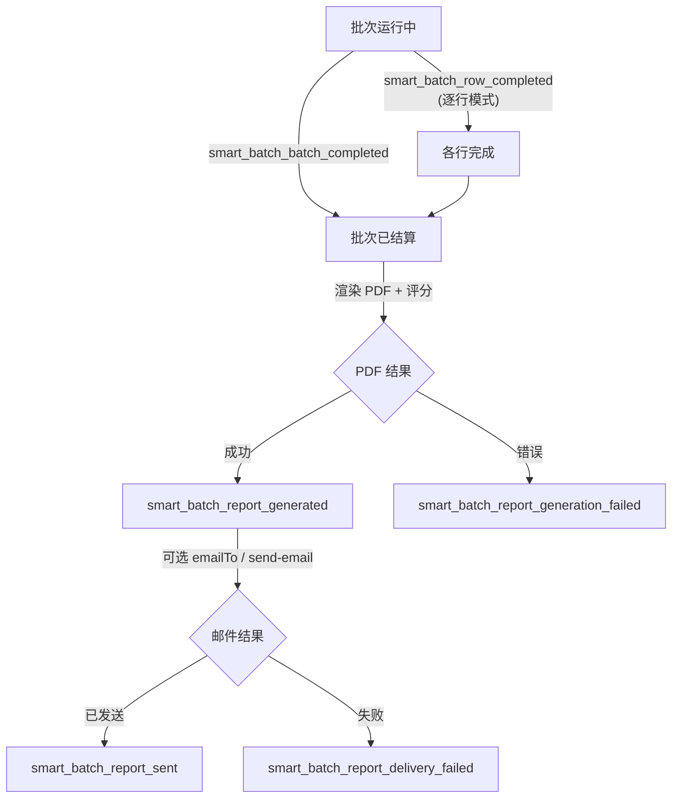

import Tabs from '@theme/Tabs';
import TabItem from '@theme/TabItem';

### 概览

SmartReports 与 SmartBatch 通过 Verifik 统一的 **Webhook** 与 **Smart Monitor** 投递管道（`WebhookEvents`）发送生命周期通知。每当批次中的某一行结算完成、整个批次执行完毕、报告 PDF 渲染成功（或失败）或邮件投递成功（或退信）时，Verifik 都会通过 HTTP `POST` 推送一个带明确类型的 `smart_batch_*` 事件。

:::info HTTP 投递格式与安全性

每次投递均为向你的目标 URL 发起的 HTTP **`POST`** 请求，超时时间为 **`5000 ms`（`5` 秒）**，采用如下 JSON 信封结构：

```json
{
  "type": "smart_batch_report_generated",
  "object": { }
}
```

- **`type`** — 精确的 `smart_batch_*` 事件标识符（如 `smart_batch_report_generated`、`smart_batch_report_sent` 等）。
- **`object`** — 特定事件的负载数据。如存在敏感内部字段（`encryptedOcr` 与 `prompt`），系统会自动将其剔除。
- **无 HMAC 签名头**：`smart_batch_*` 产品投递目前**不会**附带 `x-verifik-signature` 请求头。请务必使用 **HTTPS**，通过在配置的 URL 中加入秘密路径令牌或查询/请求头密钥来保护监听地址，并在触发不可逆的下游操作前，使用 `Authorization: Bearer <VERIFIK_JWT>` 调用 `GET https://api.verifik.co/v2/smart-reports/{id}` 校验 `object.reportId` / `object.batchId` 与 `object.externalRefId`。

请将 `object` 上新增的可选字段视为向后兼容的增量扩展。

:::

---

### 目标 URL 的选择逻辑

目标 URL 的解析取决于事件源自 **SmartReport** 操作还是 **SmartBatch** 执行：

:::tip 目标 URL 解析顺序

1. **报告事件**（`smart_batch_report_generated`、`smart_batch_report_generation_failed`、`smart_batch_report_sent`、`smart_batch_report_delivery_failed`）：
   1. 单份报告 / 单次运行级别的 **`report.webhookUrl`** 覆盖值（在 `POST /v2/smart-reports/run` 或 `POST /v2/smart-reports` 中传入）。
   2. 所属批次 `BatchConfiguration` 上的 **`batchConfiguration.notification.webhookUrl`**。
   3. 若两者均未配置，则**不发送 Webhook**。
2. **批次与行执行事件**（`smart_batch_row_completed`、`smart_batch_batch_completed`）：
   - 若显式传入 `options.webhookUrl` 则优先使用；否则使用 **`batchConfiguration.notification.webhook`** / **`batchConfiguration.notification.webhookUrl`**。
   - *说明*：异步 `FeatureRunner` 运行（`smart-batch-run-sync`）会使用 **`batchConfiguration.notification.webhookUrl`** 发送 `smart_batch_batch_completed` 事件，并在 `object` 中包含 `runId` 与 `creditsSpent`。

解析出 `webhookUrl` 后，Verifik 会自动查找或创建一个启用的客户 `Webhook` 记录（`Smart Batch — <name>`）并关联至该 `BatchConfiguration`，使投递历史显示在 **Smart Monitor** 中。

:::

---

### 投递保障与重试计划

- **成功判定**：你的服务端点必须在 **`5000 ms`** 内返回 HTTP **`2xx`** 响应。建议立即返回 `200 OK`，并将 PDF 下载或数据库写入交给后台任务处理。
- **重试计划**：遇到非 2xx 响应、超时或连接错误时，Verifik 最多调度 **`6` 次重试**，退避时间间隔分别为 **`[60, 60, 120, 120, 360, 720]` 分钟**（1 小时、1 小时、2 小时、2 小时、6 小时、12 小时），并向最近的 10 分钟整点边界对齐。
- **可选的失败/成功通知邮件**：若关联的 `Webhook` 记录配置了 `notification.email` 并启用了 `notification.success` 或 `notification.fail`，Verifik 会在**第 1 次尝试**时发送一封 Mailgun 告警邮件。

---

### 事件生命周期



---

### 事件目录

| 事件 `type` | `object.event` | 触发时机 | 关键 `object` 字段 |
| --- | --- | --- | --- |
| `smart_batch_report_generated` | `"report.generated"` | 报告 PDF 渲染成功时（`POST /v2/smart-reports/run`、`POST /v2/smart-reports/{id}/generate` 或异步批次收尾）。 | `reportId`, `batchId`, `templateId`, `status`, `rowIndex`, `pdfSize`, `pdfEngine`, `generationDurationMs`, `downloadUrl`, `htmlUrl`, `verificationScore`, `externalRefId`, `generatedAt` |
| `smart_batch_report_generation_failed` | `"report.generation_failed"` | 报告 PDF 渲染失败时。 | `reportId`, `batchId`, `templateId`, `status`, `error`, `externalRefId`, `failedAt` |
| `smart_batch_report_sent` | `"report.sent"` | 报告 PDF 邮件投递成功时（通过 `/run` 的 `emailTo` 或 `POST /v2/smart-reports/{id}/send-email`）。 | `reportId`, `batchId`, `templateId`, `status`, `recipients`, `subject`, `messageId`, `downloadUrl`, `htmlUrl`, `externalRefId`, `sentAt` |
| `smart_batch_report_delivery_failed` | `"report.delivery_failed"` | 报告 PDF 邮件投递失败或退信时。 | `reportId`, `batchId`, `templateId`, `status`, `recipients`, `subject`, `messageId`, `error`, `downloadUrl`, `htmlUrl`, `externalRefId`, `sentAt` |
| `smart_batch_batch_completed` | `"batch.completed"` | `SmartBatch` 中的所有行均进入终态（`completed` 或 `failed`）时。 | `batchId`, `runId`, `status`, `creditsSpent`, `stats` |
| `smart_batch_row_completed` | `"row.completed"` | 当批次中所有行尚未全部结束前，某个非末行进入终态（`completed`、`failed` 或 `partial`）时。 | `batchId`, `rowIndex`, `status`, `results`, `errors` |

---

### 事件 Schema 与负载示例

#### 1. `smart_batch_report_generated`

当 SmartReport PDF 渲染完成时触发（`status: "generated"`）。

| 字段 | 类型 | 说明 |
| --- | --- | --- |
| `object.event` | string | 固定为 `"report.generated"`。 |
| `object.reportId` | string | SmartReport ObjectId。 |
| `object.batchId` | string | 关联的 SmartBatch ObjectId。 |
| `object.templateId` | string | 用于渲染 PDF 的 SmartReportTemplate ObjectId。 |
| `object.status` | string | `"generated"`。 |
| `object.rowIndex` | number | 渲染到报告中的从零开始的批次行索引。 |
| `object.pdfSize` | number | 渲染后的 PDF 文件大小（字节）。 |
| `object.pdfEngine` | string | 使用的引擎（`"puppeteer"` 或 `"pdfkit"`）。 |
| `object.generationDurationMs` | number | PDF 渲染耗时（毫秒）。 |
| `object.downloadUrl` | string | 用于获取 PDF 二进制流的相对 API 路径 `/v2/smart-reports/{reportId}/download`。 |
| `object.htmlUrl` | string | 用于获取 HTML + 核验评分 JSON 的相对 API 路径 `/v2/smart-reports/{reportId}/html`。 |
| `object.verificationScore` | object *（可选）* | 启用评分时返回的评分摘要（`score`、`verdict`、`coverage`、`profile`）。 |
| `object.externalRefId` | string *（可选）* | 在 `/run` 或创建报告时传入的调用方关联 ID。 |
| `object.generatedAt` | string (ISO 8601) | 生成完成时间戳。 |

```json
{
  "type": "smart_batch_report_generated",
  "object": {
    "event": "report.generated",
    "reportId": "6740a1b2c3d4e5f678901234",
    "batchId": "6740a1b2c3d4e5f678901111",
    "templateId": "6740a1b2c3d4e5f678902222",
    "status": "generated",
    "rowIndex": 0,
    "pdfSize": 184320,
    "pdfEngine": "puppeteer",
    "generationDurationMs": 1420,
    "downloadUrl": "/v2/smart-reports/6740a1b2c3d4e5f678901234/download",
    "htmlUrl": "/v2/smart-reports/6740a1b2c3d4e5f678901234/html",
    "verificationScore": {
      "score": 0.9625,
      "verdict": "approve",
      "coverage": 1,
      "profile": "cabify_driver"
    },
    "externalRefId": "case-12345",
    "generatedAt": "2026-11-24T20:15:30.120Z"
  }
}
```

#### 2. `smart_batch_report_generation_failed`

当 PDF 生成失败时触发（`status: "failed"`）。

| 字段 | 类型 | 说明 |
| --- | --- | --- |
| `object.event` | string | 固定为 `"report.generation_failed"`。 |
| `object.reportId` | string | SmartReport ObjectId。 |
| `object.batchId` | string | 关联的 SmartBatch ObjectId。 |
| `object.templateId` | string | SmartReportTemplate ObjectId。 |
| `object.status` | string | `"failed"`。 |
| `object.error` | string | 说明渲染中止原因的失败消息。 |
| `object.externalRefId` | string *（可选）* | 如果报告上设置了关联 ID，则返回该调用方关联 ID。 |
| `object.failedAt` | string (ISO 8601) | 失败发生时间戳。 |

```json
{
  "type": "smart_batch_report_generation_failed",
  "object": {
    "event": "report.generation_failed",
    "reportId": "6740a1b2c3d4e5f678901234",
    "batchId": "6740a1b2c3d4e5f678901111",
    "templateId": "6740a1b2c3d4e5f678902222",
    "status": "failed",
    "error": "Chromium page timeout while rendering custom font asset",
    "externalRefId": "case-12345",
    "failedAt": "2026-11-24T20:16:02.450Z"
  }
}
```

#### 3. `smart_batch_report_sent`

当报告邮件投递成功时触发（`status: "sent"`）。

| 字段 | 类型 | 说明 |
| --- | --- | --- |
| `object.event` | string | 固定为 `"report.sent"`。 |
| `object.reportId` | string | SmartReport ObjectId。 |
| `object.batchId` | string | 关联的 SmartBatch ObjectId。 |
| `object.templateId` | string | SmartReportTemplate ObjectId。 |
| `object.status` | string | `"sent"`。 |
| `object.recipients` | string[] | 收件人邮箱地址列表。 |
| `object.subject` | string | 已发送的邮件主题。 |
| `object.messageId` | string | 邮件服务商返回的消息 ID。 |
| `object.downloadUrl` | string | 相对 API 路径 `/v2/smart-reports/{reportId}/download`。 |
| `object.htmlUrl` | string | 相对 API 路径 `/v2/smart-reports/{reportId}/html`。 |
| `object.externalRefId` | string *（可选）* | 如果报告上设置了关联 ID，则返回该调用方关联 ID。 |
| `object.sentAt` | string (ISO 8601) | 邮件投递完成时间戳。 |

```json
{
  "type": "smart_batch_report_sent",
  "object": {
    "event": "report.sent",
    "reportId": "6740a1b2c3d4e5f678901234",
    "batchId": "6740a1b2c3d4e5f678901111",
    "templateId": "6740a1b2c3d4e5f678902222",
    "status": "sent",
    "recipients": ["compliance@yourcompany.com"],
    "subject": "SmartReport: Colombia Citizen Comprehensive — 2026-11-24",
    "messageId": "<20261124201535.1.abc123@mg.verifik.co>",
    "downloadUrl": "/v2/smart-reports/6740a1b2c3d4e5f678901234/download",
    "htmlUrl": "/v2/smart-reports/6740a1b2c3d4e5f678901234/html",
    "externalRefId": "case-12345",
    "sentAt": "2026-11-24T20:15:35.800Z"
  }
}
```

#### 4. `smart_batch_report_delivery_failed`

当报告邮件投递失败时触发（`status: "failed"`），便于你的集成区分“发送失败”和“从未尝试发送”。

| 字段 | 类型 | 说明 |
| --- | --- | --- |
| `object.event` | string | 固定为 `"report.delivery_failed"`。 |
| `object.reportId` | string | SmartReport ObjectId。 |
| `object.batchId` | string | 关联的 SmartBatch ObjectId。 |
| `object.templateId` | string | SmartReportTemplate ObjectId。 |
| `object.status` | string | `"failed"`。 |
| `object.recipients` | string[] | 收件人邮箱地址列表。 |
| `object.subject` | string | 尝试发送的邮件主题。 |
| `object.messageId` | string *（可选）* | 若在失败前由邮件服务商签发，则为该消息 ID。 |
| `object.error` | string | 邮件投递错误信息。 |
| `object.downloadUrl` | string | 相对 API 路径 `/v2/smart-reports/{reportId}/download`。 |
| `object.htmlUrl` | string | 相对 API 路径 `/v2/smart-reports/{reportId}/html`。 |
| `object.externalRefId` | string *（可选）* | 如果报告上设置了关联 ID，则返回该调用方关联 ID。 |
| `object.sentAt` | string (ISO 8601) | 失败发送尝试完成的时间戳。 |

```json
{
  "type": "smart_batch_report_delivery_failed",
  "object": {
    "event": "report.delivery_failed",
    "reportId": "6740a1b2c3d4e5f678901234",
    "batchId": "6740a1b2c3d4e5f678901111",
    "templateId": "6740a1b2c3d4e5f678902222",
    "status": "failed",
    "recipients": ["invalid@nonexistent-domain.test"],
    "subject": "SmartReport: Colombia Citizen Comprehensive — 2026-11-24",
    "messageId": null,
    "error": "Mailgun 400: invalid recipient domain",
    "downloadUrl": "/v2/smart-reports/6740a1b2c3d4e5f678901234/download",
    "htmlUrl": "/v2/smart-reports/6740a1b2c3d4e5f678901234/html",
    "externalRefId": "case-12345",
    "sentAt": "2026-11-24T20:15:36.210Z"
  }
}
```

#### 5. `smart_batch_batch_completed`

当 `SmartBatch` 转换至终态（`"completed"` 或 `"failed"`）时触发一次。

| 字段 | 类型 | 说明 |
| --- | --- | --- |
| `object.event` | string | 固定为 `"batch.completed"`。 |
| `object.batchId` | string | SmartBatch ObjectId。 |
| `object.runId` | string *（可选）* | `FeatureRunner` 运行 ObjectId（在异步 `FeatureRunner` 同步任务中出现）。 |
| `object.status` | string | `"completed"` 或 `"failed"`。 |
| `object.creditsSpent` | number *（可选）* | 该次运行消耗的 Verifik 积分总量（在异步 `FeatureRunner` 同步任务中出现）。 |
| `object.stats` | object | 聚合统计：`{ totalRows, completedRows, failedRows, partialRows }`。 |

```json
{
  "type": "smart_batch_batch_completed",
  "object": {
    "event": "batch.completed",
    "batchId": "6740a1b2c3d4e5f678901111",
    "runId": "6740a1b2c3d4e5f678903333",
    "status": "completed",
    "creditsSpent": 12,
    "stats": {
      "totalRows": 2,
      "completedRows": 2,
      "failedRows": 0,
      "partialRows": 0
    }
  }
}
```

#### 6. `smart_batch_row_completed`

在逐行批次更新流程中，当某一行在批次所有行尚未全部完成前到达终态（`"completed"`、`"failed"` 或 `"partial"`）时触发。

| 字段 | 类型 | 说明 |
| --- | --- | --- |
| `object.event` | string | 固定为 `"row.completed"`。 |
| `object.batchId` | string | SmartBatch ObjectId。 |
| `object.rowIndex` | number | 批次内从零开始的行索引。 |
| `object.status` | string | `"completed"`、`"failed"` 或 `"partial"`。 |
| `object.results` | object | 按步骤序号（step sequence）为键的核验步骤输出映射。 |
| `object.errors` | array | 失败步骤记录的 `{ step, message, code }` 错误列表。 |

```json
{
  "type": "smart_batch_row_completed",
  "object": {
    "event": "row.completed",
    "batchId": "6740a1b2c3d4e5f678901111",
    "rowIndex": 0,
    "status": "completed",
    "results": {
      "1": {
        "fullName": "JUAN CARLOS PEREZ GOMEZ",
        "documentNumber": "123456789"
      }
    },
    "errors": []
  }
}
```

---

### Webhook 接收端示例

以下接收端实现会在 `5` 秒内立即返回确认（`200 OK`）、以幂等方式对重复投递去重、通过 `GET /v2/smart-reports/{id}` 校验报告真实状态，并使用 `Authorization: Bearer <VERIFIK_JWT>` 下载 PDF。

<Tabs>
  <TabItem value="nodejs" label="Node.js (Express)" default>

```javascript
import express from 'express';
import fs from 'node:fs/promises';

const app = express();
app.use(express.json({ limit: '2mb' }));

const VERIFIK_API_URL = 'https://api.verifik.co';
const VERIFIK_JWT = process.env.VERIFIK_JWT;

// Replace with Redis or a unique DB index in production
const processedEvents = new Set();

async function verifyAndDownloadPdf(obj) {
  // Verify the event directly against Verifik API before trusting payload fields
  const metaRes = await fetch(`${VERIFIK_API_URL}/v2/smart-reports/${obj.reportId}`, {
    headers: { Authorization: `Bearer ${VERIFIK_JWT}` },
  });
  if (!metaRes.ok) {
    throw new Error(`Report lookup failed: HTTP ${metaRes.status}`);
  }
  const { data: report } = await metaRes.json();

  const pdfRes = await fetch(`${VERIFIK_API_URL}${obj.downloadUrl}`, {
    headers: { Authorization: `Bearer ${VERIFIK_JWT}` },
  });
  if (!pdfRes.ok) {
    throw new Error(`PDF download failed: HTTP ${pdfRes.status}`);
  }

  const pdfBuffer = Buffer.from(await pdfRes.arrayBuffer());
  const outPath = `./reports/${report.externalRefId || obj.reportId}.pdf`;
  await fs.mkdir('./reports', { recursive: true });
  await fs.writeFile(outPath, pdfBuffer);
  console.log(`Saved ${outPath} (${pdfBuffer.length} bytes), score:`, report.verificationScoreSummary);
}

app.post('/webhooks/verifik-reports', (req, res) => {
  const { type, object: obj } = req.body ?? {};
  if (!type || !obj) {
    return res.status(400).json({ error: 'Invalid webhook payload' });
  }

  const idempotencyKey = `${type}:${obj.reportId || obj.batchId}:${obj.rowIndex ?? ''}:${obj.status || ''}`;
  if (processedEvents.has(idempotencyKey)) {
    return res.status(200).json({ received: true, duplicate: true });
  }
  processedEvents.add(idempotencyKey);

  // Acknowledge within 5 seconds before downloading PDFs or updating downstream systems
  res.status(200).json({ received: true });

  setImmediate(async () => {
    try {
      switch (type) {
        case 'smart_batch_report_generated':
          await verifyAndDownloadPdf(obj);
          break;
        case 'smart_batch_report_generation_failed':
          console.error('Report generation failed:', obj.reportId, obj.externalRefId, obj.error);
          break;
        case 'smart_batch_report_sent':
          console.log('Report emailed:', obj.reportId, obj.recipients, obj.messageId);
          break;
        case 'smart_batch_report_delivery_failed':
          console.error('Email delivery failed:', obj.reportId, obj.recipients, obj.error);
          break;
        case 'smart_batch_batch_completed':
          console.log('Batch settled:', obj.batchId, obj.status, obj.stats, 'credits:', obj.creditsSpent);
          break;
        case 'smart_batch_row_completed':
          console.log('Row completed:', obj.batchId, obj.rowIndex, obj.status);
          break;
        default:
          console.log('Unhandled SmartBatch event:', type);
      }
    } catch (err) {
      console.error('Async webhook handler failed:', err);
    }
  });
});

app.listen(3000, () => console.log('SmartReports webhook listener on :3000'));
```

  </TabItem>
  <TabItem value="python" label="Python (FastAPI)">

```python
import os
from pathlib import Path
import requests
from fastapi import BackgroundTasks, FastAPI, HTTPException, Request

app = FastAPI()

VERIFIK_API_URL = "https://api.verifik.co"
VERIFIK_JWT = os.environ["VERIFIK_JWT"]
PROCESSED_EVENTS: set[str] = set()


def process_smart_report_event(event_type: str, obj: dict) -> None:
    headers = {"Authorization": f"Bearer {VERIFIK_JWT}"}

    if event_type == "smart_batch_report_generated":
        report_id = obj["reportId"]
        # Confirm authentic report state via API
        meta = requests.get(f"{VERIFIK_API_URL}/v2/smart-reports/{report_id}", headers=headers, timeout=30)
        meta.raise_for_status()
        report = meta.json()["data"]

        pdf_resp = requests.get(f"{VERIFIK_API_URL}{obj['downloadUrl']}", headers=headers, timeout=60)
        pdf_resp.raise_for_status()

        out_dir = Path("./reports")
        out_dir.mkdir(parents=True, exist_ok=True)
        filename = f"{report.get('externalRefId') or report_id}.pdf"
        (out_dir / filename).write_bytes(pdf_resp.content)
        print(f"Downloaded {filename} ({len(pdf_resp.content)} bytes)")
    elif event_type == "smart_batch_report_generation_failed":
        print(f"Generation failed for {obj.get('reportId')}: {obj.get('error')}")
    elif event_type == "smart_batch_report_sent":
        print(f"Report {obj.get('reportId')} emailed to {obj.get('recipients')}")
    elif event_type == "smart_batch_report_delivery_failed":
        print(f"Email delivery failed for {obj.get('reportId')}: {obj.get('error')}")
    elif event_type == "smart_batch_batch_completed":
        print(f"Batch {obj.get('batchId')} {obj.get('status')}: {obj.get('stats')}")
    elif event_type == "smart_batch_row_completed":
        print(f"Batch {obj.get('batchId')} row {obj.get('rowIndex')}: {obj.get('status')}")


@app.post("/webhooks/verifik-reports")
async def receive_webhook(request: Request, background_tasks: BackgroundTasks):
    payload = await request.json()
    event_type = payload.get("type")
    obj = payload.get("object")
    if not event_type or not isinstance(obj, dict):
        raise HTTPException(status_code=400, detail="Invalid webhook envelope")

    key = f"{event_type}:{obj.get('reportId') or obj.get('batchId')}:{obj.get('rowIndex', '')}:{obj.get('status', '')}"
    if key in PROCESSED_EVENTS:
        return {"received": True, "duplicate": True}

    PROCESSED_EVENTS.add(key)
    background_tasks.add_task(process_smart_report_event, event_type, obj)
    return {"received": True}
```

  </TabItem>
  <TabItem value="php" label="PHP">

```php
<?php
// webhook-verifik-reports.php
declare(strict_types=1);

$rawBody = file_get_contents('php://input');
$payload = json_decode($rawBody ?: '', true);

if (!is_array($payload) || empty($payload['type']) || !is_array($payload['object'] ?? null)) {
    http_response_code(400);
    header('Content-Type: application/json');
    echo json_encode(['error' => 'Invalid webhook payload']);
    exit;
}

$type = (string) $payload['type'];
$obj = $payload['object'];

// Deduplicate using Redis/database in production
$idempotencyKey = implode(':', [
    $type,
    $obj['reportId'] ?? $obj['batchId'] ?? 'unknown',
    $obj['rowIndex'] ?? '',
    $obj['status'] ?? '',
]);
$lockFile = sys_get_temp_dir() . '/verifik_evt_' . sha1($idempotencyKey) . '.lock';
if (file_exists($lockFile)) {
    http_response_code(200);
    header('Content-Type: application/json');
    echo json_encode(['received' => true, 'duplicate' => true]);
    exit;
}
file_put_contents($lockFile, (string) time());

// Return 200 OK quickly (under 5s) before downloading files
http_response_code(200);
header('Content-Type: application/json');
echo json_encode(['received' => true]);
if (function_exists('fastcgi_finish_request')) {
    fastcgi_finish_request();
}

$jwt = getenv('VERIFIK_JWT') ?: '';
$apiUrl = 'https://api.verifik.co';

if ($type === 'smart_batch_report_generated' && !empty($obj['downloadUrl']) && $jwt !== '') {
    $ch = curl_init($apiUrl . $obj['downloadUrl']);
    curl_setopt_array($ch, [
        CURLOPT_RETURNTRANSFER => true,
        CURLOPT_FOLLOWLOCATION => true,
        CURLOPT_TIMEOUT => 30,
        CURLOPT_HTTPHEADER => ["Authorization: Bearer {$jwt}"],
    ]);
    $pdfBytes = curl_exec($ch);
    $statusCode = curl_getinfo($ch, CURLINFO_HTTP_CODE);
    curl_close($ch);

    if ($statusCode === 200 && $pdfBytes !== false) {
        $ref = preg_replace('/[^a-zA-Z0-9_-]/', '_', (string) ($obj['externalRefId'] ?? $obj['reportId']));
        file_put_contents(__DIR__ . "/report_{$ref}.pdf", $pdfBytes);
    }
}
```

  </TabItem>
  <TabItem value="go" label="Go">

```go
package main

import (
	"encoding/json"
	"fmt"
	"io"
	"log"
	"net/http"
	"os"
	"sync"
	"time"
)

type WebhookEnvelope struct {
	Type   string                 `json:"type"`
	Object map[string]interface{} `json:"object"`
}

var (
	seenMu sync.Mutex
	seen   = map[string]bool{}
)

func stringField(m map[string]interface{}, key string) string {
	if v, ok := m[key].(string); ok {
		return v
	}
	return ""
}

func downloadReportPDF(reportID, downloadPath, externalRefID string) {
	jwt := os.Getenv("VERIFIK_JWT")
	client := &http.Client{Timeout: 45 * time.Second}

	req, err := http.NewRequest(http.MethodGet, "https://api.verifik.co"+downloadPath, nil)
	if err != nil {
		log.Printf("request error: %v", err)
		return
	}
	req.Header.Set("Authorization", "Bearer "+jwt)

	resp, err := client.Do(req)
	if err != nil {
		log.Printf("download failed for %s: %v", reportID, err)
		return
	}
	defer resp.Body.Close()

	if resp.StatusCode != http.StatusOK {
		log.Printf("unexpected download status %d for %s", resp.StatusCode, reportID)
		return
	}

	pdfBytes, err := io.ReadAll(resp.Body)
	if err != nil {
		log.Printf("read error for %s: %v", reportID, err)
		return
	}

	name := externalRefID
	if name == "" {
		name = reportID
	}
	outPath := fmt.Sprintf("report-%s.pdf", name)
	if err := os.WriteFile(outPath, pdfBytes, 0o600); err != nil {
		log.Printf("write error: %v", err)
		return
	}
	log.Printf("saved %s (%d bytes)", outPath, len(pdfBytes))
}

func webhookHandler(w http.ResponseWriter, r *http.Request) {
	if r.Method != http.MethodPost {
		http.Error(w, "method not allowed", http.StatusMethodNotAllowed)
		return
	}

	var env WebhookEnvelope
	if err := json.NewDecoder(r.Body).Decode(&env); err != nil || env.Type == "" || env.Object == nil {
		http.Error(w, "invalid payload", http.StatusBadRequest)
		return
	}

	id := stringField(env.Object, "reportId")
	if id == "" {
		id = stringField(env.Object, "batchId")
	}
	key := fmt.Sprintf("%s:%s:%v:%s", env.Type, id, env.Object["rowIndex"], stringField(env.Object, "status"))

	seenMu.Lock()
	if seen[key] {
		seenMu.Unlock()
		w.WriteHeader(http.StatusOK)
		_, _ = w.Write([]byte(`{"received":true,"duplicate":true}`))
		return
	}
	seen[key] = true
	seenMu.Unlock()

	// Respond 200 OK immediately within 5 seconds
	w.Header().Set("Content-Type", "application/json")
	w.WriteHeader(http.StatusOK)
	_, _ = w.Write([]byte(`{"received":true}`))

	go func(evt WebhookEnvelope) {
		switch evt.Type {
		case "smart_batch_report_generated":
			downloadReportPDF(
				stringField(evt.Object, "reportId"),
				stringField(evt.Object, "downloadUrl"),
				stringField(evt.Object, "externalRefId"),
			)
		case "smart_batch_report_generation_failed":
			log.Printf("generation failed: report=%s err=%s", stringField(evt.Object, "reportId"), stringField(evt.Object, "error"))
		case "smart_batch_report_sent":
			log.Printf("email sent: report=%s msg=%s", stringField(evt.Object, "reportId"), stringField(evt.Object, "messageId"))
		case "smart_batch_report_delivery_failed":
			log.Printf("email failed: report=%s err=%s", stringField(evt.Object, "reportId"), stringField(evt.Object, "error"))
		case "smart_batch_batch_completed":
			log.Printf("batch completed: batch=%s status=%s", stringField(evt.Object, "batchId"), stringField(evt.Object, "status"))
		case "smart_batch_row_completed":
			log.Printf("row completed: batch=%s row=%v status=%s", stringField(evt.Object, "batchId"), evt.Object["rowIndex"], stringField(evt.Object, "status"))
		}
	}(env)
}

func main() {
	http.HandleFunc("/webhooks/verifik-reports", webhookHandler)
	log.Fatal(http.ListenAndServe(":3000", nil))
}
```

  </TabItem>
</Tabs>

---

### 相关页面

- [支持的事件](/resources/supported-events)
- [Webhooks 概览](/resources/webhooks)
- [Webhook 集成](/resources/webhook-integration)
- [无头 API 指南](/verifik-zh/smart-reports/headless-api-guide)
- [运行 Smart Report](/verifik-zh/smart-reports/run-a-smart-report)
- [MCP 与 AI 智能体](/verifik-zh/smart-reports/mcp-and-ai-agents)
