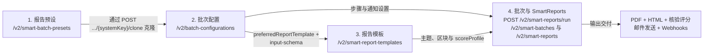

import Tabs from '@theme/Tabs';
import TabItem from '@theme/TabItem';

# SmartReports

**SmartReports** 可将多步骤的 Verifik 目录核验（`SmartCheck` + `SmartBatch`）转换为结构化的 HTML 与 PDF 档案，并自动计算 **核验评分（Verification Scores）**、支持电子邮件发送及实时 Webhook 推送。你可以在 **Smart-Agent** 门户中设计与查看报告、通过 **无头 REST API** 从后端触发端到端执行，或通过 **Model Context Protocol (MCP)** 接入自主 AI 智能体。

:::info 租户隔离与每客户独立身份验证
所有 SmartReports、模板、配置、预设和批次接口均要求使用你自己的 **每客户 Verifik Bearer JWT**（`Authorization: Bearer <VERIFIK_JWT>`）。严禁通过共享 x402 服务账号执行（返回 `403 Forbidden`），且每次执行目录核验步骤时将直接从你的 Verifik 账户余额中扣除积分。
:::

---

## 架构与核心模块

SmartReports 将 **执行哪些核验**、**结果如何呈现** 以及 **每次执行如何交付** 解耦分离：



| 核心模块 | 主要接口 | 用途 |
| --- | --- | --- |
| **报告预设（Report Presets）** | `GET /v2/smart-batch-presets`<br />`POST /v2/smart-batch-presets/{systemKey}/clone` | Verifik 按国家和业务域内置的组合包（`citizen`、`company`、`vehicle`；分为 `essential` 或 `comprehensive` 级别），预先配置好核验步骤、输入 Schema 与主题化模板。 |
| **批次配置（Batch Configurations）** | `GET / POST / PUT / DELETE /v2/batch-configurations`<br />`GET /v2/batch-configurations/{id}/input-schema` | 可复用的核验配方，用于保存有序目录步骤、步骤串联映射（`{{results.N.*}}`）、`mergeStrategy`（`sequential`、`parallel-independent`、`parallel-with-fallback`）、`preferredReportTemplate` 及 `notification` 设置（`webhookUrl`、`emailOnCompletion`）。 |
| **报告模板（Report Templates）** | `GET / POST / PUT / DELETE /v2/smart-report-templates`<br />`POST /v2/smart-report-templates/generate-layout`<br />`POST /v2/smart-report-templates/preview-html`<br />`POST /v2/smart-report-templates/introspect` | 可视化排版定义（`sections[]`、`reportTheme`、自定义字体、水印、数字签名、PDF 密码保护及评分配置）。系统模板（`type: "System"`）为只读；客户模板（`type: "client"`）完全可编辑。 |
| **批次与 SmartReports** | `POST /v2/smart-reports/run`<br />`/v2/smart-batches`<br />`/v2/smart-reports` | 在服务端通过 `FeatureRunner` 执行核验步骤、计算行级 `verificationScore`、渲染 HTML 与 PDF、向收件人发送邮件并分发 Webhook 事件。 |

### 各模块如何协同工作

1. **发现或克隆预设**：通过 `GET /v2/smart-batch-presets` 和 `POST /v2/smart-batch-presets/{systemKey}/clone` 获取内置预设，或基于你账户中任意目录接口创建自定义 `BatchConfiguration`。
2. **检查所需输入**：调用 `GET /v2/batch-configurations/{id}/input-schema`（或查看预设的 `inputSchema` 对象），获取 `requiredFields`、`optionalFields`、`jsonSchema`、`exampleInput` 以及 `estimatedCreditsPerRow`。
3. **定制模板**：在 `/v2/smart-report-templates` 中使用内置主题、AI 生成布局（`POST /v2/smart-report-templates/generate-layout`）、数据字段面板探测（`POST /v2/smart-report-templates/introspect`）以及零积分实时 HTML 预览（`POST /v2/smart-report-templates/preview-html`）。
4. **执行并交付**：既可通过 `POST /v2/smart-reports/run`（传入 `systemKey` 或 `batchConfigurationId`）在单次无头调用中完成全流程，也可通过 `/v2/smart-batches` 和 `/v2/smart-batches/from-file` 处理大批量数据，再调用 `/v2/smart-reports/{id}/generate`、`/download`、`/html` 和 `/send-email`。

---

## 三大集成入口

| 集成入口 | 访问地址 | 适用场景 |
| --- | --- | --- |
| **Smart-Agent 门户** | `https://ai.verifik.co` | 交互式模板编辑器、预设图库、批次监控、报告查看器，以及内置的 **Developer & AI Agent Kit**（`API & AI Agent` / `API / MCP`）。 |
| **无头 REST API** | `https://api.verifik.co/v2/...`<br />`https://ai.verifik.co/v2/...` | 后端服务、自动化 KYC/KYB/车队流水线、基于 Webhook 驱动的 PDF 生成以及无需浏览器界面的大批量文件处理。 |
| **Streamable HTTP MCP 服务器** | `https://ai.verifik.co/mcp`<br />`https://ai.verifik.co/api/mcp` | 自主 AI 智能体（Claude Desktop、Cursor、Windsurf、ChatGPT Agents 及自定义 JSON-RPC 2.0 MCP 客户端）直接调用 10 个 `smart_report_*` 工具。 |

:::note `api.verifik.co` 与 `ai.verifik.co` 上的 `/v2/...` 路径完全相同
你可以直接请求 `https://api.verifik.co`，也可以通过 Smart-Agent 代理 `https://ai.verifik.co` 调用 `/v2/smart-reports/*`、`/v2/smart-report-templates/*`、`/v2/batch-configurations/*`、`/v2/smart-batches/*` 和 `/v2/smart-batch-presets/*`。两者执行完全一致的每客户 JWT 身份验证。
:::

---

## 身份验证与计费模型

### 强制每客户 Bearer JWT 验证

每个 SmartReports、模板、批次配置、预设和 SmartBatch 接口均按租户隔离，必须携带 **调用方提供的 Verifik Bearer JWT**：

```text
Authorization: Bearer <VERIFIK_JWT>
```

- **Smart-Agent 代理守卫（`smartReportAuthGuard`）**：任何访问 `/v2/smart-reports*`、`/v2/smart-report-templates*`、`/v2/batch-configurations*`、`/v2/smart-batches*` 或 `/v2/smart-batch-presets*`（或对应的 `/api/...` / `/api/proxy` 路径）的请求，若未携带有效的每客户 Bearer JWT，将在 x402 支付处理之前直接被拒绝，返回 **HTTP `403 Forbidden`**：

```json
{
  "code": "Forbidden",
  "message": "SmartReports, SmartReportTemplates, BatchConfigurations, and SmartBatches require your own per-client Verifik Bearer JWT. They are not available through the shared x402 account."
}
```

- **MCP 租户隔离**：发现类方法（`initialize`、`ping`、`notifications/initialized`、`tools/list`）无需凭据即可调用，而 `tools/call` 严格要求每客户请求头 `Authorization: Bearer <VERIFIK_JWT>`；若缺失或传入共享服务令牌，则返回 **HTTP `401`**（JSON-RPC `-32001`）。
- **SmartReports 路由无 `x-payment-info`**：在 `https://ai.verifik.co/openapi.json` 中，SmartReports 路由使用 `bearerAuth` 安全方案，而非按次付费的 x402 请求头。

### 基于积分的计费

- **按目录步骤计费**：仅当核验步骤实际向目录数据源发起查询时，才从你的 Verifik 客户账户余额中扣除积分（在批次中通过 `creditsSpent` 记录）。
- **预先费用估算**：在执行任何查询之前，`GET /v2/smart-batch-presets` 和 `GET /v2/batch-configurations/{id}/input-schema` 会返回 `estimatedCreditsPerRow`。
- **零积分设计与读取操作**：列出预设或模板、检查 Schema、调用 `/introspect`、`/preview-html`、`/theme-starters`、`/score-profiles`、`/simulated-responses`、获取 `/v2/smart-reports/{id}/html`、下载 PDF 以及发送报告邮件均**不**消耗核验积分。
- **账户权限校验**：在运行批次或 `POST /v2/smart-reports/run` 前，Verifik 会检查每个已启用的步骤接口是否已在你的客户账户中开通（若有步骤不可用，将返回 `409 Conflict` 及 `endpoints_not_in_account`）。

---

## 核验评分、主题与 PDF 引擎

### 内置报告主题（`reportTheme.id`）

SmartReports 内置 **4 套主题化 HTML/PDF 设计系统**，通过 `reportTheme.id` 配置（并可通过 `reportTheme.tokens` 覆盖品牌配色、字体排版、间距、`logoText` 与 `logoUrl`）：

| 主题 ID | 别名 | 视觉风格 | 默认配色方案 |
| --- | --- | --- | --- |
| `premium_dark` | — *（默认）* | 深海蓝封面（`#0b1730`）、暖石色正文页（`#f7f5f2`）、利落纯白卡片 | 文本 `#122033`、强调色 `#c4b5fd`、标志色 `#1e3a5f` |
| `light_cards` | `smart_enroll_v2` | 高对比度纯白页面（`#ffffff`）、柔和浅色卡片（`#f3f5f1`）与胶囊标签 | 文本 `#0e0f0c`、强调色 `#7145d6`、标志色 `#163300` |
| `editorial` | — | 暖纸质背景（`#fffdf8`）、衬线展示标题（`Noto Serif`）、大字距大写标签 | 文本 `#1b1a17`、强调色 `#7145d6`、极细边框线 |
| `dashboard` | — | 简洁白色画布配结构化指标卡片（`#f6f7fb`）与紧凑圆角（`12px`） | 文本 `#111827`、强调色 `#7145d6`、柔和紫罗兰高亮 |

:::tip 旧版主题别名
使用 `reportTheme: "smart_enroll_v2"` 或 `reportTheme.id: "smart_enroll_v2"` 保存的模板在渲染时会自动解析为 `light_cards`。
:::

### 核验评分配置（`scoreProfile`）

启用评分后（`score: true` 或由主题化模板自动启用），SmartReports 会将每个已执行的核验步骤归一化为 `0`–`1` 之间的分值（保留 4 位小数的 `score` 以及 `0`–`100` 的 `score100`），评估 **一票否决规则（knockout rules）** 与 **覆盖率（coverage）**（`approve` 最低要求 `90%`），并生成最终判定结果：

- `approve` — 加权分值 `0.90–1.00`、覆盖率 `>= 90%`，且所有关键核验项均已返回结果
- `review` — 加权分值 `0.70–0.89`（或存在非一票否决类的复核发现）
- `reject` — 加权分值 `< 0.70` 或触发了已启用的一票否决规则
- `pending` — 某项关键核验未返回结果（例如上游超时/`5xx`）或覆盖率 `< 90%`

系统内置支持 10 种评分配置（调用 `GET /v2/smart-report-templates/score-profiles` 可查询实时 ID 与标签）：

| 配置 ID | 标签 | 别名 | 分类权重（总计 `100%`） |
| --- | --- | --- | --- |
| `cabify_driver` *（默认）* | 司机准入（Driver onboarding） | `driver`, `cabify` | `records` (25), `driving` (25), `identity` (15), `biometrics` (15), `watchlists` (10), `vehicle` (10) |
| `kyc` | 通用 KYC（Generic KYC） | `generic_kyc` | `identity` (25), `biometrics` (25), `watchlists` (25), `records` (20), `contact` (5) |
| `kyb` | KYB | — | `company` (45), `watchlists` (25), `identity` (15), `records` (15) |
| `fleet` | 车辆 / 车队（Vehicle / fleet） | `vehicle` | `vehicle` (60), `driving` (15), `identity` (15), `watchlists` (10) |
| `vehicle_purchase` | 车辆购买 / 经销商（Vehicle purchase / dealer） | `dealer` | `vehicle` (70), `identity` (15), `watchlists` (10), `driving` (5) |
| `identity_lookup` | 仅身份查询（Identity only） | `identity_only` | `identity` (100) |
| `background_check` | 背景调查（Background screening） | `screening` | `records` (45), `watchlists` (25), `identity` (20), `company` (10) |
| `lending` | 信贷（Lending） | `credit` | `identity` (40), `records` (25), `supporting` (25), `driving` (10) |
| `healthcare_professional` | 医疗专业人员（Health professional） | `health_professional` | `supporting` (55), `identity` (25), `watchlists` (20) |
| `biometrics` | 生物特征识别（Biometrics） | `face` | `biometrics` (70), `identity` (30) |

### PDF 渲染引擎：`puppeteer` 与 `pdfkit`

| 引擎 | 行为说明 | 支持特性 |
| --- | --- | --- |
| `puppeteer` *（默认）* | 通过池化无头 Chromium 实例渲染完整 HTML/CSS。 | 支持全部 4 套报告主题、SVG 评分仪表盘与图表（`pie`/`bar`）、动态 `dataTable` 与 `keyValueGrid` 布局、自定义字体、图片/文字水印、签名叠加以及 PDF 密码加密。 |
| `pdfkit` | 在模板与 API 请求中保留用于向后兼容，实际通过 HTML/Puppeteer 兼容垫片（`pdf-pdfkit.service.js`）路由渲染。 | 配置了 `pdfEngine: "pdfkit"` 的既有模板会自动获得完整表格渲染、水印与签名能力，而不会退化为降级占位符。 |

---

## 文档目录

浏览 SmartReports 指南与 API 参考章节：

- **指南与集成**
  - [无头 API 指南](/verifik-zh/smart-reports/headless-api-guide) — 无需 UI 的单次同步/异步执行、Webhook、轮询、自定义配方与错误处理。
  - [MCP 与 AI 智能体](/verifik-zh/smart-reports/mcp-and-ai-agents) — Streamable HTTP MCP 服务器（`https://ai.verifik.co/mcp`）、全部 10 个 `smart_report_*` 工具、OpenAPI 发现以及应用内 **Developer & AI Agent Kit**。
  - [SmartReports Webhooks](/verifik-zh/resources/smart-reports-webhooks) — 全部 6 种 `smart_batch_*` Webhook 事件、负载结构、URL 解析顺序与重试计划。
- **Reports API（报告接口）**
  - [运行 Smart Report](/verifik-zh/smart-reports/run-a-smart-report) (`POST /v2/smart-reports/run`) — 端到端无头执行。
  - [列出 Smart Reports](/verifik-zh/smart-reports/list-smart-reports) (`GET /v2/smart-reports`)
  - [创建 Smart Report](/verifik-zh/smart-reports/create-a-smart-report) (`POST /v2/smart-reports`)
  - [获取 Smart Report](/verifik-zh/smart-reports/retrieve-a-smart-report) (`GET /v2/smart-reports/{id}`)
  - [更新 Smart Report](/verifik-zh/smart-reports/update-a-smart-report) (`PUT /v2/smart-reports/{id}`)
  - [删除 Smart Report](/verifik-zh/smart-reports/delete-a-smart-report) (`DELETE /v2/smart-reports/{id}`)
  - [生成 Smart Report PDF](/verifik-zh/smart-reports/generate-smart-report-pdf) (`POST /v2/smart-reports/{id}/generate`)
  - [下载 Smart Report PDF](/verifik-zh/smart-reports/download-smart-report-pdf) (`GET /v2/smart-reports/{id}/download`)
  - [获取 Smart Report HTML](/verifik-zh/smart-reports/retrieve-smart-report-html) (`GET /v2/smart-reports/{id}/html`)
  - [通过邮件发送 Smart Report](/verifik-zh/smart-reports/send-smart-report-email) (`POST /v2/smart-reports/{id}/send-email`)
- **Templates API（模板接口）**
  - [列出报告模板](/verifik-zh/smart-reports/list-report-templates) (`GET /v2/smart-report-templates`)
  - [创建报告模板](/verifik-zh/smart-reports/create-a-report-template) (`POST /v2/smart-report-templates`)
  - [获取报告模板](/verifik-zh/smart-reports/retrieve-a-report-template) (`GET /v2/smart-report-templates/{id}`)
  - [更新报告模板](/verifik-zh/smart-reports/update-a-report-template) (`PUT /v2/smart-report-templates/{id}`)
  - [删除报告模板](/verifik-zh/smart-reports/delete-a-report-template) (`DELETE /v2/smart-report-templates/{id}`)
  - [生成模板布局](/verifik-zh/smart-reports/generate-template-layout) (`POST /v2/smart-report-templates/generate-layout`)
  - [预览模板 HTML](/verifik-zh/smart-reports/preview-template-html) (`POST /v2/smart-report-templates/preview-html`)
  - [探测示例数据](/verifik-zh/smart-reports/introspect-sample-data) (`POST /v2/smart-report-templates/introspect`)
  - [列出主题起步模板](/verifik-zh/smart-reports/list-theme-starters) (`GET /v2/smart-report-templates/theme-starters`)
  - [列出评分配置](/verifik-zh/smart-reports/list-score-profiles) (`GET /v2/smart-report-templates/score-profiles`)
  - [列出模拟响应](/verifik-zh/smart-reports/list-simulated-responses) (`GET /v2/smart-report-templates/simulated-responses`)
  - [获取模拟响应](/verifik-zh/smart-reports/retrieve-simulated-response) (`GET /v2/smart-report-templates/simulated-responses/{code}`)
  - [发送模板示例](/verifik-zh/smart-reports/send-template-sample) (`POST /v2/smart-report-templates/{id}/send-sample`)
  - [下载模板示例](/verifik-zh/smart-reports/download-template-sample) (`POST /v2/smart-report-templates/{id}/download-sample`)
- **Presets & Configurations API（预设与配置接口）**
  - [列出报告预设](/verifik-zh/smart-reports/list-report-presets) (`GET /v2/smart-batch-presets`)
  - [克隆报告预设](/verifik-zh/smart-reports/clone-a-report-preset) (`POST /v2/smart-batch-presets/{systemKey}/clone`)
  - [列出批次配置](/verifik-zh/smart-reports/list-batch-configurations) (`GET /v2/batch-configurations`)
  - [创建批次配置](/verifik-zh/smart-reports/create-a-batch-configuration) (`POST /v2/batch-configurations`)
  - [获取批次配置](/verifik-zh/smart-reports/retrieve-a-batch-configuration) (`GET /v2/batch-configurations/{id}`)
  - [获取配置输入 Schema](/verifik-zh/smart-reports/retrieve-configuration-input-schema) (`GET /v2/batch-configurations/{id}/input-schema`)
  - [更新批次配置](/verifik-zh/smart-reports/update-a-batch-configuration) (`PUT /v2/batch-configurations/{id}`)
  - [删除批次配置](/verifik-zh/smart-reports/delete-a-batch-configuration) (`DELETE /v2/batch-configurations/{id}`)
- **Batch Execution API（批次执行接口）**
  - [列出 Smart Batches](/verifik-zh/smart-reports/list-smart-batches) (`GET /v2/smart-batches`)
  - [创建 Smart Batch](/verifik-zh/smart-reports/create-a-smart-batch) (`POST /v2/smart-batches`)
  - [从文件创建 Smart Batch](/verifik-zh/smart-reports/create-smart-batch-from-file) (`POST /v2/smart-batches/from-file`)
  - [获取 Smart Batch](/verifik-zh/smart-reports/retrieve-a-smart-batch) (`GET /v2/smart-batches/{id}`)
  - [更新 Smart Batch](/verifik-zh/smart-reports/update-a-smart-batch) (`PUT /v2/smart-batches/{id}`)
  - [删除 Smart Batch](/verifik-zh/smart-reports/delete-a-smart-batch) (`DELETE /v2/smart-batches/{id}`)
  - [SmartBatch](/verifik-zh/smart-batch) — UI 向导、Async 与 Sync 模式以及仪表盘追踪。
  - [以队列方式调用接口 (async)](/verifik-zh/smart-batch/async-queue) — 在 `https://async.verifik.co` 上进行的单行 `type=queue` API 集成。
