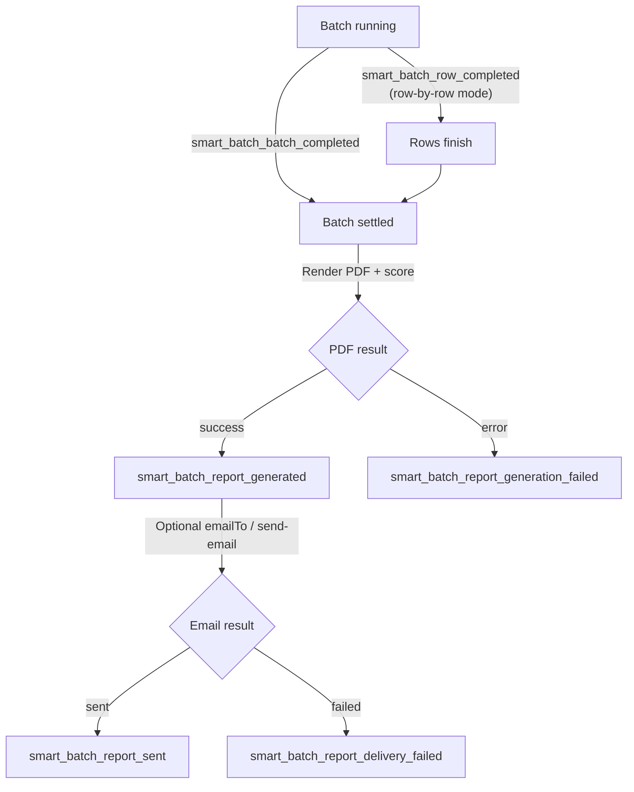

import Tabs from '@theme/Tabs';
import TabItem from '@theme/TabItem';

### Overview

SmartReports and SmartBatch deliver lifecycle notifications over Verifik's shared **Webhook** and **Smart Monitor** delivery pipeline (`WebhookEvents`). Whenever a batch row settles, a batch completes, a report PDF finishes rendering (or fails), or an email delivery succeeds (or bounces), Verifik dispatches a typed `smart_batch_*` event via HTTP `POST`.

:::info HTTP delivery format & security

Every delivery is an HTTP **`POST`** to your target URL with a **`5000 ms` (`5` second)** timeout and JSON envelope:

```json
{
  "type": "smart_batch_report_generated",
  "object": { }
}
```

- **`type`** — Exact `smart_batch_*` event identifier (`smart_batch_report_generated`, `smart_batch_report_sent`, etc.).
- **`object`** — Event-specific payload. Sensitive internal fields (`encryptedOcr` and `prompt`) are stripped if present.
- **No HMAC signature header**: `smart_batch_*` product deliveries do **not** currently send an `x-verifik-signature` header. Always use **HTTPS**, protect your listener URL with a secret path token or query/header secret on your configured URL, and validate `object.reportId` / `object.batchId` and `object.externalRefId` against `GET https://api.verifik.co/v2/smart-reports/{id}` (using `Authorization: Bearer <VERIFIK_JWT>`) before triggering irreversible downstream actions.

Treat new optional fields on `object` as additive.

:::

---

### How the target URL is chosen

Target URL resolution depends on whether the event originates from a **SmartReport** operation or a **SmartBatch** execution:

:::tip Target URL resolution order

1. **Report events** (`smart_batch_report_generated`, `smart_batch_report_generation_failed`, `smart_batch_report_sent`, `smart_batch_report_delivery_failed`):
   1. Per-report / per-run **`report.webhookUrl`** override (passed in `POST /v2/smart-reports/run` or `POST /v2/smart-reports`).
   2. **`batchConfiguration.notification.webhookUrl`** on the batch's `BatchConfiguration`.
   3. If neither exists, **no webhook is sent**.
2. **Batch and row execution events** (`smart_batch_row_completed`, `smart_batch_batch_completed`):
   - Uses `options.webhookUrl` when explicitly passed, or **`batchConfiguration.notification.webhook`** / **`batchConfiguration.notification.webhookUrl`**.
   - *Note*: Async `FeatureRunner` runs (`smart-batch-run-sync`) emit `smart_batch_batch_completed` using **`batchConfiguration.notification.webhookUrl`** and include `runId` and `creditsSpent` in `object`.

When a `webhookUrl` is resolved, Verifik automatically looks up or creates an active client `Webhook` record (`Smart Batch — <name>`) and links the `BatchConfiguration` so delivery history appears in **Smart Monitor**.

:::

---

### Delivery guarantees & retry schedule

- **Success criteria**: Your endpoint must return an HTTP **`2xx`** response within **`5000 ms`**. Return `200 OK` immediately and offload PDF downloads or database writes to a background worker.
- **Retry schedule**: On non-2xx responses, timeouts, or connection errors, Verifik schedules up to **`6` retry attempts** using the backoff intervals **`[60, 60, 120, 120, 360, 720]` minutes** (1h, 1h, 2h, 2h, 6h, 12h), rounded to the nearest 10-minute boundary.
- **Optional failure/success notification emails**: If the linked `Webhook` record configures `notification.email` and enables `notification.success` or `notification.fail`, Verifik sends a Mailgun alert on **attempt 1**.

---

### Event lifecycle



---

### Event Catalog

| Event `type` | `object.event` | When it fires | Key `object` fields |
| --- | --- | --- | --- |
| `smart_batch_report_generated` | `"report.generated"` | Report PDF rendering succeeds (`POST /v2/smart-reports/run`, `POST /v2/smart-reports/{id}/generate`, or async batch finalization). | `reportId`, `batchId`, `templateId`, `status`, `rowIndex`, `pdfSize`, `pdfEngine`, `generationDurationMs`, `downloadUrl`, `htmlUrl`, `verificationScore`, `externalRefId`, `generatedAt` |
| `smart_batch_report_generation_failed` | `"report.generation_failed"` | Report PDF rendering fails. | `reportId`, `batchId`, `templateId`, `status`, `error`, `externalRefId`, `failedAt` |
| `smart_batch_report_sent` | `"report.sent"` | Report PDF email delivery succeeds (`emailTo` on `/run` or `POST /v2/smart-reports/{id}/send-email`). | `reportId`, `batchId`, `templateId`, `status`, `recipients`, `subject`, `messageId`, `downloadUrl`, `htmlUrl`, `externalRefId`, `sentAt` |
| `smart_batch_report_delivery_failed` | `"report.delivery_failed"` | Report PDF email delivery fails or bounces. | `reportId`, `batchId`, `templateId`, `status`, `recipients`, `subject`, `messageId`, `error`, `downloadUrl`, `htmlUrl`, `externalRefId`, `sentAt` |
| `smart_batch_batch_completed` | `"batch.completed"` | All rows in a `SmartBatch` reach a terminal state (`completed` or `failed`). | `batchId`, `runId`, `status`, `creditsSpent`, `stats` |
| `smart_batch_row_completed` | `"row.completed"` | A non-final row in a `SmartBatch` reaches a terminal status (`completed`, `failed`, or `partial`). | `batchId`, `rowIndex`, `status`, `results`, `errors` |

---

### Event schemas & payload examples

#### 1. `smart_batch_report_generated`

Fired when a SmartReport PDF finishes rendering (`status: "generated"`).

| Field | Type | Description |
| --- | --- | --- |
| `object.event` | string | Always `"report.generated"`. |
| `object.reportId` | string | SmartReport ObjectId. |
| `object.batchId` | string | Associated SmartBatch ObjectId. |
| `object.templateId` | string | SmartReportTemplate ObjectId used to render the PDF. |
| `object.status` | string | `"generated"`. |
| `object.rowIndex` | number | Zero-based batch row index rendered into the report. |
| `object.pdfSize` | number | Rendered PDF file size in bytes. |
| `object.pdfEngine` | string | Engine used (`"puppeteer"` or `"pdfkit"`). |
| `object.generationDurationMs` | number | PDF rendering duration in milliseconds. |
| `object.downloadUrl` | string | Relative API path `/v2/smart-reports/{reportId}/download` to fetch the PDF binary. |
| `object.htmlUrl` | string | Relative API path `/v2/smart-reports/{reportId}/html` to fetch HTML + Verification Score JSON. |
| `object.verificationScore` | object *(optional)* | Score summary (`score`, `verdict`, `coverage`, `profile`) when scoring is enabled. |
| `object.externalRefId` | string *(optional)* | Caller correlation ID passed on `/run` or report creation. |
| `object.generatedAt` | string (ISO 8601) | Timestamp when generation completed. |

```json
{
  "type": "smart_batch_report_generated",
  "object": {
    "event": "report.generated",
    "reportId": "6740a1b2c3d4e5f678901234",
    "batchId": "6740a1b2c3d4e5f678901111",
    "templateId": "6740a1b2c3d4e5f678902222",
    "status": "generated",
    "rowIndex": 0,
    "pdfSize": 184320,
    "pdfEngine": "puppeteer",
    "generationDurationMs": 1420,
    "downloadUrl": "/v2/smart-reports/6740a1b2c3d4e5f678901234/download",
    "htmlUrl": "/v2/smart-reports/6740a1b2c3d4e5f678901234/html",
    "verificationScore": {
      "score": 0.9625,
      "verdict": "approve",
      "coverage": 1,
      "profile": "cabify_driver"
    },
    "externalRefId": "case-12345",
    "generatedAt": "2026-11-24T20:15:30.120Z"
  }
}
```

#### 2. `smart_batch_report_generation_failed`

Fired when PDF generation fails (`status: "failed"`).

| Field | Type | Description |
| --- | --- | --- |
| `object.event` | string | Always `"report.generation_failed"`. |
| `object.reportId` | string | SmartReport ObjectId. |
| `object.batchId` | string | Associated SmartBatch ObjectId. |
| `object.templateId` | string | SmartReportTemplate ObjectId. |
| `object.status` | string | `"failed"`. |
| `object.error` | string | Failure message describing why rendering aborted. |
| `object.externalRefId` | string *(optional)* | Caller correlation ID if present on the report. |
| `object.failedAt` | string (ISO 8601) | Timestamp when failure occurred. |

```json
{
  "type": "smart_batch_report_generation_failed",
  "object": {
    "event": "report.generation_failed",
    "reportId": "6740a1b2c3d4e5f678901234",
    "batchId": "6740a1b2c3d4e5f678901111",
    "templateId": "6740a1b2c3d4e5f678902222",
    "status": "failed",
    "error": "Chromium page timeout while rendering custom font asset",
    "externalRefId": "case-12345",
    "failedAt": "2026-11-24T20:16:02.450Z"
  }
}
```

#### 3. `smart_batch_report_sent`

Fired when report email delivery succeeds (`status: "sent"`).

| Field | Type | Description |
| --- | --- | --- |
| `object.event` | string | Always `"report.sent"`. |
| `object.reportId` | string | SmartReport ObjectId. |
| `object.batchId` | string | Associated SmartBatch ObjectId. |
| `object.templateId` | string | SmartReportTemplate ObjectId. |
| `object.status` | string | `"sent"`. |
| `object.recipients` | string[] | Recipient email addresses. |
| `object.subject` | string | Email subject line sent. |
| `object.messageId` | string | Mail provider message ID. |
| `object.downloadUrl` | string | Relative API path `/v2/smart-reports/{reportId}/download`. |
| `object.htmlUrl` | string | Relative API path `/v2/smart-reports/{reportId}/html`. |
| `object.externalRefId` | string *(optional)* | Caller correlation ID if present on the report. |
| `object.sentAt` | string (ISO 8601) | Timestamp when email dispatch completed. |

```json
{
  "type": "smart_batch_report_sent",
  "object": {
    "event": "report.sent",
    "reportId": "6740a1b2c3d4e5f678901234",
    "batchId": "6740a1b2c3d4e5f678901111",
    "templateId": "6740a1b2c3d4e5f678902222",
    "status": "sent",
    "recipients": ["compliance@yourcompany.com"],
    "subject": "SmartReport: Colombia Citizen Comprehensive — 2026-11-24",
    "messageId": "<20261124201535.1.abc123@mg.verifik.co>",
    "downloadUrl": "/v2/smart-reports/6740a1b2c3d4e5f678901234/download",
    "htmlUrl": "/v2/smart-reports/6740a1b2c3d4e5f678901234/html",
    "externalRefId": "case-12345",
    "sentAt": "2026-11-24T20:15:35.800Z"
  }
}
```

#### 4. `smart_batch_report_delivery_failed`

Fired when report email delivery fails (`status: "failed"`), so your integration can distinguish a failed send from one that was never attempted.

| Field | Type | Description |
| --- | --- | --- |
| `object.event` | string | Always `"report.delivery_failed"`. |
| `object.reportId` | string | SmartReport ObjectId. |
| `object.batchId` | string | Associated SmartBatch ObjectId. |
| `object.templateId` | string | SmartReportTemplate ObjectId. |
| `object.status` | string | `"failed"`. |
| `object.recipients` | string[] | Recipient email addresses. |
| `object.subject` | string | Email subject line attempted. |
| `object.messageId` | string *(optional)* | Mail provider message ID if issued prior to failure. |
| `object.error` | string | Email delivery error message. |
| `object.downloadUrl` | string | Relative API path `/v2/smart-reports/{reportId}/download`. |
| `object.htmlUrl` | string | Relative API path `/v2/smart-reports/{reportId}/html`. |
| `object.externalRefId` | string *(optional)* | Caller correlation ID if present on the report. |
| `object.sentAt` | string (ISO 8601) | Timestamp when the failed send attempt completed. |

```json
{
  "type": "smart_batch_report_delivery_failed",
  "object": {
    "event": "report.delivery_failed",
    "reportId": "6740a1b2c3d4e5f678901234",
    "batchId": "6740a1b2c3d4e5f678901111",
    "templateId": "6740a1b2c3d4e5f678902222",
    "status": "failed",
    "recipients": ["invalid@nonexistent-domain.test"],
    "subject": "SmartReport: Colombia Citizen Comprehensive — 2026-11-24",
    "messageId": null,
    "error": "Mailgun 400: invalid recipient domain",
    "downloadUrl": "/v2/smart-reports/6740a1b2c3d4e5f678901234/download",
    "htmlUrl": "/v2/smart-reports/6740a1b2c3d4e5f678901234/html",
    "externalRefId": "case-12345",
    "sentAt": "2026-11-24T20:15:36.210Z"
  }
}
```

#### 5. `smart_batch_batch_completed`

Fired once when a `SmartBatch` transitions to a terminal state (`"completed"` or `"failed"`).

| Field | Type | Description |
| --- | --- | --- |
| `object.event` | string | Always `"batch.completed"`. |
| `object.batchId` | string | SmartBatch ObjectId. |
| `object.runId` | string *(optional)* | `FeatureRunner` run ObjectId (present on async `FeatureRunner` syncs). |
| `object.status` | string | `"completed"` or `"failed"`. |
| `object.creditsSpent` | number *(optional)* | Total Verifik credits spent by the run (present on async `FeatureRunner` syncs). |
| `object.stats` | object | Aggregate counts: `{ totalRows, completedRows, failedRows, partialRows }`. |

```json
{
  "type": "smart_batch_batch_completed",
  "object": {
    "event": "batch.completed",
    "batchId": "6740a1b2c3d4e5f678901111",
    "runId": "6740a1b2c3d4e5f678903333",
    "status": "completed",
    "creditsSpent": 12,
    "stats": {
      "totalRows": 2,
      "completedRows": 2,
      "failedRows": 0,
      "partialRows": 0
    }
  }
}
```

#### 6. `smart_batch_row_completed`

Fired in row-by-row batch update flows when a row reaches a terminal state (`"completed"`, `"failed"`, or `"partial"`) before all rows in the batch are done.

| Field | Type | Description |
| --- | --- | --- |
| `object.event` | string | Always `"row.completed"`. |
| `object.batchId` | string | SmartBatch ObjectId. |
| `object.rowIndex` | number | Zero-based row index within the batch. |
| `object.status` | string | `"completed"`, `"failed"`, or `"partial"`. |
| `object.results` | object | Map of verification step outputs keyed by step sequence. |
| `object.errors` | array | List of `{ step, message, code }` errors recorded for failed steps. |

```json
{
  "type": "smart_batch_row_completed",
  "object": {
    "event": "row.completed",
    "batchId": "6740a1b2c3d4e5f678901111",
    "rowIndex": 0,
    "status": "completed",
    "results": {
      "1": {
        "fullName": "JUAN CARLOS PEREZ GOMEZ",
        "documentNumber": "123456789"
      }
    },
    "errors": []
  }
}
```

---

### Webhook receiver examples

The receiver implementations below acknowledge requests immediately within `5` seconds (`200 OK`), deduplicate repeated deliveries idempotently, verify the report via `GET /v2/smart-reports/{id}`, and download the PDF using `Authorization: Bearer <VERIFIK_JWT>`.

<Tabs>
  <TabItem value="nodejs" label="Node.js (Express)" default>

```javascript
import express from 'express';
import fs from 'node:fs/promises';

const app = express();
app.use(express.json({ limit: '2mb' }));

const VERIFIK_API_URL = 'https://api.verifik.co';
const VERIFIK_JWT = process.env.VERIFIK_JWT;

// Replace with Redis or a unique DB index in production
const processedEvents = new Set();

async function verifyAndDownloadPdf(obj) {
  // Verify the event directly against Verifik API before trusting payload fields
  const metaRes = await fetch(`${VERIFIK_API_URL}/v2/smart-reports/${obj.reportId}`, {
    headers: { Authorization: `Bearer ${VERIFIK_JWT}` },
  });
  if (!metaRes.ok) {
    throw new Error(`Report lookup failed: HTTP ${metaRes.status}`);
  }
  const { data: report } = await metaRes.json();

  const pdfRes = await fetch(`${VERIFIK_API_URL}${obj.downloadUrl}`, {
    headers: { Authorization: `Bearer ${VERIFIK_JWT}` },
  });
  if (!pdfRes.ok) {
    throw new Error(`PDF download failed: HTTP ${pdfRes.status}`);
  }

  const pdfBuffer = Buffer.from(await pdfRes.arrayBuffer());
  const outPath = `./reports/${report.externalRefId || obj.reportId}.pdf`;
  await fs.mkdir('./reports', { recursive: true });
  await fs.writeFile(outPath, pdfBuffer);
  console.log(`Saved ${outPath} (${pdfBuffer.length} bytes), score:`, report.verificationScoreSummary);
}

app.post('/webhooks/verifik-reports', (req, res) => {
  const { type, object: obj } = req.body ?? {};
  if (!type || !obj) {
    return res.status(400).json({ error: 'Invalid webhook payload' });
  }

  const idempotencyKey = `${type}:${obj.reportId || obj.batchId}:${obj.rowIndex ?? ''}:${obj.status || ''}`;
  if (processedEvents.has(idempotencyKey)) {
    return res.status(200).json({ received: true, duplicate: true });
  }
  processedEvents.add(idempotencyKey);

  // Acknowledge within 5 seconds before downloading PDFs or updating downstream systems
  res.status(200).json({ received: true });

  setImmediate(async () => {
    try {
      switch (type) {
        case 'smart_batch_report_generated':
          await verifyAndDownloadPdf(obj);
          break;
        case 'smart_batch_report_generation_failed':
          console.error('Report generation failed:', obj.reportId, obj.externalRefId, obj.error);
          break;
        case 'smart_batch_report_sent':
          console.log('Report emailed:', obj.reportId, obj.recipients, obj.messageId);
          break;
        case 'smart_batch_report_delivery_failed':
          console.error('Email delivery failed:', obj.reportId, obj.recipients, obj.error);
          break;
        case 'smart_batch_batch_completed':
          console.log('Batch settled:', obj.batchId, obj.status, obj.stats, 'credits:', obj.creditsSpent);
          break;
        case 'smart_batch_row_completed':
          console.log('Row completed:', obj.batchId, obj.rowIndex, obj.status);
          break;
        default:
          console.log('Unhandled SmartBatch event:', type);
      }
    } catch (err) {
      console.error('Async webhook handler failed:', err);
    }
  });
});

app.listen(3000, () => console.log('SmartReports webhook listener on :3000'));
```

  </TabItem>
  <TabItem value="python" label="Python (FastAPI)">

```python
import os
from pathlib import Path
import requests
from fastapi import BackgroundTasks, FastAPI, HTTPException, Request

app = FastAPI()

VERIFIK_API_URL = "https://api.verifik.co"
VERIFIK_JWT = os.environ["VERIFIK_JWT"]
PROCESSED_EVENTS: set[str] = set()


def process_smart_report_event(event_type: str, obj: dict) -> None:
    headers = {"Authorization": f"Bearer {VERIFIK_JWT}"}

    if event_type == "smart_batch_report_generated":
        report_id = obj["reportId"]
        # Confirm authentic report state via API
        meta = requests.get(f"{VERIFIK_API_URL}/v2/smart-reports/{report_id}", headers=headers, timeout=30)
        meta.raise_for_status()
        report = meta.json()["data"]

        pdf_resp = requests.get(f"{VERIFIK_API_URL}{obj['downloadUrl']}", headers=headers, timeout=60)
        pdf_resp.raise_for_status()

        out_dir = Path("./reports")
        out_dir.mkdir(parents=True, exist_ok=True)
        filename = f"{report.get('externalRefId') or report_id}.pdf"
        (out_dir / filename).write_bytes(pdf_resp.content)
        print(f"Downloaded {filename} ({len(pdf_resp.content)} bytes)")
    elif event_type == "smart_batch_report_generation_failed":
        print(f"Generation failed for {obj.get('reportId')}: {obj.get('error')}")
    elif event_type == "smart_batch_report_sent":
        print(f"Report {obj.get('reportId')} emailed to {obj.get('recipients')}")
    elif event_type == "smart_batch_report_delivery_failed":
        print(f"Email delivery failed for {obj.get('reportId')}: {obj.get('error')}")
    elif event_type == "smart_batch_batch_completed":
        print(f"Batch {obj.get('batchId')} {obj.get('status')}: {obj.get('stats')}")
    elif event_type == "smart_batch_row_completed":
        print(f"Batch {obj.get('batchId')} row {obj.get('rowIndex')}: {obj.get('status')}")


@app.post("/webhooks/verifik-reports")
async def receive_webhook(request: Request, background_tasks: BackgroundTasks):
    payload = await request.json()
    event_type = payload.get("type")
    obj = payload.get("object")
    if not event_type or not isinstance(obj, dict):
        raise HTTPException(status_code=400, detail="Invalid webhook envelope")

    key = f"{event_type}:{obj.get('reportId') or obj.get('batchId')}:{obj.get('rowIndex', '')}:{obj.get('status', '')}"
    if key in PROCESSED_EVENTS:
        return {"received": True, "duplicate": True}

    PROCESSED_EVENTS.add(key)
    background_tasks.add_task(process_smart_report_event, event_type, obj)
    return {"received": True}
```

  </TabItem>
  <TabItem value="php" label="PHP">

```php
<?php
// webhook-verifik-reports.php
declare(strict_types=1);

$rawBody = file_get_contents('php://input');
$payload = json_decode($rawBody ?: '', true);

if (!is_array($payload) || empty($payload['type']) || !is_array($payload['object'] ?? null)) {
    http_response_code(400);
    header('Content-Type: application/json');
    echo json_encode(['error' => 'Invalid webhook payload']);
    exit;
}

$type = (string) $payload['type'];
$obj = $payload['object'];

// Deduplicate using Redis/database in production
$idempotencyKey = implode(':', [
    $type,
    $obj['reportId'] ?? $obj['batchId'] ?? 'unknown',
    $obj['rowIndex'] ?? '',
    $obj['status'] ?? '',
]);
$lockFile = sys_get_temp_dir() . '/verifik_evt_' . sha1($idempotencyKey) . '.lock';
if (file_exists($lockFile)) {
    http_response_code(200);
    header('Content-Type: application/json');
    echo json_encode(['received' => true, 'duplicate' => true]);
    exit;
}
file_put_contents($lockFile, (string) time());

// Return 200 OK quickly (under 5s) before downloading files
http_response_code(200);
header('Content-Type: application/json');
echo json_encode(['received' => true]);
if (function_exists('fastcgi_finish_request')) {
    fastcgi_finish_request();
}

$jwt = getenv('VERIFIK_JWT') ?: '';
$apiUrl = 'https://api.verifik.co';

if ($type === 'smart_batch_report_generated' && !empty($obj['downloadUrl']) && $jwt !== '') {
    $ch = curl_init($apiUrl . $obj['downloadUrl']);
    curl_setopt_array($ch, [
        CURLOPT_RETURNTRANSFER => true,
        CURLOPT_FOLLOWLOCATION => true,
        CURLOPT_TIMEOUT => 30,
        CURLOPT_HTTPHEADER => ["Authorization: Bearer {$jwt}"],
    ]);
    $pdfBytes = curl_exec($ch);
    $statusCode = curl_getinfo($ch, CURLINFO_HTTP_CODE);
    curl_close($ch);

    if ($statusCode === 200 && $pdfBytes !== false) {
        $ref = preg_replace('/[^a-zA-Z0-9_-]/', '_', (string) ($obj['externalRefId'] ?? $obj['reportId']));
        file_put_contents(__DIR__ . "/report_{$ref}.pdf", $pdfBytes);
    }
}
```

  </TabItem>
  <TabItem value="go" label="Go">

```go
package main

import (
	"encoding/json"
	"fmt"
	"io"
	"log"
	"net/http"
	"os"
	"sync"
	"time"
)

type WebhookEnvelope struct {
	Type   string                 `json:"type"`
	Object map[string]interface{} `json:"object"`
}

var (
	seenMu sync.Mutex
	seen   = map[string]bool{}
)

func stringField(m map[string]interface{}, key string) string {
	if v, ok := m[key].(string); ok {
		return v
	}
	return ""
}

func downloadReportPDF(reportID, downloadPath, externalRefID string) {
	jwt := os.Getenv("VERIFIK_JWT")
	client := &http.Client{Timeout: 45 * time.Second}

	req, err := http.NewRequest(http.MethodGet, "https://api.verifik.co"+downloadPath, nil)
	if err != nil {
		log.Printf("request error: %v", err)
		return
	}
	req.Header.Set("Authorization", "Bearer "+jwt)

	resp, err := client.Do(req)
	if err != nil {
		log.Printf("download failed for %s: %v", reportID, err)
		return
	}
	defer resp.Body.Close()

	if resp.StatusCode != http.StatusOK {
		log.Printf("unexpected download status %d for %s", resp.StatusCode, reportID)
		return
	}

	pdfBytes, err := io.ReadAll(resp.Body)
	if err != nil {
		log.Printf("read error for %s: %v", reportID, err)
		return
	}

	name := externalRefID
	if name == "" {
		name = reportID
	}
	outPath := fmt.Sprintf("report-%s.pdf", name)
	if err := os.WriteFile(outPath, pdfBytes, 0o600); err != nil {
		log.Printf("write error: %v", err)
		return
	}
	log.Printf("saved %s (%d bytes)", outPath, len(pdfBytes))
}

func webhookHandler(w http.ResponseWriter, r *http.Request) {
	if r.Method != http.MethodPost {
		http.Error(w, "method not allowed", http.StatusMethodNotAllowed)
		return
	}

	var env WebhookEnvelope
	if err := json.NewDecoder(r.Body).Decode(&env); err != nil || env.Type == "" || env.Object == nil {
		http.Error(w, "invalid payload", http.StatusBadRequest)
		return
	}

	id := stringField(env.Object, "reportId")
	if id == "" {
		id = stringField(env.Object, "batchId")
	}
	key := fmt.Sprintf("%s:%s:%v:%s", env.Type, id, env.Object["rowIndex"], stringField(env.Object, "status"))

	seenMu.Lock()
	if seen[key] {
		seenMu.Unlock()
		w.WriteHeader(http.StatusOK)
		_, _ = w.Write([]byte(`{"received":true,"duplicate":true}`))
		return
	}
	seen[key] = true
	seenMu.Unlock()

	// Respond 200 OK immediately within 5 seconds
	w.Header().Set("Content-Type", "application/json")
	w.WriteHeader(http.StatusOK)
	_, _ = w.Write([]byte(`{"received":true}`))

	go func(evt WebhookEnvelope) {
		switch evt.Type {
		case "smart_batch_report_generated":
			downloadReportPDF(
				stringField(evt.Object, "reportId"),
				stringField(evt.Object, "downloadUrl"),
				stringField(evt.Object, "externalRefId"),
			)
		case "smart_batch_report_generation_failed":
			log.Printf("generation failed: report=%s err=%s", stringField(evt.Object, "reportId"), stringField(evt.Object, "error"))
		case "smart_batch_report_sent":
			log.Printf("email sent: report=%s msg=%s", stringField(evt.Object, "reportId"), stringField(evt.Object, "messageId"))
		case "smart_batch_report_delivery_failed":
			log.Printf("email failed: report=%s err=%s", stringField(evt.Object, "reportId"), stringField(evt.Object, "error"))
		case "smart_batch_batch_completed":
			log.Printf("batch completed: batch=%s status=%s", stringField(evt.Object, "batchId"), stringField(evt.Object, "status"))
		case "smart_batch_row_completed":
			log.Printf("row completed: batch=%s row=%v status=%s", stringField(evt.Object, "batchId"), evt.Object["rowIndex"], stringField(evt.Object, "status"))
		}
	}(env)
}

func main() {
	http.HandleFunc("/webhooks/verifik-reports", webhookHandler)
	log.Fatal(http.ListenAndServe(":3000", nil))
}
```

  </TabItem>
</Tabs>

---

### Related

- [Supported Events](/resources/supported-events)
- [Webhooks Overview](/resources/webhooks)
- [Webhook Integration](/resources/webhook-integration)
- [Headless API Guide](/smart-reports/headless-api-guide)
- [Run a SmartReport](/smart-reports/run-a-smart-report)
- [MCP & AI Agents](/smart-reports/mcp-and-ai-agents)
