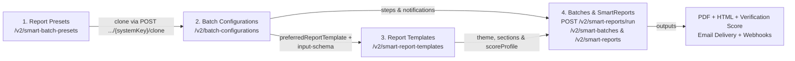

import Tabs from '@theme/Tabs';
import TabItem from '@theme/TabItem';

# SmartReports

**SmartReports** turns multi-step Verifik catalog verifications (`SmartCheck` + `SmartBatch`) into structured HTML and PDF dossiers with automated **Verification Scores**, email delivery, and real-time webhooks. You can design and inspect reports in the **Smart-Agent** portal, trigger end-to-end runs from your backend over the **Headless REST API**, or connect autonomous assistants via the **Model Context Protocol (MCP)**.

:::info Tenant isolation and per-client authentication
Every SmartReports, Template, Configuration, Preset, and Batch endpoint requires your own **per-client Verifik Bearer JWT** (`Authorization: Bearer <VERIFIK_JWT>`). Shared x402 service-account execution is strictly blocked (`403 Forbidden`), and credits are billed directly against your Verifik account balance per executed catalog step.
:::

---

## Architecture & Building Blocks

SmartReports separates **what checks to run**, **how results look**, and **how each execution is delivered**:



| Building Block | Primary Endpoints | Purpose |
| --- | --- | --- |
| **Report Presets** | `GET /v2/smart-batch-presets`<br />`POST /v2/smart-batch-presets/{systemKey}/clone` | Built-in Verifik country and domain bundles (`citizen`, `company`, `vehicle`; `essential` or `comprehensive` tier) with pre-wired verification steps, input schemas, and themed templates. |
| **Batch Configurations** | `GET / POST / PUT / DELETE /v2/batch-configurations`<br />`GET /v2/batch-configurations/{id}/input-schema` | Reusable recipe storing ordered catalog steps, step chaining (`{{results.N.*}}`), `mergeStrategy` (`sequential`, `parallel-independent`, `parallel-with-fallback`), `preferredReportTemplate`, and `notification` settings (`webhookUrl`, `emailOnCompletion`). |
| **Report Templates** | `GET / POST / PUT / DELETE /v2/smart-report-templates`<br />`POST /v2/smart-report-templates/generate-layout`<br />`POST /v2/smart-report-templates/preview-html`<br />`POST /v2/smart-report-templates/introspect` | Visual layout definition (`sections[]`, `reportTheme`, custom fonts, watermarks, digital signature, PDF password protection, and score configuration). System templates (`type: "System"`) are read-only; client templates (`type: "client"`) are fully editable. |
| **Batches & SmartReports** | `POST /v2/smart-reports/run`<br />`/v2/smart-batches`<br />`/v2/smart-reports` | Executes verification steps server-side via `FeatureRunner`, computes the row's `verificationScore`, renders HTML and PDF, emails recipients, and dispatches webhook events. |

### How the Pieces Connect

1. **Discover or clone a preset** with `GET /v2/smart-batch-presets` and `POST /v2/smart-batch-presets/{systemKey}/clone`, or build a custom `BatchConfiguration` from any catalog endpoints in your account.
2. **Inspect required inputs** via `GET /v2/batch-configurations/{id}/input-schema` (or the preset's `inputSchema` object) to obtain `requiredFields`, `optionalFields`, `jsonSchema`, `exampleInput`, and `estimatedCreditsPerRow`.
3. **Customize a template** in `/v2/smart-report-templates` using built-in themes, AI-generated layouts (`POST /v2/smart-report-templates/generate-layout`), data-palette inspection (`POST /v2/smart-report-templates/introspect`), and zero-credit live HTML previews (`POST /v2/smart-report-templates/preview-html`).
4. **Execute and deliver** either in one headless call via `POST /v2/smart-reports/run` (with `systemKey` or `batchConfigurationId`), or at high volume via `/v2/smart-batches` and `/v2/smart-batches/from-file` followed by `/v2/smart-reports/{id}/generate`, `/download`, `/html`, and `/send-email`.

---

## Three Integration Surfaces

| Surface | Entry Point | Best For |
| --- | --- | --- |
| **Smart-Agent Portal** | `https://ai.verifik.co` | Interactive template builder, preset gallery, batch monitoring, report viewer, and the built-in **Developer & AI Agent Kit** (`API & AI Agent` / `API / MCP`). |
| **Headless REST API** | `https://api.verifik.co/v2/...`<br />`https://ai.verifik.co/v2/...` | Backend services, automated KYC/KYB/fleet pipelines, webhook-driven PDF generation, and high-volume file batches without any browser UI. |
| **Streamable HTTP MCP Server** | `https://ai.verifik.co/mcp`<br />`https://ai.verifik.co/api/mcp` | Autonomous AI agents (Claude Desktop, Cursor, Windsurf, ChatGPT Agents, and custom JSON-RPC 2.0 MCP clients) calling the 10 `smart_report_*` tools directly. |

:::note Same `/v2/...` paths on `api.verifik.co` and `ai.verifik.co`
You can call `/v2/smart-reports/*`, `/v2/smart-report-templates/*`, `/v2/batch-configurations/*`, `/v2/smart-batches/*`, and `/v2/smart-batch-presets/*` against `https://api.verifik.co` directly or through the Smart-Agent proxy at `https://ai.verifik.co`. Both enforce identical per-client JWT authentication.
:::

---

## Authentication & Billing Model

### Per-Client Bearer JWT Enforcement

Every SmartReports, Template, Batch Configuration, Preset, and SmartBatch endpoint is tenant-scoped and requires a **caller-supplied Verifik Bearer JWT**:

```text
Authorization: Bearer <VERIFIK_JWT>
```

- **Smart-Agent proxy guard (`smartReportAuthGuard`)**: Any request targeting `/v2/smart-reports*`, `/v2/smart-report-templates*`, `/v2/batch-configurations*`, `/v2/smart-batches*`, or `/v2/smart-batch-presets*` (or `/api/...` / `/api/proxy` equivalents) without a valid per-client Bearer JWT is rejected before x402 payment handling with **HTTP `403 Forbidden`**:

```json
{
  "code": "Forbidden",
  "message": "SmartReports, SmartReportTemplates, BatchConfigurations, and SmartBatches require your own per-client Verifik Bearer JWT. They are not available through the shared x402 account."
}
```

- **MCP tenant isolation**: Discovery methods (`initialize`, `ping`, `notifications/initialized`, `tools/list`) work without credentials, while `tools/call` strictly requires a per-client `Authorization: Bearer <VERIFIK_JWT>` header and returns **HTTP `401`** (JSON-RPC `-32001`) if missing or if a shared service token is supplied.
- **No `x-payment-info` on SmartReports routes**: In `https://ai.verifik.co/openapi.json`, SmartReports routes use `bearerAuth` security rather than pay-per-call x402 headers.

### Credit-Based Billing

- **Catalog step billing**: Credits are deducted from your Verifik client account balance when verification steps actually execute against catalog sources (tracked on the batch via `creditsSpent`).
- **Upfront estimates**: `GET /v2/smart-batch-presets` and `GET /v2/batch-configurations/{id}/input-schema` return `estimatedCreditsPerRow` before any lookup runs.
- **Zero-credit design & retrieval actions**: Listing presets or templates, inspecting schemas, calling `/introspect`, `/preview-html`, `/theme-starters`, `/score-profiles`, `/simulated-responses`, retrieving `/v2/smart-reports/{id}/html`, downloading PDFs, and sending report emails do **not** charge verification credits.
- **Account entitlement check**: Before running a batch or `POST /v2/smart-reports/run`, Verifik checks that every enabled step endpoint is enabled in your client account (returning `409 Conflict` with `endpoints_not_in_account` if any step is unavailable).

---

## Verification Score, Themes & PDF Engines

### Built-In Report Themes (`reportTheme.id`)

SmartReports includes **4 themed HTML/PDF design systems** configured via `reportTheme.id` (with optional overrides in `reportTheme.tokens` for brand colors, typography, spacing, `logoText`, and `logoUrl`):

| Theme ID | Alias | Visual Style | Default Palette |
| --- | --- | --- | --- |
| `premium_dark` | — *(default)* | Dark navy cover (`#0b1730`), warm stone body pages (`#f7f5f2`), crisp white cards | Ink `#122033`, Accent `#c4b5fd`, Mark `#1e3a5f` |
| `light_cards` | `smart_enroll_v2` | High-contrast white pages (`#ffffff`) with soft light cards (`#f3f5f1`) and pill chips | Ink `#0e0f0c`, Accent `#7145d6`, Mark `#163300` |
| `editorial` | — | Warm paper surface (`#fffdf8`), serif display titles (`Noto Serif`), uppercase tracked labels | Ink `#1b1a17`, Accent `#7145d6`, Hairline borders |
| `dashboard` | — | Clean white canvas with structured metric cards (`#f6f7fb`) and compact radius (`12px`) | Ink `#111827`, Accent `#7145d6`, Soft violet highlights |

:::tip Legacy theme alias
Templates saved with `reportTheme: "smart_enroll_v2"` or `reportTheme.id: "smart_enroll_v2"` automatically resolve to `light_cards` at render time.
:::

### Verification Score Profiles (`scoreProfile`)

When scoring is enabled (`score: true` or automatically enabled by a themed template), SmartReports normalizes each executed verification step into a `0`–`1` score (`score` with 4 decimal places and `score100` from `0`–`100`), evaluates **knockout rules** and **coverage** (minimum `90%` for `approve`), and produces a verdict:

- `approve` — weighted score `0.90–1.00`, coverage `>= 90%`, all critical checks answered
- `review` — weighted score `0.70–0.89` (or non-knockout review findings)
- `reject` — weighted score `< 0.70` or an armed knockout rule triggered
- `pending` — a critical check did not answer (for example upstream timeout/`5xx`) or coverage `< 90%`

Ten built-in score profiles are supported (query `GET /v2/smart-report-templates/score-profiles` for live IDs and labels):

| Profile ID | Label | Aliases | Category Weights (`100%` total) |
| --- | --- | --- | --- |
| `cabify_driver` *(default)* | Driver onboarding | `driver`, `cabify` | `records` (25), `driving` (25), `identity` (15), `biometrics` (15), `watchlists` (10), `vehicle` (10) |
| `kyc` | Generic KYC | `generic_kyc` | `identity` (25), `biometrics` (25), `watchlists` (25), `records` (20), `contact` (5) |
| `kyb` | KYB | — | `company` (45), `watchlists` (25), `identity` (15), `records` (15) |
| `fleet` | Vehicle / fleet | `vehicle` | `vehicle` (60), `driving` (15), `identity` (15), `watchlists` (10) |
| `vehicle_purchase` | Vehicle purchase / dealer | `dealer` | `vehicle` (70), `identity` (15), `watchlists` (10), `driving` (5) |
| `identity_lookup` | Identity only | `identity_only` | `identity` (100) |
| `background_check` | Background screening | `screening` | `records` (45), `watchlists` (25), `identity` (20), `company` (10) |
| `lending` | Lending | `credit` | `identity` (40), `records` (25), `supporting` (25), `driving` (10) |
| `healthcare_professional` | Health professional | `health_professional` | `supporting` (55), `identity` (25), `watchlists` (20) |
| `biometrics` | Biometrics | `face` | `biometrics` (70), `identity` (30) |

### PDF Rendering Engines: `puppeteer` vs `pdfkit`

| Engine | Behavior | Features Supported |
| --- | --- | --- |
| `puppeteer` *(default)* | Renders full HTML/CSS through a pooled headless Chromium instance. | All 4 report themes, SVG score gauges & charts (`pie`/`bar`), dynamic `dataTable` & `keyValueGrid` layouts, custom fonts, image/text watermarks, signature overlays, and PDF password encryption. |
| `pdfkit` | Accepted in templates and API requests for backward compatibility, and routed through the HTML/Puppeteer compatibility shim (`pdf-pdfkit.service.js`). | Existing templates configured with `pdfEngine: "pdfkit"` automatically benefit from full table rendering, watermarks, and signatures without degraded placeholders. |

---

## Documentation Sections

Explore the SmartReports guides and API reference sections:

- **Guides & Integration**
  - [Headless API Guide](/smart-reports/headless-api-guide) — One-shot sync/async execution, webhooks, polling, custom recipes, and error handling without the UI.
  - [MCP & AI Agents](/smart-reports/mcp-and-ai-agents) — Streamable HTTP MCP server (`https://ai.verifik.co/mcp`), all 10 `smart_report_*` tools, OpenAPI discovery, and the in-app **Developer & AI Agent Kit**.
  - [SmartReports Webhooks](/resources/smart-reports-webhooks) — All 6 `smart_batch_*` webhook events, payload schemas, URL resolution order, and retry schedule.
- **Reports API**
  - [Run a Smart Report](/smart-reports/run-a-smart-report) (`POST /v2/smart-reports/run`) — End-to-end headless execution.
  - [List Smart Reports](/smart-reports/list-smart-reports) (`GET /v2/smart-reports`)
  - [Create a Smart Report](/smart-reports/create-a-smart-report) (`POST /v2/smart-reports`)
  - [Retrieve a Smart Report](/smart-reports/retrieve-a-smart-report) (`GET /v2/smart-reports/{id}`)
  - [Update a Smart Report](/smart-reports/update-a-smart-report) (`PUT /v2/smart-reports/{id}`)
  - [Delete a Smart Report](/smart-reports/delete-a-smart-report) (`DELETE /v2/smart-reports/{id}`)
  - [Generate Smart Report PDF](/smart-reports/generate-smart-report-pdf) (`POST /v2/smart-reports/{id}/generate`)
  - [Download Smart Report PDF](/smart-reports/download-smart-report-pdf) (`GET /v2/smart-reports/{id}/download`)
  - [Retrieve Smart Report HTML](/smart-reports/retrieve-smart-report-html) (`GET /v2/smart-reports/{id}/html`)
  - [Send Smart Report by Email](/smart-reports/send-smart-report-email) (`POST /v2/smart-reports/{id}/send-email`)
- **Templates API**
  - [List report templates](/smart-reports/list-report-templates) (`GET /v2/smart-report-templates`)
  - [Create a report template](/smart-reports/create-a-report-template) (`POST /v2/smart-report-templates`)
  - [Retrieve a report template](/smart-reports/retrieve-a-report-template) (`GET /v2/smart-report-templates/{id}`)
  - [Update a report template](/smart-reports/update-a-report-template) (`PUT /v2/smart-report-templates/{id}`)
  - [Delete a report template](/smart-reports/delete-a-report-template) (`DELETE /v2/smart-report-templates/{id}`)
  - [Generate template layout](/smart-reports/generate-template-layout) (`POST /v2/smart-report-templates/generate-layout`)
  - [Preview template HTML](/smart-reports/preview-template-html) (`POST /v2/smart-report-templates/preview-html`)
  - [Introspect sample data](/smart-reports/introspect-sample-data) (`POST /v2/smart-report-templates/introspect`)
  - [List theme starters](/smart-reports/list-theme-starters) (`GET /v2/smart-report-templates/theme-starters`)
  - [List score profiles](/smart-reports/list-score-profiles) (`GET /v2/smart-report-templates/score-profiles`)
  - [List simulated responses](/smart-reports/list-simulated-responses) (`GET /v2/smart-report-templates/simulated-responses`)
  - [Retrieve a simulated response](/smart-reports/retrieve-simulated-response) (`GET /v2/smart-report-templates/simulated-responses/{code}`)
  - [Send template sample](/smart-reports/send-template-sample) (`POST /v2/smart-report-templates/{id}/send-sample`)
  - [Download template sample](/smart-reports/download-template-sample) (`POST /v2/smart-report-templates/{id}/download-sample`)
- **Presets & Configurations API**
  - [List report presets](/smart-reports/list-report-presets) (`GET /v2/smart-batch-presets`)
  - [Clone a report preset](/smart-reports/clone-a-report-preset) (`POST /v2/smart-batch-presets/{systemKey}/clone`)
  - [List batch configurations](/smart-reports/list-batch-configurations) (`GET /v2/batch-configurations`)
  - [Create a batch configuration](/smart-reports/create-a-batch-configuration) (`POST /v2/batch-configurations`)
  - [Retrieve a batch configuration](/smart-reports/retrieve-a-batch-configuration) (`GET /v2/batch-configurations/{id}`)
  - [Retrieve configuration input schema](/smart-reports/retrieve-configuration-input-schema) (`GET /v2/batch-configurations/{id}/input-schema`)
  - [Update a batch configuration](/smart-reports/update-a-batch-configuration) (`PUT /v2/batch-configurations/{id}`)
  - [Delete a batch configuration](/smart-reports/delete-a-batch-configuration) (`DELETE /v2/batch-configurations/{id}`)
- **Batch Execution API**
  - [List Smart Batches](/smart-reports/list-smart-batches) (`GET /v2/smart-batches`)
  - [Create a Smart Batch](/smart-reports/create-a-smart-batch) (`POST /v2/smart-batches`)
  - [Create a Smart Batch from a file](/smart-reports/create-smart-batch-from-file) (`POST /v2/smart-batches/from-file`)
  - [Retrieve a Smart Batch](/smart-reports/retrieve-a-smart-batch) (`GET /v2/smart-batches/{id}`)
  - [Update a Smart Batch](/smart-reports/update-a-smart-batch) (`PUT /v2/smart-batches/{id}`)
  - [Delete a Smart Batch](/smart-reports/delete-a-smart-batch) (`DELETE /v2/smart-batches/{id}`)
  - [SmartBatch](/smart-batch) — UI wizard, Async vs Sync modes, and dashboard tracking.
  - [Call endpoints as queue (async)](/smart-batch/async-queue) — Single-row `type=queue` API integration on `https://async.verifik.co`.
